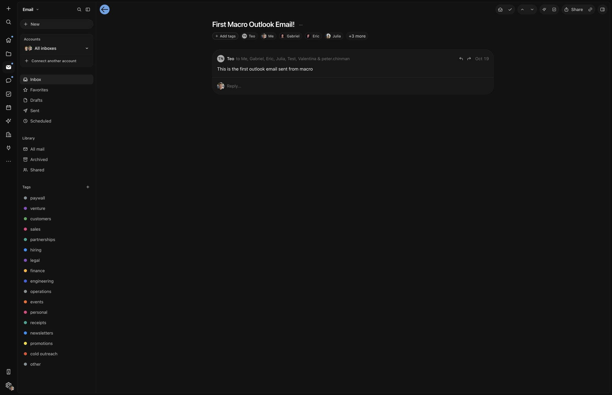
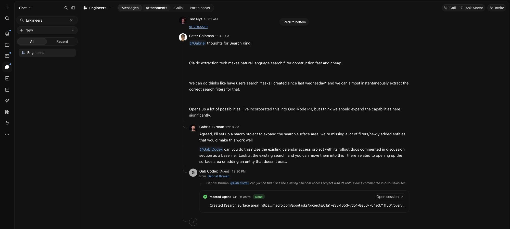
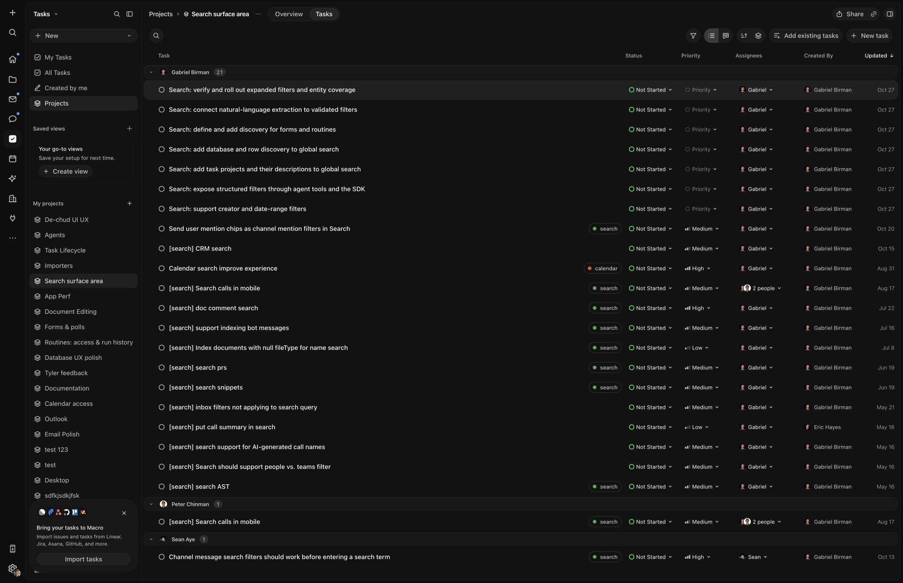
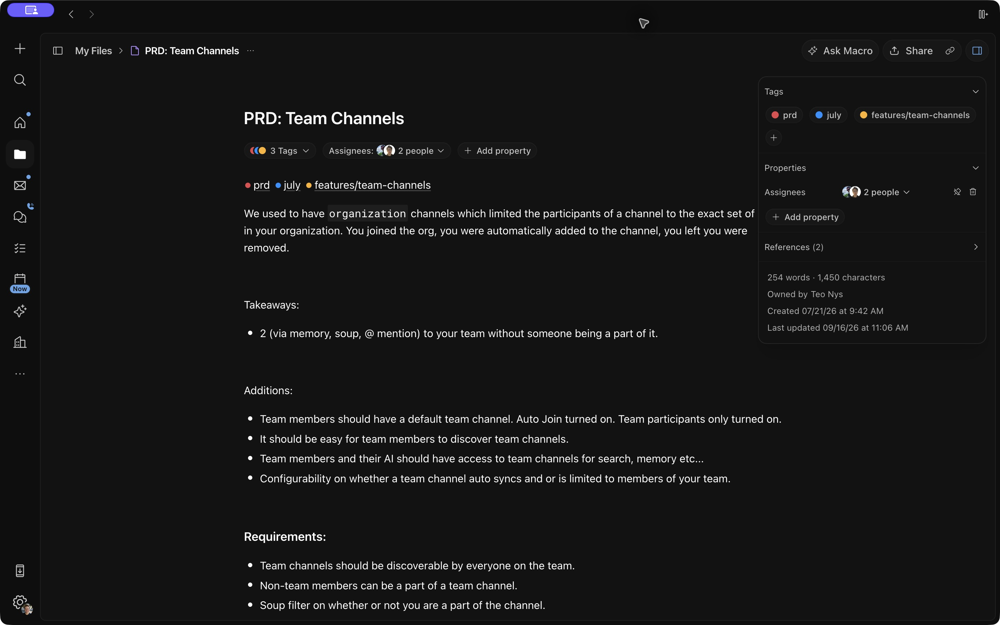
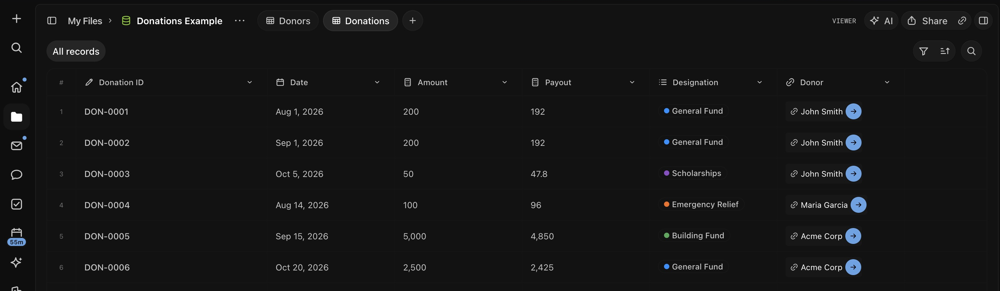
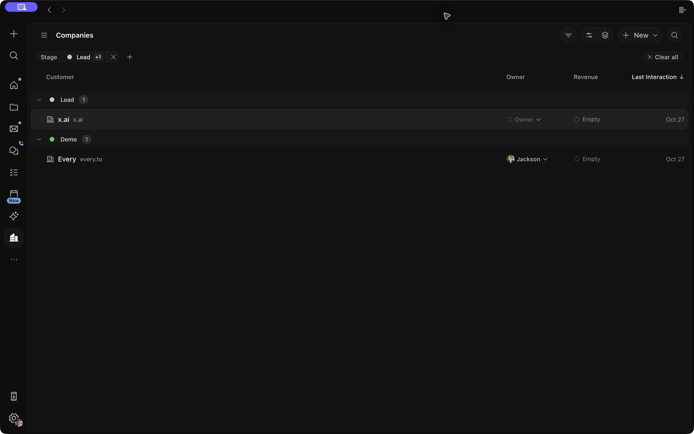
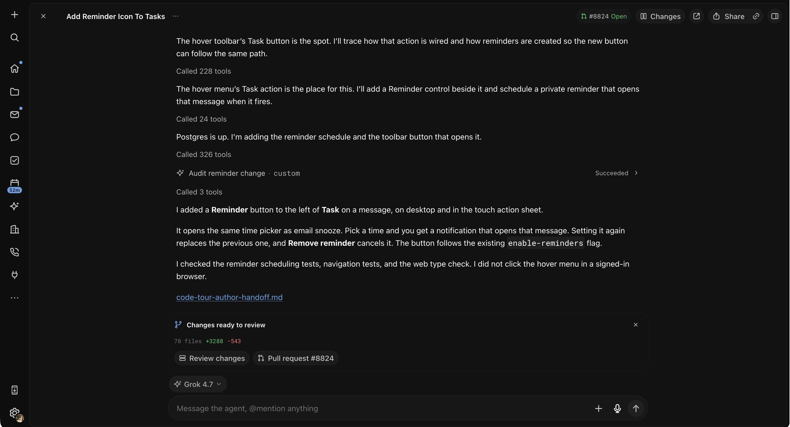
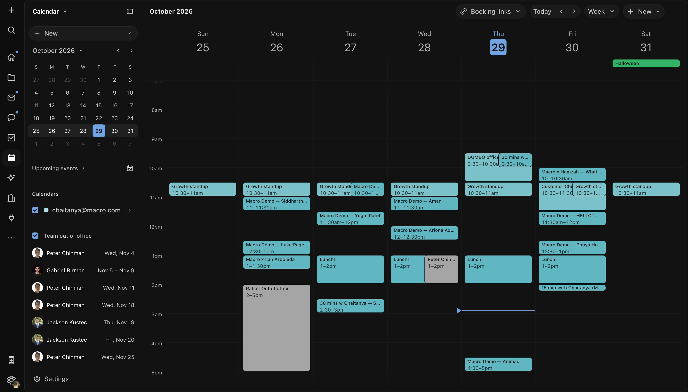
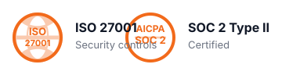
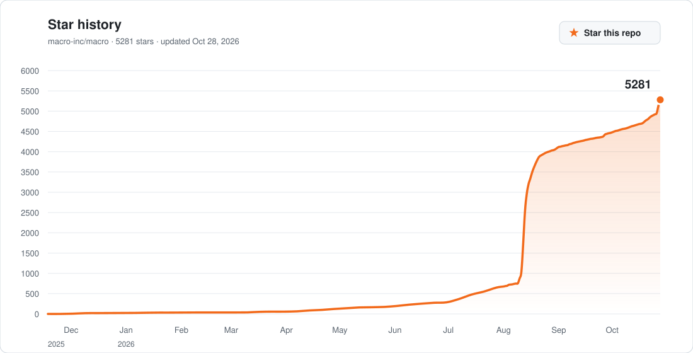

<div align="center">
  <a target="_blank" href="https://macro.com">
    
  </a>

  <br />
  <br />

  <p>
    <a href="https://macro.com/app">Sign up</a>
    ·
    <a href="https://docs.macro.com">Docs</a>
    ·
    <a href="https://macro.com/app/book/6de4003c-15e4-549f-b5a9-0e930bbf56e4/demo">Book demo</a>
    ·
    <a href="https://macro.com">Website</a>
    ·
    <a href="mailto:contact@macro.com">Feature requests</a>
    ·
    <a href="CONTRIBUTING.md">Contribute</a>
    ·
    <a href="mailto:teo@macro.com">Hiring</a>
  </p>
</div>

<br />

Macro is the all-in-one workspace for you and your team. It unifies email + messages + docs + tasks + calls + agents + CRM + databases into a single fast interface with shared team-level memory. Everything in your workspace is @linked and searchable so your team (and your agents) never have to switch tools.
 
<br />

# Why Macro

We built Macro because we wanted a single operating system for our startup. There are many good software products, and we used them all — Slack, Linear, Notion, HubSpot, and Superhuman — but they don't work together as one system. As we scaled our last venture to ~20 people things started to break: every team got their own tools and the company was held together by MCP and Zapier. The company was not computable. It was chaotic.

Macro is a complete redesign of work software from the ground up as a single system.

Designed by us in NYC and Toronto, dogfooded by our team of ~15 for two years. Built in SolidJS and Rust for speed and reliability. We're focused on building something that teams can use as their "operating system".

<br />

# Features

Macro is composed of 'blocks' designed to be modular, extensible, and work together like Lego. For each block, we studied the best prior art and tried to make it even better.

Each surface is purpose-built for its job rather than composed from a generic block primitive — but every one of them shares the same backend; cross-references between a doc and a task, or a channel message and an email, are natively stored as a **bidirectional graph**.

| Block | Docs | What it does |
| --- | --- | --- |
| Email | [Docs &rarr;](https://docs.macro.com/product/email) | Multi-account unified inbox, keyboard shortcuts, and shared inboxes. |
| Messages | [Docs &rarr;](https://docs.macro.com/product/channels) | Channels and direct messages designed for focused technical discussions. |
| Tasks | [Docs &rarr;](https://docs.macro.com/product/tasks) | Linear-inspired tasks, tightly integrated with channels, email, and agents. |
| Docs | [Docs &rarr;](https://docs.macro.com/product/docs) | Real-time collaborative, markdown-native docs built on CRDTs, with @mentions. |
| Canvas | [Docs &rarr;](https://docs.macro.com/product/canvas) | 2D board with embedded @links to tasks, files, and emails. |
| Agents | [Docs &rarr;](https://docs.macro.com/product/agents) | Use our models or your agents to work across Macro and automate tasks. |
| Calls | [Docs &rarr;](https://docs.macro.com/product/calls) | Recorded, transcribed, and logged to team memory for agents. |
| File storage | [Docs &rarr;](https://docs.macro.com/product/folders) | Auto-imported from email and channels, fully searchable. |
| Pull requests | [Docs &rarr;](https://docs.macro.com/integrations/github) | Linked to tasks, embeddable in channels, available to agents. |
| CRM | [Docs &rarr;](https://docs.macro.com/product/crm) | Customer and contact objects, custom properties, email sync, enrichment. |
| Databases | — | Tables with typed columns, relations, saved views, and agent queries. |
| Calendar | [Docs &rarr;](https://docs.macro.com/product/calendar) | Calendar sync, availability, and personal or team booking links. |

<br />

# **Multiple email inboxes** w/ good AI tools

Macro Mail is inspired by Superhuman's keyboard-first interface with a few key additions:

1. Multi-account. Triage all your email accounts in a single inbox, with the same tagging and sharing system. Or triage individually.
2. Unified inbox: emails, messages, @mentions, and tasks to complete, all in the same list. Use `j` `k` and `e` to navigate everything.
3. Better AI, with a tools/MCP surface designed to work across inboxes and to help your agents more accurately retrieve information. For example, we expose a unified search tool that allows agents to search all file attachment PDFs (parsed out of email) directly, rather than pulling email threads then attachments. You can also draft, edit and send emails right from AI chats, without opening your email.



4. Multitasking ability — Macro has a built-in window manager that lets you create 3+ splits (scales with monitor size) so you can draft emails while reviewing prior threads.
5. Company/Contact objects. Macro has native CRM capability so you can `cmd+k` to a contact, like tim@acme.com to see all emails between you and that person, or companies, to see all emails and files between everyone on your team and everyone at that company, e.g. `@acme.com`. All of this right from your email without having to open a heavyweight CRM like HubSpot or Salesforce. Email aggregation by contact or company is also available to your agents so they can better assist with CRM-type queries and actions.

Macro Mail lives in the same interface as channels, docs, tasks, and code. From any email, hit "task" to create a linked task, e.g. a ticket for an engineer from a customer support email. @mention emails in documents, e.g. @Re: Contract Signature.eml inside of Todos.md. In Macro, your email is brought into the fold with all of your tools, and your team, in the same permissions system: just hit `Share` to share an email to any DM or channel — no need to screenshot.

[Email docs &rarr;](https://docs.macro.com/product/email)

<br />

# Chat connected to the rest of your work

Macro Chat is designed to be more focused than Slack. The first couple of replies show inline and the rest collapse into a thread, so a busy channel stays readable. Copy a link to a message/thread to reference it elsewhere in Macro. Everything is stored in a bidirectional graph, so tasks @link to messages that created them, customer support emails tie into support channels, CRM records get updated when they're discussed in messages, etc. The core idea is that (i) messaging should be the centerpiece around which tasks, mail, docs, and content management are built, all in a lightweight way, and agents should be first-class citizens like human users and (ii) messaging needs to be more focused and readable for technical conversations, and not turn into battles where context is lost and progress is indistinguishable from noise.



We've also added ways for you to bring in conversations outside of your team into Macro. We wanted to make sure that all your external and internal communication can live in Macro.

- Add people outside your team to Macro chats.
- Connect your WhatsApp account to access selected direct and group chats.
- Read, reply to, and share your WhatsApp conversations from Macro.

[Messages docs &rarr;](https://docs.macro.com/product/channels)

<br />

# **Task management** built around chat

Issue tracking never really worked, at least for us. We really tried and we blamed ourselves, but as we talked to other companies, it turns out that nobody was using their issue tracker "correctly". And if that's the case, the problem is the design of the tool, not the companies that use it.

The core problem with traditional issue trackers or project management tools is that they get out of date. The reason they get out of date is that (i) they're a separate system from where the conversation really happens in team chat (e.g. Slack, Macro, Discord, etc.) and (ii) they don't add much benefit beyond tracking the work. They're a chore with near-term costs and only the promise of long-term benefit. They're too rigid compared to a 2D canvas, too opinionated, and don't match how your project actually functions.

The solution isn't to forgo tracking entirely. We tried that and it was a different form of chaos. **The solution we've found is lightweight issues tightly coupled to your channels and DMs, so that issue tracking naturally occurs where the conversation itself happens.**



Creating tasks in Macro is easy. Where possible, tasks created are bidirectionally linked to the creating context (e.g. a customer email) so the full chain is auditable from "why are we doing this" → task → agent → pull request, all in one system.

- Create a task from an email.
- From anywhere via `c` `t`.
- From a markdown doc with `/task`.
- From any `- [ ]` bullet by highlighting and clicking "Task".
- `@Macro` create tasks in any channel or DM.
- In any agent chat.
- Via external MCP, API or SDK.

We made organizing tasks in Macro simple. Group related tasks into projects and assign responsibility to team members or agents. To track your work use lists, boards, and saved views. You can hand off tasks to agents and they'll use the context connected to the task to complete it and update the status.

[Tasks docs &rarr;](https://docs.macro.com/product/tasks)

<br />

# @linked markdown docs powered by CRDTs

We wanted everything in a single markdown editor without switching tools.

- Native markdown compatibility.
- Live collaboration with CRDTs and Cloudflare durable objects make it feel like you're editing on the same computer. Edits come in ~instantly instead of ka-chunking like Google Docs.
- Version control: history and forking, with a neat UI for scrubbing history.
- Offline editing and reconciliation.
- @-linked to everything in your workspace: email, docs, tasks, messages, channels, companies, contacts, etc. Like Notion but multi-modal.
- Embed a database view or live query result inside your docs.
- Mobile-friendly, in our [iOS app](https://apps.apple.com/us/app/macro-app/id6743133649), [Android app](https://play.google.com/store/apps/details?id=com.macro.workspace.mobile&pcampaignid=web_share), or on the web.
- Agent native editing, powered by swarms of agents operating as peers in the CRDT collaboration system like human collaborators. See [Wolf's tech blog on this](https://404wolf.com/posts/AgentsAttackTheDocument/). Use via MCP or internal agent.



Agents can edit documents that are open or closed. One interesting use case for agentic editing is to maintain team-context. For example we have a Macro Routine that runs daily to update our in-office Pool Games markdown doc. It scans through all of the channels to see if anyone has won and then updates the doc. If somebody has already edited the doc, it can know that and forgo the update. Conflicts are handled natively by the CRDT collaboration system.

[Docs &rarr;](https://docs.macro.com/product/docs)

<br />

# Databases

Macro is designed to fit the exact needs of your team. Our databases let you build your own tables for things like recruiting, customer requests, or a content calendar, with custom columns, relationships, and saved table or board views. Databases bidirectionally link to people, tasks, and files, keeping your records connected to the work they describe.

You can ask agents to create tables, update records, and answer questions about your data. You can also embed a database view or query result in a document and it'll stay up to date as the underlying data changes.



<br />

# CRM that keeps itself up to date

The problem with standalone CRM is the same as with task trackers: it's not up to date. The CRM only partially reflects reality, so if you want to know what the latest status on a deal is you still have to message the AE/SDR and ask for context. CRMs are also too rigid and closed-source, while DIY CRMs in Airtable/Notion don't provide email aggregation by Company/Contact/Deal that is the core feature of CRM.

**Macro fixes this by colocating your CRM with your team chat and email, instead of having a separate system.** When you @mention a company record in a message, your team can click that record to see the latest — it's much faster than navigating to your CRM to find the record, going back to Slack and pasting it in, and this speed difference makes all the difference. Secondly, @mentioning a Company/Contact creates a bidirectional link between that message and the record, so from the record later you can trace the conversations that happened. This fixes the core issue we had with Attio/HubSpot/Salesforce: the actual important conversation about a deal happens not in the CRM but over messages. Macro makes this a feature rather than making you feel disorganized about it. It's not your fault, it was the CRM's fault!



- Customizable sales pipelines and deal stages with board and list views.
- Company and contact records have their own discussions where your team can leave notes and @mention people and work.
- See related emails, files, tasks, calls, and discussions from a company or contact record.
- @mention the company or contact from any note, message, task, pull request, etc., to create a bidirectional link between the record and that thing. For example, @mention a company from an engineering task to note their request. It all ties together.

[CRM docs &rarr;](https://docs.macro.com/product/crm)

<br />

# Agents and unified team-level memory

Agents in Macro have the superpower of all your context. Your emails, conversations, docs, tasks, and customer records are already connected so agents have the context behind a request and complete high quality work without giving you slop.

- DM an agent, @mention one in a channel, or assign it a task.
- Have agents research a customer, draft a reply, update a document, maintain a database, or take an engineering task through to a pull request.
- Use the models we provide, connect Cursor with your own API key, or bring agents running on your own machine into Macro through macrod.
- Create routines for work that should happen on a schedule or in response to activity in your workspace.
- Give agents reusable instructions through skills, so you don’t have to explain the same process every time.



Macro also builds memory from your work across conversations, email, tasks, and documents. That gives agents background on what you’re working on and what matters to you, beyond what you’ve told them in an individual chat.

Memory isn't supposed to encompass everything. Agents can also search your workspace for current information and use Macro’s tools to act on it. The context and the resulting work stay connected: a customer email can become a task, that task can go to an agent, and the agent’s work can become a document update or pull request.

Your coding agents can use Macro too. Point Claude Code, Codex, or any MCP client at your workspace:

```bash
claude mcp add --transport http macro https://mcp-server.macro.com/mcp
```

See [Agents docs](https://docs.macro.com/product/agents), [MCP setup](https://docs.macro.com/AI/mcp/overview), and [agent recipes](https://docs.macro.com/AI/recipes).

<br />

# Calls

Since Macro already has your CRM, chats, DMs, booking links, and calendar, calls can happen where you already are. We run standups in our engineering channel, which allows us to keep the context of our calls connected to our work.

- Call teammates directly or start a call in a channel, with video and screen sharing.
- Send meeting links to customers, people outside your team, and people without Macro accounts.
- Calls are automatically recorded and transcribed, with speaker labels and AI summaries.
- Agents can use the call context to write follow-ups, create tasks, and update documents.

[Calls docs &rarr;](https://docs.macro.com/product/calls)

<br />

# Calendar

We built a simple Calendar in Macro so you can manage your week right next to where your work is happening.

- Connect multiple Google and Outlook calendars in one place.
- Share personal or team booking links. Guests don’t need a Macro account.
- Set your availability and avoid conflicts across connected calendars.
- Ask agents to find time, schedule meetings, and update events.



<br />

# How it all works together

**Bidirectional @linking.** @mention a doc in a message and both know about each other. Your workspace becomes a web of context you can navigate in either direction.

**Channel-based permissions.** Anything you @mention in a channel is automatically shared with its members. Join a channel, gain access; leave, lose it. No permission-request dance.

**Unified memory.** Agents remember what your whole team is doing across email, messages, tasks, docs, and calls, not just your own chat history. Refreshed nightly.

**One inbox.** Emails, channel messages, task assignments, @mentions, and agent responses all land in one place. Keyboard-first throughout.

Deeper reading: [key concepts](https://docs.macro.com/concepts/blocks) covers blocks, mentions, properties, and permissions; the [FAQ](https://docs.macro.com/faq) covers comparisons, licensing, and self-hosting.

<br />

# Using the hosted app

[Sign up](https://macro.com/app) and connect your Gmail or Outlook account. Macro runs in any modern browser, with an [iOS app](https://apps.apple.com/us/app/macro-app/id6743133649) or [Android app](https://play.google.com/store/apps/details?id=com.macro.workspace.mobile&pcampaignid=web_share) for your phone. The [getting started guide](https://docs.macro.com/getting-started) takes you from a fresh account to a working setup in about 15 minutes. Coming from Notion, Slack, Superhuman, or Linear? See [Switch to Macro](https://docs.macro.com/switch-to-macro).

<br />

# Running it locally

To run the frontend against hosted services, or to run the local stack, follow [Running locally](docs/development/running-locally.md).

To contribute, see [CONTRIBUTING.md](CONTRIBUTING.md).

<br />

# Security



Enterprise-grade security. Zero data retention with model providers, including no training on customer data. SOC 2 Type II certified. We welcome responsible security reports and pay bounties in accordance with severity and impact. Send reports to [security@macro.com](mailto:security@macro.com).

<br />

# License

Macro is fully open source — not "open core" — under the GNU Affero General Public License v3.0. See `LICENSE.txt` for details.

You can self-host Macro under the terms of the AGPLv3; the [FAQ](https://docs.macro.com/faq) covers what that involves. If you want to build on top of Macro under a different license, contact [licensing@macro.com](mailto:licensing@macro.com). For managed hosting or commercial arrangements, contact [self-host@macro.com](mailto:self-host@macro.com).

<br />

# Community

Have an idea, want to contribute, or want to work on Macro?

- Feature requests: [contact@macro.com](mailto:contact@macro.com).
- Contributions: see our [contribution guidelines](CONTRIBUTING.md).
- Hiring: [teo@macro.com](mailto:teo@macro.com).

<br />

# Star us on GitHub

If Macro is interesting/useful to you, please scroll up and give the repo a star (scroll to the top of this page -> click `Star` in top right). Stars are how most users hear about Macro because they move us up GitHub's search and trending pages.

<a href="https://github.com/macro-inc/macro">
  <picture>
    <source media="(prefers-color-scheme: dark)" srcset=".github/readme/star-history-dark.svg" />
    
  </picture>
</a>
