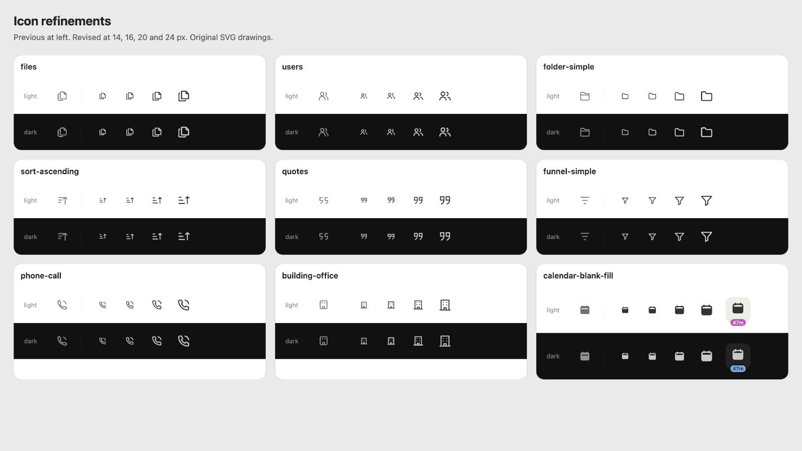

# Macro interface icons

Original SVG drawings for Macro's interface. The source of truth is the SVG
files in this directory. These drawings were authored on a blank coordinate
grid; no Apple, OpenAI, Linear, or Phosphor vector paths were imported or traced.
SF Symbols and ChatGPT were visual references for optical balance and clarity,
not asset sources. The icons have no platform font or native symbol dependency.

Apple's design guidance informs optical balance, not asset reuse. Do not import,
trace, or modify SF Symbols exports or templates for this cross-platform set.
The original source geometry and this provenance note are not a legal clearance
or a guarantee of non-infringement. Apple's supplied images have separate
[platform-restricted terms](https://www.apple.com/legal/sla/docs/xcode.pdf).

## Drawing system

- A `0 0 24 24` viewBox. Most pictograms occupy an 18–19 unit optical area;
  round and diagonal forms can overshoot it to appear equally large.
- Regular strokes are 2 units: approximately 1.67 CSS px at a 20 px navigation
  size and 1.33 CSS px at a 16 px toolbar size. Internal details can use
  lighter strokes to preserve their negative space. Bold entity glyphs use 2.3 units.
- In the app, `icon-styles.css` optically adjusts those default strokes to
  1.7 / 2 units in light themes. Dark themes retain 2 / 2.3. At 20 px, the
  light regular stroke is about 1.42 px. Colors and filled silhouettes stay
  unchanged. Theme-scoped variables also support the gallery's nested themes.
- Rounded joins and terminals, restrained 2–3 unit corner radii, open counters,
  and few internal details. Macro's diagonal rhythm appears in folds, tails,
  branches, and the angular four-point agent mark.
- Active navigation variants keep their regular counterpart's optical center
  and silhouette. Cutouts are transparent, never theme-colored.
- `currentColor` owns both stroke and fill. Do not apply `fill-current` to an
  outline glyph or reuse stroke overrides designed for a 256-unit viewBox.

## Use

Import individual SVGs so unrelated drawings stay out of the startup bundle:

```tsx
import SearchIcon from '@icon/system/regular/magnifying-glass.svg';

<button aria-label="Search"><SearchIcon class="size-4" /></button>
```

Use 20 px for rail navigation, 16 px for header actions and status glyphs,
and 14 px for compact secondary controls. Keep the enclosing hit target
independent of the drawing size. Avoid scaling detailed glyphs below 14 px.
SVGs are decorative by default; put accessible names on their controls.
For a meaningful standalone glyph with its own accessible label, explicitly
set `aria-hidden={false}` so the default does not hide its status or label.
Property status option glyphs are decorative too: their surrounding value or
menu label names the status. Standalone `TaskStatusIcon` identity glyphs retain
their accessible status label.

The existing semantic filenames make the migration explicit at each import.
Several equivalent concepts (for example `folder` and `folder-simple`) share
the same drawing to avoid introducing competing silhouettes. Existing brand
logos and the legacy animated showcase retain their own assets and licensing.
Interface controls, including editor tools, file types, task states, priorities,
and settings, use this family. Board views use the shared Kanban drawing: three connected columns with
staggered bottoms and open counters, following the familiar Phosphor silhouette. Gantt layouts use `chart-gantt`, with staggered horizontal task bars;
it is also listed in the regular icon gallery. Brand marks retain their existing assets.
Icons introduced on main after the source PR retain their existing assets when
this family has no matching drawing.
Urgent priority uses `priority-urgent-fill`, a filled rounded square with rounded
exclamation-stem and dot cutouts. Its dedicated `priority-urgent` token maps to
the theme's orange rather than warning or accent.
Task status rings use a 2.25-unit stroke: `task-created` is a plain hollow ring,
`task-in-progress` adds a counterclockwise half pie from 12 o'clock, and
`task-in-review` adds a counterclockwise three-quarter pie. Both pies use a 6-unit
radius with a 1.875-unit gap to the ring's inner edge. Not started keeps its
neutral color, with no shadow or highlight. Completed and Canceled use the
status-specific `task-completed-fill` and `task-canceled-fill` discs with transparent
check and cross cutouts; keep generic check-circle and x-circle icons separate.
Empty priority uses `../wide-priority-none.svg`: the same 18×12 ascending bars,
color, and display box as Low/Medium/High, with all three bars at 30% opacity in
the SVG and no additional empty-icon dimming. Empty assignees use
`user-circle-dashed`, a dashed ring around a filled person. Set projects use
`cube`; empty projects use `cube-dashed`, with a dash at every corner rather than
a dashed stack. Use the same dashed cube for empty Project values in title pills,
list cells, side-panel values, and group headers.
Draw the cube's dash gaps as explicit segments; `pathLength`-normalized dashes
become solid when SVG optimization merges the individual edges.
Task statuses use independent `task-status-not-started`, `task-status-in-progress`,
`task-status-in-review`, `task-status-completed`, and `task-status-canceled` theme
tokens for icons and group-header tints. Their defaults are muted gray, blended
amber, violet, accent, and muted gray respectively. In Progress mixes amber with
`content-0` in sRGB: 80% amber in dark mode and 50% in light mode, improving contrast
without rotating amber toward a tinted foreground's hue. Authored overrides stay
unchanged.
Status and Priority option glyphs share a 12 px default, including edit menus
and title property pills. Explicit caller sizing takes precedence: leading task
status controls use 18 px, leading priority controls use 16 px on desktop and
20 px on phones, and side-panel values use 16 px. Leading priority glyphs never
flex-shrink. Group-header carets use 16 px; hit targets stay unchanged.

Prefer one recognizable silhouette and only the detail needed to identify its
action. Chat variants share one bubble, task variants one checked square,
people variants two figures. The CRM icon retains its stepped building silhouette.
Office glyphs use two sparse rows of windows and a baseline to avoid a face-like
appearance. Keep the selected calendar header open around its binding posts,
quote heads closed with trailing tails, and the filter recognizable as a funnel.
Calendar dots, extra signal arcs, and decorative tool details are omitted.
Keep meaningful distinctions such as mute slashes, warning marks, file-type
symbols, and ordered-list numbers. The shared `../share.svg` also appears in the
gallery and follows the same theme-aware stroke rules.
File-type marks use 1.5-unit interior strokes in both weights to keep their
small counters open; the surrounding page retains the normal family weight.
Settings navigation and its page controls use this same set, including the
appearance, keyboard, usage, billing, runtime, integration, and developer icons.
Inactive settings rows use muted ink; selection and hover supply emphasis.

## Optical review principles

Apple's [interface icon guidance](https://developer.apple.com/design/human-interface-guidelines/icons)
informs the review: match the perceived weight of adjacent text, simplify detail,
and adjust each glyph's dimensions and padding for optical balance. The 24-unit
grid and stroke values above are Macro's drawing choices, not Apple requirements.
Center the visible shape, not only its bounding box; inspect its baseline and cap
height relationship when it sits beside a label.

Use outlines for ordinary toolbar and list actions. A filled counterpart can
emphasize selection, but it should preserve the original shape's visual position.
Review both variants at their actual size and contrast, following Apple's
[SF Symbols guidance](https://developer.apple.com/design/human-interface-guidelines/sf-symbols#Design-variants).
These are composition principles; the drawings remain independently authored.

## Interaction motion

`icon-motion.ts` is installed once by the app shell. It delegates pointer presses
and keyboard/assistive-technology clicks to the leading action glyph in buttons,
links, tabs, command options, and menu items, including portal menus and newly mounted controls.
All existing and newly authored `data-macro-icon` SVGs inherit this behavior.

- Keep feedback brief and finite: 320 ms on press, 280 ms on hover. Use a small
  press-and-settle, a restrained turn for settings, tilt for folders/mail,
  or lift for sharing. Do not bounce continuously or delay the action.
- Hover is limited to search, settings, and add glyphs after 160 ms of
  pointer intent. Touch does not trigger hover. Most icons respond only to press.
  The agent sparkle stays still.
- Animate the drawing, never its label, hit target, selection background, or
  layout. Individual transform properties preserve existing layout transforms.
- Put `data-icon-motion-target` on a fixed-size wrapper when an action swaps SVGs
  (as `NavGlyph` does). Both variants then move as one without a position jump.
- Static glyphs, disclosure arrows, state/check indicators, loading spinners,
  disabled/busy controls, and illustrations larger than 32 px stay still.
  Add `data-icon-motion="none"` on a glyph or ancestor for other stateful icons
  or controls that own their own motion. Do not add decorative motion to status.
- Respect `prefers-reduced-motion` for every effect, including hover; preference
  changes cancel in-flight animation. Rapid presses replace rather than stack.
- New semantic motion belongs in this shared module, not individual consumers.
  Draw original paths and motion; references such as Grok inform restraint and
  timing, never asset reuse. No new animation runtime is needed.

## Review

Open `/app/debug/icon-gallery` in the running app. The original family is the
default view; the legacy animated gallery remains available. Review the actual
14/16/20/24 px drawings on both Macro themes, then check the affected app view.
Do not judge a toolbar icon solely from a large preview. Use the weight tabs
and navigation buttons to check emphasis without a size or position jump.

After changing geometry, update its bold/active counterparts and inspect them
together. Test the real app on a standard-density display as well as Retina;
SVG portability alone does not verify Windows rendering.

## Small-size review

Compare altered silhouettes in light and dark at 14, 16, 20, and 24 px, including
filled and bold counterparts. Review selected calendar glyphs with a countdown
badge to ensure the binding header remains recognizable.


