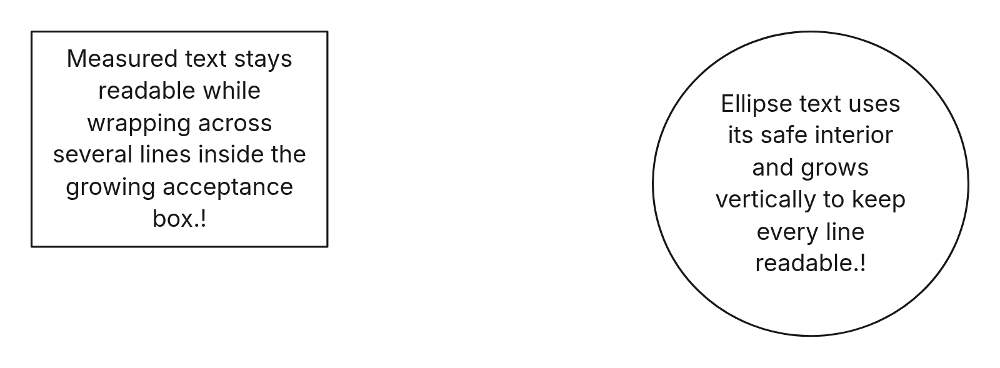

# Canvas multiplayer browser fixture

This fixture mounts three independent Canvas sessions (two editors and a viewer)
using the production Loro backend, session persistence contract, awareness adapter,
and graphics surface. An in-memory transport replaces hosted SyncService. It does
not mount the app shell or exercise hosted authentication.

From `apps/web`, run:

```sh
bunx playwright test --config src/features/block-canvas/browser-test/playwright.config.ts
```

The desktop case covers drag previews, cursors, remote selection and style,
local undo, session reopening, and peer departure. The touch case covers mobile
selection awareness. Each case runs only in its applicable device project.
Set `PLAYWRIGHT_CHROMIUM_EXECUTABLE_PATH` to use an installed Chromium.


The separate `render.playwright.config.ts` mounts the production read-only
`canvas-render.html` bundle and checks actual DOM text bounds after measured grow,
contain/error, relabeling, font changes and narrower widths, for rectangles,
ellipses, standalone text, unbroken strings and tiny glyph widths. It runs desktop
and phone projects. Set `CANVAS_RENDER_BASE_URL` to use a running preview instead
of starting fixture Vite. No live scene or account data is changed by these tests.
Check visible DOM word ranges and mention-chip rectangles against the intended
interior; container dimensions alone can hide overflowing words.
When other Docker stacks are changing host network interfaces, run Playwright in
the frontend container. Host Chromium can abort module loads with
`ERR_NETWORK_CHANGED`.


The live local-stack acceptance run used two named concurrent model writers, then
checked a native cropped image and actual DOM bounds after fitting at 24px.


