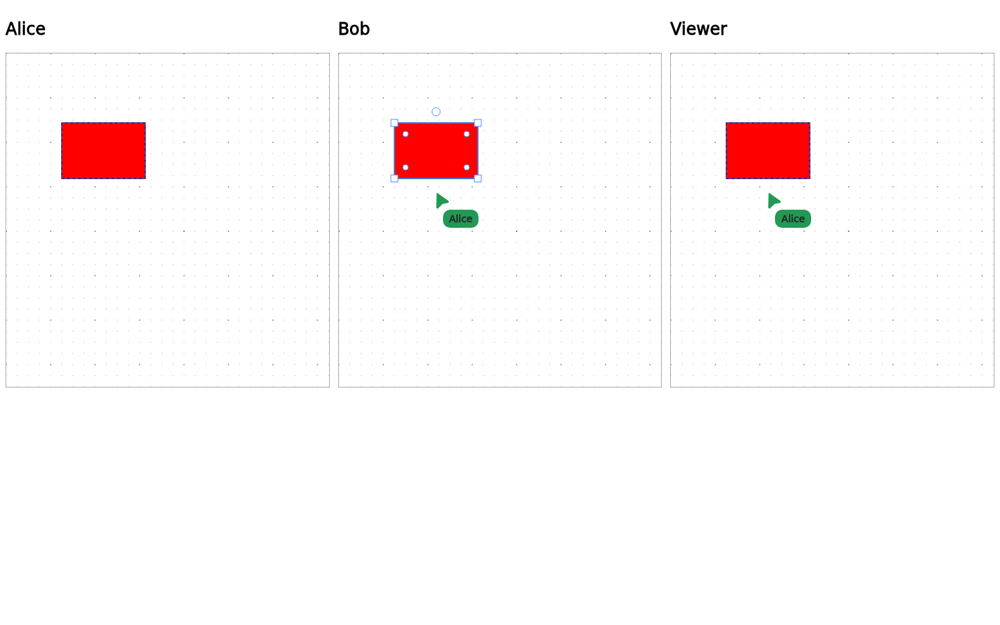
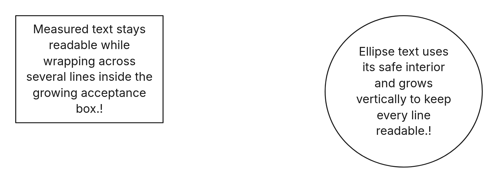

# Canvas multiplayer browser fixture

This fixture mounts three independent Canvas sessions (two editors and a viewer)
using the production Loro backend, session persistence contract, awareness adapter,
and graphics surface. An in-memory transport replaces hosted SyncService. It does
not mount the app shell or exercise hosted authentication.

From `apps/web`, run:

```sh
bunx playwright test --config src/features/block-canvas/browser-test/playwright.config.ts
```

The desktop case covers drag previews, cursors, remote selection and style,
local undo, session reopening, and peer departure. The touch case covers mobile
selection awareness. Each case runs only in its applicable device project.
`touch-navigation.browser.e2e.ts` sends real multi-touch through Chromium
(`Input.dispatchTouchEvent`) in the touch project: pinch in the select, hand,
rectangle and pencil tools after the first finger has started its gesture,
two-finger pan, and the glide after a flick. `window.canvasFixture.setTool`
switches the fixture's tool.

`touch.html` mounts the editable canvas as a phone shows it: the real touch
view (`views/mobile/canvas-view.tsx`) and the real float-region host, over a
stand-in dock and a stand-in for the page's New button, with no session or
services. `touch.html?chrome=none` leaves the host out, as a public link opened
signed out does. `touch-layout.browser.e2e.ts` runs against it in the touch
project: the tools above the dock, uncovered and at least 44px; the grouped
tools; the selection's actions and their undo steps; the inspector sheet
resting under the shape and closing with the selection kept; the long-press
menu outliving the lift (and a drag not opening it); the zoom sheet; the
in-canvas placement without the app's chrome; a corner taken from 12px outside
it and the shape moved from its middle; and an outlined shape selected by a tap
near its stroke. The long-press cases advance Playwright's clock rather than
waiting.
Set `PLAYWRIGHT_CHROMIUM_EXECUTABLE_PATH` to use an installed Chromium.




The separate `render.playwright.config.ts` mounts the production read-only
`canvas-render.html` bundle and checks actual DOM text bounds after measured grow,
contain/error, relabeling, font changes and narrower widths, for rectangles,
ellipses, standalone text, unbroken strings and tiny glyph widths. It runs desktop
and phone projects. Set `CANVAS_RENDER_BASE_URL` to use a running preview instead
of starting fixture Vite. No live scene or account data is changed by these tests.
Check visible DOM word ranges and mention-chip rectangles against the intended
interior; container dimensions alone can hide overflowing words.
When other Docker stacks are changing host network interfaces, run Playwright in
the frontend container. Host Chromium can abort module loads with
`ERR_NETWORK_CHANGED`.


The live local-stack acceptance run used two named concurrent model writers, then
checked a native cropped image and actual DOM bounds after fitting at 24px.


