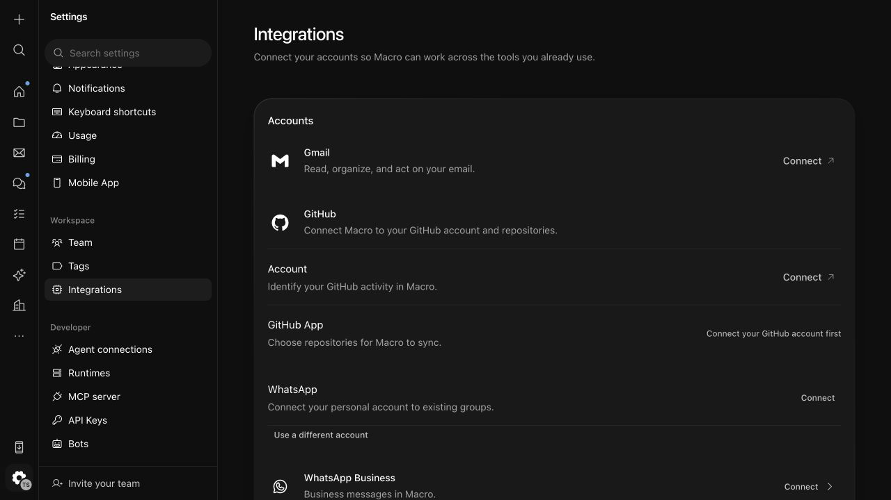
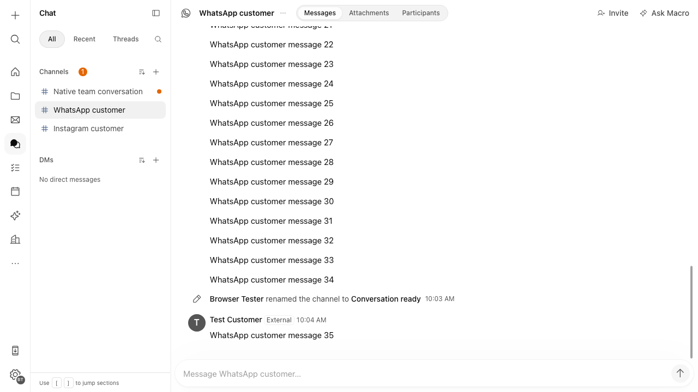
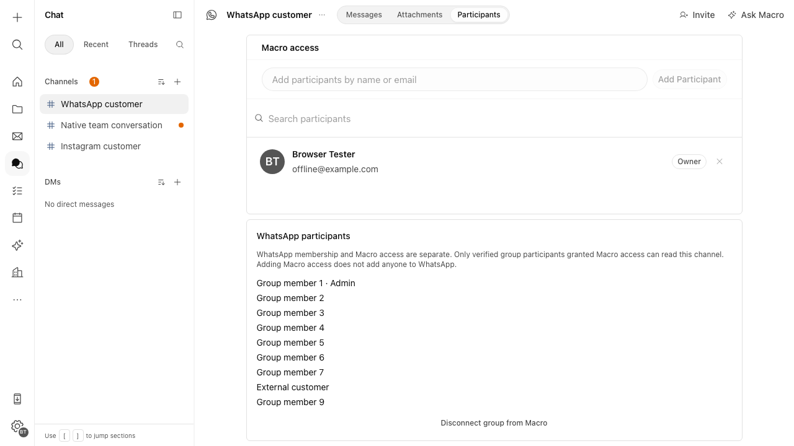
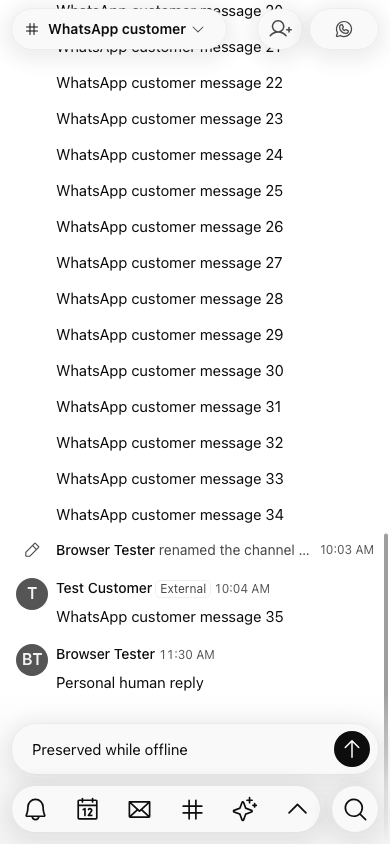
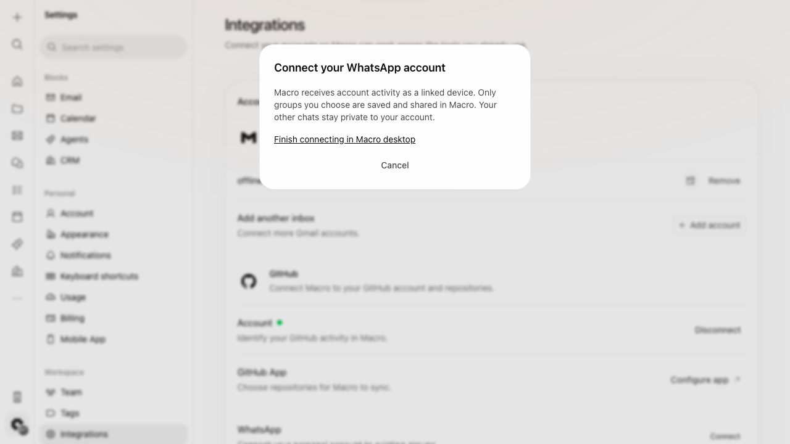
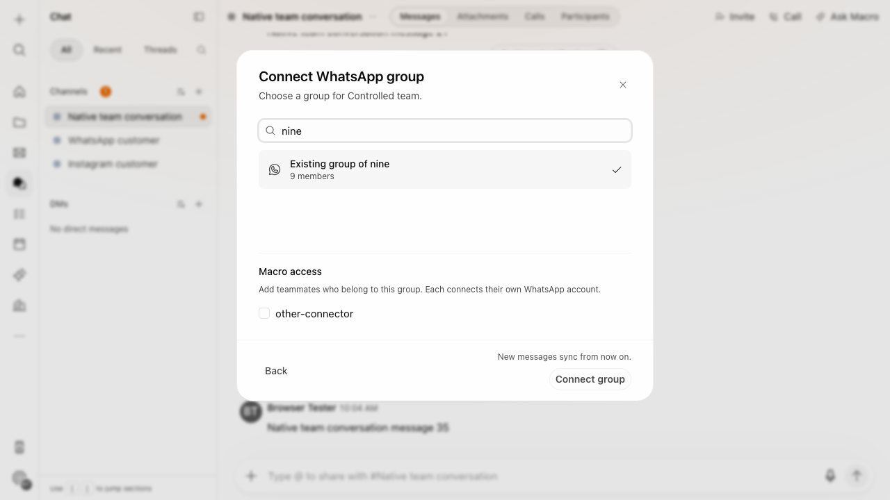
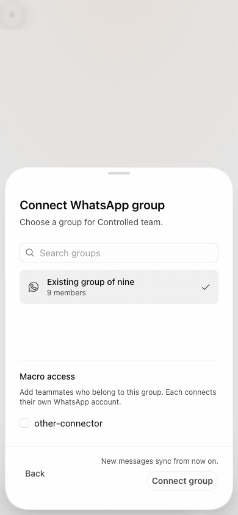

# Linked-device verification evidence

This records automated fixtures and local runtime verification, not a real-account delivery claim. The
companion is stacked on #7981, head `f683155efe6d35d62f67b5106f5a65fc4443ca4c`,
whose base is `ebc82ec40cb0bd6dba66b8c9aece371b81ee6ddc`. Both remained unchanged
and #7981 remained open when rechecked. Upstream whatsmeow HEAD was rechecked as
`b2b1e71d45e2ff171153b025b5a42f475bb30ef8`; the native authenticator is pinned at
`579f9144d37161bedf25ed1236d73486ce303de6`.

The work used an isolated `codex/whatsapp-linked-device` checkout and a task-owned
PostgreSQL instance on port 5549 with fresh disposable databases. The final
consolidated additive migration was applied to `macro_whatsapp_linked_v3`; no
shared database was reset. Automated runtime/browser fixtures use synthetic users
and block nonlocal destinations. The subsequent localhost smoke check reached a
real WhatsApp pairing QR without scanning it. Production AWS KMS and physical
authenticator devices were not used.

## Executed checks

Commands used the repository Nix environment unless they are `go.sh` commands.

| Check | Recorded result |
| --- | --- |
| `cargo test -p meta_messaging --all-features` | 91 passed |
| `cargo test -p notification --all-features` | 285 passed, 5 explicitly ignored |
| `cargo test -p document_storage_service --lib native_messaging` plus focused linked regression | Existing 87 cases passed; new linked case passed with seven concurrent adoptions, observations and quoted replies; 1 unrelated ignored case |
| `cargo test -p channels --all-features` | 334 passed |
| `cargo test -p entity_access --all-features` | 591 passed; 1 ignored doc example |
| `cargo test -p entity_access_db_utils --all-features` | 25 passed |
| `cargo test -p macro_db_client --all-features` | 190 library cases plus 9 integration cases passed |
| `cargo test -p messages --all-features` | 133 passed |
| `cargo test -p soup --all-features` | 333 passed, 4 explicit diagnostics ignored |
| `cargo test -p comms_db_client -p macro_service_urls` | 39 comms cases, 47 service-URL cases and 1 doc test passed |
| `RUSTFLAGS=-Dwarnings cargo check -p notification --all-features --tests` | Passed |
| `cargo clippy -p meta_messaging -p document_storage_service -p notification -p messages -p channels --all-features -- -D warnings` | Passed |
| `cargo check --manifest-path apps/web/tauri/Cargo.toml -p app` | Passed on macOS |
| `go.sh test -race ./... go.mau.fi/whatsmeow go.mau.fi/whatsmeow/socket` | Passed, including real-process supervisor cases with the isolated DB |
| `go.sh vet ./...` and `go.sh build -trimpath … ./cmd/whatsapp-session` | Passed; compiled local patched executable |
| `bunx --bun vitest run src/features/meta-messaging` | 162 passed across the configured test projects |
| `bun run type-check` | Passed |
| Bundled `meta-messaging.spec.ts whatsapp-linked.spec.ts` | 7 browser journeys passed |
| DSS OpenAPI/client generation | Passed; 15 linked paths added, no existing paths changed; only `CountedReaction`, `ImportedAuthor`, `MessagingBinding`, and `MetaReplyContent` existing schemas changed |
| Workspace SQLx preparation against the final additive migration | Passed; generated the production workspace cache with the repository recipe |
| `cargo x deps --check` and `cargo x workflows --check` | Passed |
| `CHECK_BASE=f683155… just check` | Passed; Rust formatting, frontend formatting/lint and code rules completed, with the repository's warn-only diagnostics |
| Root `cargo deny check` | Passed with existing warnings |
| Additional Tauri-wide `cargo deny … check` | Failed on pre-existing native graph findings; see below |
| Required auditor review | No remaining concrete source blocker; verified the recorded checks, generated-contract scope, browser screenshots and external prerequisites |
| Local runtime smoke check | Linux backend services built and started; macOS desktop built with Apple's linker; authenticated local UI showed an enabled personal Connect action and reached a real WhatsApp pairing QR |
| Local service wiring | Frontend HTTP/HTTPS returned 200; DSS-to-session mTLS succeeded, a client without a certificate was rejected, and LocalStack KMS encryption/decryption plus wrong-context rejection passed |

The companion PR uses the repository's `[no preview]` title marker. Its initially
automatic preview run was canceled during the build; AWS credential setup, preview
creation and deployment steps were skipped. No preview was deployed. The dedicated
GitHub protocol workflow also passed its race, patched-writer and vet checks.

The app bundle was built to exercise the actual native UI in the browser harness.
Unchanged compiled browser prerequisites were reused where possible. One harness
startup collided with a Rust build lock and timed out; the warm rerun completed
all seven journeys. This is recorded separately from a functional failure.

The localhost check used the named `whatsapp-linked` instance, seven synthetic
Macro personas and a local workspace. It preserved the earlier instance's data.
Stalled automatic Colima database/KMS forwards were replaced with dedicated
loopback forwards, and the already-built frontend bundle was reused for a lighter
preview. Pairing was exercised only up to the QR; account approval, remote group
adoption and real message delivery remain user-run checks.

## What the regressions prove

- Seven distinct verified accounts and a nine-person remote roster share one
  authorized native binding. Concurrent adoption returns the same native channel;
  a hidden binding is not granted to an outsider. Sender selection uses the human's
  account; another account cannot be substituted. Pairing tests cover owner,
  verified-identity, expiry, cancellation and completed-continuation fences.
- Reordered/replayed PN/LID observations converge in real native message storage.
  Different actors using the same source ID remain distinct. Edits/delete tombstones
  affect the same native message. Seven concurrent quoted observations resolve the
  original within the same native transaction without exhausting the connection pool.
  Remote membership and workspace removal affect
  the actual owning access adapter and notification eligibility; removing the
  content owner suspends new materialization.
- Shared send tests retain the original idempotency/deadline behavior, recheck
  account/channel/document authority after preparation, and recover accepted sends
  without redispatch. Existing Meta/Instagram private media, early echo, late media,
  revisions, publication failure and permission fixtures remain passing.
- SQLCipher tests exercise concurrent duplicate commands, crashes/reopen,
  wrong-key/plaintext absence, source/group/generation/expiry substitution and
  adopted-group boundaries. Receipt evidence commits with the inbox; pruning body
  copies retains acceptance/idempotency.
- A real child process test proves an expired lease cannot replace a live worker,
  shutdown joins physical termination and durable state, KMS export failure leaves
  recoverable proof, and later offline disconnect can purge retired live keys while
  preserving secret-free accepted outcomes.
- Worker tests drop unadopted content, retain a view-once placeholder, revoke one
  group without disabling the account, and reject pairing-flow substitution.
  History fills the bounded journal, resumes from its private cursor, deduplicates
  an acknowledged prefix and retries receipts without re-downloading a completed
  blob. The pinned native assertion shape is accepted without changing signed
  bytes, while unknown fields and wrong/completed flows remain rejected.
- Tests inside the exact patched whatsmeow source cover a physically blocked
  websocket writer, placeholder recovery failure propagation, grouped-receipt
  failure aggregation and expanded-history allocation bounds. These are protocol
  doubles, not evidence from WhatsApp's live servers.
- Browser journeys exercise existing native/Meta/Instagram behavior, zero messaging
  requests for ordinary channels, linked-only requests for personal groups,
  deliberate personal sends, account-generation draft isolation, connecting/offline
  recovery, roster/native-access layout, actual touch emulation, focused QR/passkey
  handoff and existing-group adoption without a remote create action.

## UI follow-up — 2026-10-20

The composer now uses the native channel name without a phone-number banner.
Personal-account permission denials no longer display Business API reply-window,
template or human-support copy; the backend's linked policy already has no reply
expiry. The picker switches content within one native Panel and supports search,
audience review and pending-action dismissal protection.

The current source passed the frontend type check, scoped `just check`, the
54 composer test executions and the picker journey on desktop and 390px touch.
The personal-account lifecycle journey passed using the existing bundle containing
the composer name/banner cleanup; the latest permission-denial branch is covered
by the component regression. That journey timed out during repeated live-reload
navigations before passing with the supported bundled runner. Memory-heavy bundle
attempts were interrupted; no additional backend build was needed for this UI work.
The local stack was stopped when the live sending denial was investigated, so its
underlying connection/permission condition has not been verified or bypassed.

## Browser proof

These screenshots contain synthetic fixture data, not customer accounts.

## Existing native audit and external prerequisites

The additional Tauri-wide audit used the repository's root deny policy against
the separate desktop workspace. Its reported vulnerable/unmaintained package and
version pairs already exist in the foundation's Tauri lockfile: `mach 0.3.2`,
`nix 0.19.1`, `proc-macro-error 1.0.4`, `quick-xml 0.37.5/0.38.4`,
`rustls 0.23.45`, `unic-* 0.9.0`, `zbus_names 4.3.1`, `zip 4.6.1/6.0.0`, and
`zvariant/zvariant_derive 5.10.0`. It also rejects existing unlicensed native
workspace packages, CC0/MIT-0 dependencies and tracing-subscriber edges under the
root server policy. No policy exceptions or unrelated upgrades were added to hide
those results. Resolve that native release audit through its owning process.

The exact pinned Go graph includes GPL-3.0 libsignal; the copied notices and hashes
are an inventory, not legal approval. The companion review must decide the combined
artifact's corresponding-source and distribution obligations before rollout.

The agent did not link a real account, send real messages, mutate remote groups,
change production or deploy. Connected traces in Tempo and
production KMS/mTLS wiring were not verified. Actual QR/passkey/OS/Bluetooth
qualification, seven real accounts in one existing group of at least nine people,
external-phone sender inspection, media and failure/recovery checks remain the
user/operator's authorized qualification. Follow the concrete checklist and
private host/KMS/mTLS/flag setup in [the operator guide](WHATSAPP_LINKED_DEVICES.md).
