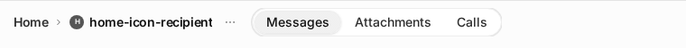

# Home

## Home (desktop) / Notifications (mobile) — `/app/home`

Touch devices render the Inbox as **Notifications**: a floating Signal/Noise
pill strip with a leading filter drawer (Status and Type), pull-to-refresh,
and swipe-left to mark done. A swiped row folds away, divider and all, before
it leaves; a row the feed keeps (the viewer's own work) unfolds again once the
done settles. The touch list shows no Undo for a done. On touch, Signal is a pure notification feed — the viewer's own
touched-by-me recents are not merged in; that merge is desktop Home's Signal
only, so sent mail and AI chats without notifications appear only on desktop.
Access requests, grants and removals on a paired machine appear as rows about
that machine; opening one goes to Settings → Machines with the machine pointed out.
Signal, including its empty state, starts with the Home tutorial entry (from `features/video-tutorials`) once that video is in its catalog: a `TutorialSidebarItem` in the desktop rail; touch devices show none. It sits outside the virtualized rows, so list keyboard focus skips it.

At 720px or narrower on touch, Notifications fills the pane with floating
Signal/Noise pills and opens items as standalone pages. Above 720px, including
unfolded Duo, the notification list docks on the left with the selected item's
preview on the right, using Chat's width check. Collapse sits beside the
Notifications title; the leading preview control restores the list. The Home
composer remains desktop-only. Restored detail URLs stay inline when wide and
redirect to standalone pages when folded.

Check live Home recency with two accounts: leave the recipient on Home without
opening the conversation, then send a DM from the other account. The row should
move into **Last few minutes** and show unread without reloading, including when
notifications use GraphQL but Home's notified-at list uses REST. Read the DM,
return to Home, and repeat; also check a row previously marked done and a thread
reply. Delay the Home list response while allowing single-entity hydration to
finish: hydration must not cancel the list refresh or leave an old notification
timestamp. Older in-flight snapshots must not move the delivered row backward.
Also test a stale response that entirely omits a just-restored, previously done
row: the row must stay visible. Marking it done again must override that restore,
and other filter scopes must not inherit the retained membership.

GraphQL-attached notification rows share the global feed's local seen/done
overrides: Mark Done and Undo reflect local intent without waiting for an older
cached notification snapshot to be replaced. These display overrides do not turn
incomplete predicate-index facts into authoritative membership evidence.

On desktop with the new app views enabled, Home defaults to a Signal feed merging
notifications with Activity's `touched_by_me` recents, including sent emails and
AI chats. Recent emails must be classified as Signal by the server; touching a
Noise email must not bring it into Home, including through local search. Verify
that a recently viewed Noise email stays absent while a Signal email and recent
chat remain visible, and that loading older rows still works through pages of
Noise-only email activity. Each entity appears once, ordered by its latest
notification or own action. On desktop, the funnel button to the right of **Home**
opens **Filter Home**.

Desktop Signal reads
the server work feed (`user.workFeed` plus the `workFeedUpdates` subscription)
instead of merging sources in the browser; Noise and touch devices keep
the merged feed.

Typing in **Search Home** there filters the feed first: every loaded Home row
whose name matches the query is listed, in Home's order, whatever its type or
age, followed by the search service's hits (content matches in mail, documents,
tasks and chats that pass Home's notification filters). The Watch tutorial row
is hidden while the field has text. Rows on feed pages that have not loaded
yet, and a row whose only match is its sender or body, are found only if the
search service returns them. To check, type a word from the title of a row of
each type further down the list (an agent session, a task older than two
weeks, a channel, a project): each must appear. Verify these against a backend that serves the work feed: a
document you edited with no notifications appears read and offers no **Mark Done**.
What an agent session does for you is the session's work, not yours: a task or
document it creates stays out of Home unless a notification brings it in, and
its edits never move an item you worked on.
**Mark Done** clears a row's notifications (and archives an inbox email): a row
that is only notifications leaves and stays gone after a reload, while a row you
also worked on stays, read, at the time of your own work. **Undo** brings a done
row back in place. A new comment on a months-old document appears at the top. With
two sessions of the same account, marking a row done in one removes it from the
other without reloading. A channel thread and its channel remain separate rows, and
completing the channel leaves the thread. The server applies **Status** and the
**Documents**/**Tasks** split, so with **Unread** on, a feed that is mostly read own
work still fills the first screen from one request; a row read while shown stays
until the feed is fetched again.
The menu shares the legacy compact submenus: **Status** offers **Unread**, **Read**,
and **All** as single-select radio items with a checkmark on the right of the selected
option, and **Type** contains the entity checkboxes. Status closes the menu
after selection. Type uses the [shared multiselect dropdown pattern](ui-conventions.md#multiselect-dropdowns):
clicking a row or its checkbox toggles it without closing, Enter adds and closes,
and Shift/Only selects just one type without closing. Press **f** to open the menu.
Entity type checkboxes start checked. Unchecking **Email** hides received
and sent mail. **Channels** controls
both channels and reply threads; **Chats** and **Agents** have separate toggles.
**Folders** is the Drive folder filter and **Projects** the task project
filter: a project with a pending access request or a discussion notification
is its own feed row, carried by the work feed as its own item kind.
Unchecking every type shows an empty feed. **Reset filters** shows every type and
both read states again. A badge counts hidden types plus an active status filter.
Read status and type selections persist.
There are no desktop Signal/Noise tabs. A **Home** heading
labels the top left of the block, matching the **Email**, **Tasks**, **Chat**, and
**Agents** sidebar headings. The full-width **New** plus pill below the heading
clears the preview and returns to the Home starting pane; it does not create a
chat. It uses the shared desktop creation styling described in
[navigation](navigation.md).

The Home provider honors an explicit initial tab, search, grouping, and facet
selection. Filters persist per user across reloads and fresh Home navigation;
split history restores that entry's filter selection. An explicit facet selection
overrides saved filters. Returning through split history resets navigation to Signal.

Channel thread replies remain separate Home entries from their parent channel,
using single-line rows and a reply arrow icon on desktop, labeled
with the sender and channel (for example, **Peter in #battlefield**). Replies and
mentions name the latest notification's sender, including bots, even after the
notification is read. Document-mention and reaction notifications also name
their sender, never the thread's original author. Verify a reply containing a
document chip in your own thread: the row must keep the replier's name when
the document-mention notification arrives, including after it is marked done.
To verify user mentions, mention yourself from a second account in a
thread started by someone else: the row must name the mentioner and open their
message. Channel names
prefer the current channel cache, then a matching thread notification's name,
then **Unknown channel** if neither source has a name. Selecting a
thread opens that thread in the channel preview; Shift-click opens it in a split.
A click or Enter gives the conversation's composer focus, and Esc returns to the
row; see [composer focus and Esc](channels.md#composer-focus-and-esc).
If the channel is already open in another split or preview, clicking a message
or reply notification focuses that view and jumps to the specific message,
without a **Content already open** warning. Verify with two splits and a reply
in a different thread from the one currently displayed; repeat on touch.
A Home URL containing only the channel `threadId` opens that thread's root,
not the latest message. Reloading or opening the same URL on touch retains the
target; an explicit reply `messageId` still takes precedence.

Items in the 256px desktop rail use single-line pills with 16px icons: profile photos for
DMs and model logos for AI chats (Claude sunburst or ChatGPT knot). Other items
use the same glyphs as entity rows elsewhere: document file-type and
task/snippet/skill variants, hashes for channels, read/unread envelopes or
calendar invites for email, sparkles for agents, folders for folders, the
project stack for task projects, and alarms for reminders. Pull requests retain open, merged, and closed status glyphs and
colors; unknown foreign sources use the generic file icon.
New agent-session rows always use a sparkle in the left slot, including while
working. A coding session adds a second line with repository, captured working
branch (when available), and PR number/status. Non-coding sessions stay on one
line. Their timestamps and unread dots stay visible. Missing repository metadata
is omitted.
A session a person starts is their own work from the moment its row commits,
before its sandbox boots: Home lists it on every signed-in device within a
couple of seconds of sending, without waiting for the first reply. Sessions
another agent or a routine starts join only when they notify. Verify by sending
a prompt from Home and checking the row appears while the session is still
starting, is highlighted while it is open, and shows on a second device too.
Once `HIDE_AGENT_DM_SESSIONS` is enabled after the warm-marker rollout, agent
DM contexts stay out of broad Agents/Home lists, including work-feed and
notification-driven candidates. Prior notifications or activity must not bring
them back. The DM remains in Channels/DMs; authorized direct session links and
explicitly saved favorites still open their context. Verify this alongside an
ordinary standalone session, which remains listed.

A session started from a thread (a mention in a channel, document or call, or a
task assignment) stays out of Home, Recent and the Agents sidebar for everyone,
owner included, whichever agent runs it; the thread is where it is reached.
Follow-up mentions in that thread list it for nobody either. A person who
prompts the session from the session view itself (after **Open session**)
follows it: from then on it lists for them in Home, Recent and Agents while they
can still open it, and nobody else's lists change. Prompting never changes
anyone's access. Verify with two accounts: mention an agent in a document
thread and check neither lists it, then have the second account open the
session, send a prompt, and check the row appears for that account only.

The Agents workspace uses a single left dot for activity and unread state in
place of the sparkle. Clicking a session row in Home or the Agents sidebar
clears the row's loaded unread dot immediately; a failed read write restores
it. The opened session also marks its notifications read after the viewing
delay, including notifications arriving while that session remains active.
Other Home items have no title tooltips, and their timestamps are
visible only while hovering the row. An unread
dot remains visible. Click a row to preview it; `j`/`k` navigate and update the
preview; alternate activation and Shift-click open a split.

On desktop, before selecting a row, the main pane shows a centered single-line chat
composer under “What should we get done in Macro?”. Attachment, text, model, and
send controls share one row; longer prompts expand the input as needed.
Home uses the shared app font and composer theme tokens; hover states use the same semantic colors as other app surfaces.
Type in “Type @ to reference / for skills”, use the attachment button for
attachments and the model menu to choose a model, then press Enter or Send to
create and open an AI chat. If chat creation fails, the submitted text and attachments
are restored, including before a chat-limit paywall opens. With agents disabled,
the input stays 32px above the vertical center. With agents enabled, the
composer uses the same topbar offset and 24/64 padding as the Agents
new-conversation page so the two inputs share a baseline. With
`enable-suggestions` on, today and the top priorities appear below the
composer; otherwise the space below it is empty. Shift+Enter adds a line. Selecting a Home row replaces
the composer with its preview. Desktop Home uses the shared 256px sidebar and collapses
navigation below 720px. The hamburger or `Cmd+.` opens the full feed as a
slide-over. Activating a row or **New chat** closes that overlay to show content;
arrow-key browsing keeps it open. Preview headers start with **Home >**. Clicking
**Home** clears the preview and returns to the starting pane without changing
sidebar visibility. Use the hamburger to reopen the feed. Narrow touch shows
the notification feed alone; wide touch keeps the feed beside its preview.

Project rows, including unread discussion notifications, open the project Overview
inside Home on desktop. The preview keeps the Home return breadcrumb, project
properties, description, and discussion; a discussion notification targets its
message. Overview/Tasks tabs stay inside the Home preview, and reloading its URL
restores the section and discussion target. Shift-click still opens the project
in a split; touch opens the full-screen project page. Verify clicking an unread
project row, switching tabs, returning Home, and reopening the same comment.

Desktop previews use the same header controls as their standalone views, with
the **Home >** return breadcrumb added. Calendar shares its date, search,
navigation, view, and New controls; email shares its action, navigation, AI/task,
and Share groups. Touch previews and standalone pages retain their compact headers.

Conversation breadcrumbs preserve identity: human DMs show the other participant's
avatar, agent DMs show the persona avatar, and named channels show their picture
or the channel glyph. Verify switching between these entries without reloading,
including a reply-thread entry and a direct Home URL reload. Clicking an avatar
inside a breadcrumb must select that breadcrumb, not open another DM.

Document previews opened from Home expose **Share** and **Copy Share Link** before
the details toggle, including tasks, snippets, skills, canvases, PDFs, images,
code, and videos. Share uses the selected item's permissions and updates when
switching items; copied links point to the entity rather than the Home feed.

Markdown previews (documents, tasks, snippets, skills) register the same entity
commands as their standalone pages, so Cmd+K lists **Copy link**, **Copy ID**
and, for tasks, **Copy branch name** while the preview has focus. They live in
the preview's own hotkey scope; with focus on the feed, the list's commands act
on the focused row. Verify with the cursor in the preview's body.

AI chat, agent, and channel message bodies use 15px text, including thread replies.
Home uses the same unified agent/model selector as the Agents workspace. Switch
from Auto to Chat or Code to show it. The menu includes custom agents, advertised
models, Reasoning effort, and supported Speed choices; Auto hides those controls.
Opening or dismissing the selector preserves Home's separate unsent draft and
attachments. The saved model, per-model effort, and speed keep their existing
preference ownership. Inline and standalone agent sessions use that selector too,
with session-owned changes rather than new-chat preferences.
Desktop AI chats, agents, and channel composers share Home's rounded composer
surface: a muted dark fill or a white light-mode surface with a soft shadow,
15px input text, and circular controls. Composer geometry is scaled to 15/16
of the original design (48.75px single-line height); the Home composer is at most
720px wide. In narrower desktop splits, the Home heading wraps and the composer
shrinks to the available pane width; suggestion text truncates while Open stays
visible. Plain channel messages use a compact row;
multiline messages, formatting, and attachments retain a full-width editor and
footer. Switching between compact and expanded layouts keeps the same editor and
draft. Mobile composer styling and send behavior are unchanged.

Sections are Last few minutes (under five minutes), Last hour, This evening
(6pm onward), This afternoon (noon–6pm), This morning (6am–noon), Earlier today,
Yesterday, and the existing older-date groups. Sections always follow this order,
with newest rows first and entity identity breaking equal-timestamp ties.
The reference clock uses whole minutes, so refreshing within the same minute
preserves grouping. Rolling five-minute/hour windows continue across midnight;
future timestamps caused by clock skew stay in the newest section, and invalid
dates go last. Calendar sections use local time. The clock is checked every 30
seconds without a new action. Scrolling near the bottom automatically
loads older items. Home buffers older rows until both notification and own-activity
pages have loaded through their timestamp, then advances the shallower feed first.
Fetched rows still advance this boundary when display filters hide them;
older cache-only rows do not.
Rows tied at a page boundary appear together, so loading another page does not
insert older history above already displayed rows. Live actions and refreshes
can still reorder rows. Short or fully filtered pages continue loading until the list
fills or there are no more results. A failed
source shows a retry notice while the other source stays usable. Document typing
starts an Edited activity for that editing session. Human edits
are attributed to the signed-in editor; agent edits retain their agent attribution.

Calendar reminder rows use the reminder delivery time for Home's date section,
including on a cold GraphQL load with notification sorting disabled. Verify that
an older reminder stays in its older section after the event's metadata syncs;
opening its details should show the expected occurrence. A newer reminder or your
own later activity can move the row forward, but a calendar sync alone should not.

On mobile, the dock uses the bell icon and **Notifications**
label; Home is desktop-only. Notifications has no merged own-activity feed or
chat starting pane. Opening a row navigates to its entity. On iOS, rows fade
underneath the filters and status bar using the shared top edge gradient.
With `enable-unified-notifications` on, the bell opens the unified
Notifications view instead (see [notifications.md](notifications.md)).

Notifications have three lifecycle states: `unseen`, `seen`, and `done`. Active means
unseen or seen. Viewing must not reopen a done notification; undoing done (`Ctrl+Z`
or `⌘Z`) returns it to seen, not unseen. The row returns to the active inbox without
an unread badge. Applying the active Inbox preset preserves read/unread selections:
read (`seen` or `done`) narrows to `seen`, not to all active states. Email read/unread
is separate from notification lifecycle state.

Agent sessions notify through the same inbox. `<bot> finished <session>` goes to the
owner and everyone who has prompted or answered in that session when a turn ends with
nothing queued; `<bot> needs your answer in <session>` goes to the same people when the
agent stops to ask (anyone with edit access may answer); `<user> mentioned you in <session>`
goes to users @-mentioned in a prompt - when the author can edit the session, the mention
grants them edit access first, so the link leads somewhere they can act. All three are
filed under the session itself: the inbox shows an agent-session row (agent icon, session
name, the bot or mentioner as sender, the excerpt or question as the body) and clicking it
opens the session. They are
not retracted automatically yet: answering the question or starting the next turn leaves
the earlier notification until you mark it done. The chip announcement post itself no
longer notifies the thread. Settings → notifications lists them under `AI`.

## Home — `/app/component/home`

Greeting, example prompt buttons (`Draft a document`, `Draft an email`,
`Search & research`), and the desktop `Ask AI` composer. Mobile Home keeps its
New action without a floating AI input. Finishing onboarding
without a deep link lands here. The retired Getting Started page's old
`/app/getting-started` and `/app/component/getting-started` links also open Home.

On phones, shared confirmations (including Remove Member and Cancel Invitation)
use a glass sheet with a title, description, Close confirmation button, and
side-by-side cancel and confirm actions. Pending actions disable both buttons
and prevent dismissal; canceling leaves the underlying data unchanged.

## Suggestions on Home

With `enable-suggestions` on (desktop only), the idle pane shows, below the composer:

- **Today**: the day's timed events across working hours (8am to 8pm) as
  neutral chips with a thin line at now; a chip opens the event in Calendar.
  It needs the calendar to be on.
- **Your top priorities**: the five most important open suggestions, as the
  server ranks them. A row opens For you with that suggestion first; **All in
  For you** opens the page.

For you has a sidebar of lists, each with its count: **Today** (everything
that waits or runs), **To do** (the person's own mail and documents),
**Suggestions** (work Macro can do: runs, chats and routines) and **Done**
(finished in the last day). Under them, **Routines** links **Ideas** (a dot
when a routine was proposed since the last visit) and **Your routines**, both
opening Agents → Routines. The page shows the chosen list under its name and
the date as one flat list of rows, each 56px: a tile tinted by kind, a title,
and one line, cut where the row ends (hover shows the rest). A row's age sits
on the right; pointing at the row or focusing in it swaps the age for its
buttons: ✓ (mark done, where taking it up finishes it), ✕ (dismiss) and the
row's action. **Run** starts a background run at once (a run that posts or
sends something says so at the start of its line); the row reads
"Running…" with **Stop**, which stops the run and keeps the suggestion
("Stopping…" until the server opens it again). A finished run stays in place
for the visit with a green check, the one line its run reported, and
**Open**, which opens its session; a failed run turns red with **Retry**.
**Open chat** opens the composer with a prompt typed, unsent, and pressing a
run's text puts its prompt there without starting it. **Turn on** saves a
routine switched on in one click: the row reads "<name> is on" with a green
dot and when it runs, **Edit** and its switch, and a toast offers **View
routine**. Switched off there, it reads "<name> is off" with a grey dot. A To do row names the item it is about, who wrote, whether a
reply is drafted, and how long it has waited; pressing its text, or **Open**
/ **Open draft**, opens the item. A reply stays open until the person
replies on its thread, however often it is opened, and has no ✓. **Open
draft** opens the thread with the draft in its reply composer and a footer
under it that reads **Drafted by Macro**, links what else the suggestion
cites, and offers **Rewrite**, which opens the agent composer with the thread
mentioned and the request typed, unsent. ✓ strikes the row through, "Done
just now · Stays here until you leave this page" (the Done list already
holds it), with **Undo** on the row and in a **Marked done** toast. With nothing waiting in Today, the page reads
**You’re all caught up** (the date line adds "Nothing needs you right now")
with **See what’s done** and **Browse routines**. ✕ dismisses at once and
leaves the row in place with **Undo** for the visit (a routine idea has no
Undo: the server can't bring it back); Undo restores the suggestion, which
the server allows for a few minutes. Dismissing a running
suggestion stops its run, and restoring it brings it back open, not running.
**Refresh** in the top bar asks for a fresh run, at most once an hour; while
one runs it reads "Looking for suggestions", and during the cooldown
"Available at" a time.

