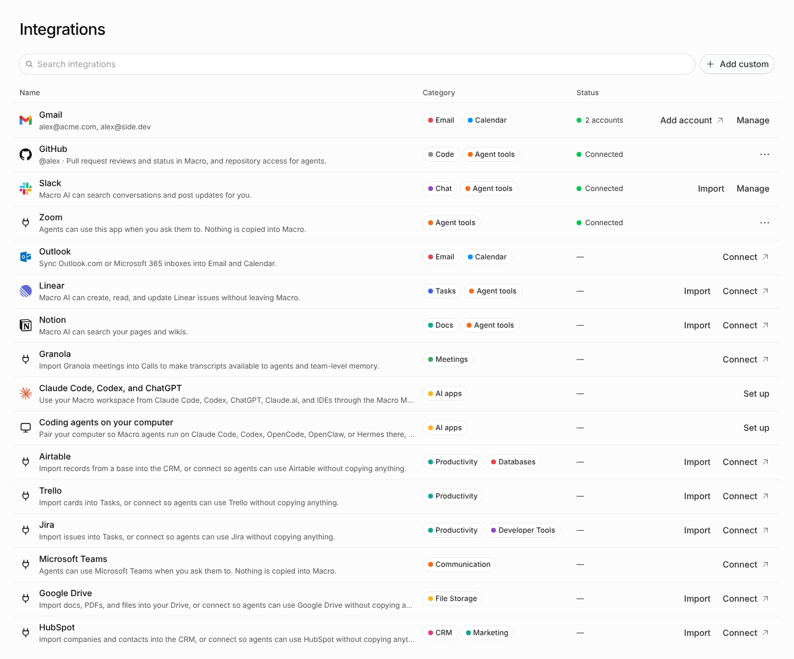

# Settings

## Settings — `/app/settings/<section>`

### Slack archive import

Temporary message storage recovers closed IndexedDB connections without restarting
the import or deleting staged history. Verify closure between staging batches and
between cursor pages: all messages must remain ordered, deduplicated, and within
the original byte limit. Cancellation and cleanup still work during recovery.
Deleted or replaced scratch databases fail the old import instead of silently
continuing with incomplete history; its cleanup must leave a replacement intact.

In **Integrations → Accounts**, the **Slack export** row appears only for team admins
and owners with `enable-slack-archive-import` enabled. Production rollout stays
off until explicitly enabled. Select an export ZIP, filter the grouped conversation
picker, optionally show archived conversations, and use Space to toggle focused
checkboxes. **Select all visible conversations** preserves selections hidden by
filters; unchecking it or **Clear visible selection** clears only visible selections.
Rows show stable Slack IDs
so duplicate names remain distinguishable. Counts are advisory when available,
otherwise “not yet counted.” Discovery moves keyboard focus to the filter.
Slack file/canvas discussion folders (`FC:<file-id>:<title>`) are ignored, not
imported as channels; their presence must not prevent channel discovery.

Review email attribution and external membership implications, choose whether to
include history, and confirm the immutable Slack workspace binding before
**Import selected channels (N)**. At least one selection is required. File selection
alone makes no server writes. Close/Escape or cancel before confirmation discards
the archive and selection without creating a job; reopening requires choosing a
file again. After confirmation the selected IDs/options are frozen. Closing and
reopening then retains the upload session; keep Team Settings open until it finishes.
The dialog restores focus to its opener, and polling should not blank Settings.

Use **Job history** (including older pages) for server progress after a reload.
It displays the persisted selected names/IDs/kinds, history option and selected
failures/skips without the ZIP. Unselected channels are not skipped work. Reload
recovers server tracking, **not interrupted local uploads**; finalize verified work
with skips or cancel and explicitly confirm a new import/token.
**Cancel import (keep partial results)** does not delete committed messages or
channels; running work may finish. An interrupted upload offers **Recover job
receipt**, then **Finalize with skips** or cancellation. Channel links appear only
when the server confirms current participation and the viewer's channel list
confirms access. Verify counters, errors and skip
reasons at narrow widths, using synthetic exports and a test backend rather than
importing customer data into hosted dev.

For a release check, inspect the actual create request and then reload the server
receipt: both must contain exactly the selected Slack IDs and history option.
Select two rows with the same display name, filter both out, and confirm the
selected total remains unchanged. Cancel before confirmation and verify there
were no create, registration or PUT requests. An open job must reject tampered
registration/sealing of an unselected ID; a client-only picker test is insufficient.
Check desktop web and Tauri: opening Settings alone creates no ZIP worker, and
signed PUTs work without dropping checksum or conditional headers. A 412 upload
retry verifies the existing object instead of overwriting it. Keep an active job
open through websocket disconnect/reconnect to verify polling remains usable.
The [runbook](../runbooks/slack-archive-import.md) distinguishes fixture tests from
live-backend release gates and documents staging retention and recovery.

### Email signatures

Open **Settings → Email → Signatures**. Each owned inbox opens in **Preview**,
using the same isolated HTML renderer as the email composer. **HTML** lets you
paste or edit a custom signature without flattening its tables or spacing.
**Rich text** offers text formatting, links, and image uploads; opening a custom
HTML layout there asks before converting it. Switching views alone never changes
the saved signature. Pasting a custom layout into Rich text preserves its HTML
and opens Preview (ask to replace first when the editor already has content).
Choose **Save signature** to save edits and return to the canonical preview.
**Clear signature** removes the saved signature and the current unsaved draft;
after clearing, reopening Rich text starts empty. It leaves the inbox connected, while
**Remove inbox** in Accounts uses the existing inbox removal confirmation.
**Add to replies & forwards** saves that preference immediately. On desktop,
**Import from Gmail** in each Gmail inbox's header fetches that account's Gmail
signature and saves it right away, replacing any unsaved draft; a toast reports
when Gmail has no signature. Outlook inboxes offer Rich text and HTML editing
without a Gmail import action. The import action uses the inbox's provider,
not its email domain. Unsaved drafts
survive switching settings pages. On phones, the signature preview, replies/forwards
toggle, and clear action are available; editing and import remain desktop-only.
Accounts list each inbox as its own row, followed by **Connect another Google
Workspace account** and **Connect an Outlook account**; Integrations shows the
same rows. Its **Email settings**
gear opens the dedicated page, and Email links to Notifications and Calendar.
With a composer open, save a changed signature or reply-signature preference and
verify its preview updates. Once the account refresh completes, reopen a composer
offline and confirm it uses the saved settings.

Regression check: import a nested-table signature, edit its source in HTML,
preview, save, leave settings, and reopen. Confirm the tables, spacing, and image
sizes survive in both settings and the new-message preview. Cancel a Rich text
conversion and verify the saved HTML is unchanged. Check the preview on a phone
and ensure a wide signature scrolls inside its own preview instead of the page.
Save a signature created in Rich text, reopen settings, and confirm Rich text
editing resumes without a conversion prompt.
With Gmail and Outlook inboxes connected, confirm only Gmail offers import
(including Gmail accounts on a custom domain), while both support HTML and Rich
text editing. Empty Outlook signatures must not suggest Gmail import.
Type an unsaved Rich text draft and clear it, both with and without an existing
saved signature. Reopen settings and confirm the editor stays empty and the
composer no longer includes a signature. A delayed clear must preserve a newer
draft, even if its text matches the old draft. HTML with `!important` styles must
still ask before conversion to Rich text. The backend-free browser suite uses
the real form, Quill, settings mutations, account-list remounts, query cache,
and composer preview with fixture services:
`bunx playwright test --config src/features/settings/browser-test/signatures/playwright.config.ts`.
Trace signature actions under `email.signature.save`, `email.signature.clear`,
or `email.signature.import`; the REST write and `email.settings.refresh` run
under that action, including the account catalog's durable refresh.

### Notification permission prompt

After onboarding, an eligible desktop app user sees **Enable Desktop
Notifications**. Select **Enable** to request permission through the native
notification provider; macOS uses its system permission dialog. The Android app
says **Enable Notifications** and requests the Android notification permission
through the same native provider. The web prompt says **Enable Browser
Notifications** and uses browser permissions.
Select **Hide** to dismiss the prompt. It waits in the same region as other
prompts, one card at a time.

### Notification snoozes

Open **Settings → Notifications** to see **Snoozed items** and their local resume
times. **Change time** opens the same searchable time picker used by entity
actions; **Resume** cancels a snooze immediately. Permanent mutes appear separately
under **Muted items**, with **Snooze instead** to replace one with a timed pause.

The Chat detail pane also supplies these commands for its current channel or DM;
focus the conversation before opening the command menu.

To snooze an entity, right-click its row (long-press on mobile) and choose
**Snooze notifications…**, or select/open the entity and search for that command
in Cmd/Ctrl+K. Multi-selection applies the chosen deadline to all selected items.
Use arrow keys and Enter, click a preset, or type a future date/time such as
`2h` or `tomorrow 10am`. The next morning means the next local 9 AM; the weekend
preset resumes on Monday at 9 AM. The picker displays the exact local date and
time before saving. Escape closes the picker; before choosing a time, it makes
no changes.

Snoozing pauses notifications only: it does not hide, archive, mark read, or mark
done. Channel message/thread rows target their parent channel, matching mute.
The server enforces expiration even when no client is open. Displayed snooze
state refreshes when the window regains focus or a mute/snooze changes; the
client does not poll. A failed save keeps the picker open for retry; a successful
save appears in notification settings.
If only some selected items save, the picker shows the saved count and retries
only the remaining items. Closing it keeps any snoozes already saved.

On phones, long-press opens the entity actions drawer. The snooze time picker
uses the same responsive `Dialog`, width, and `CommandMenuShell` as Cmd/Ctrl+K,
with larger touch targets and tap instructions. Swipe the preset list when the
viewport is short. In **More views → Settings → Notifications**, item names and
deadlines sit above **Change time** and **Resume**. Saving or cancelling a picker
returns to the settings sheet. Start new snoozes from an entity's actions or
Cmd/Ctrl+K; Settings manages existing snoozes and mutes.

Design references: [Slack notification pause/resume](https://slack.com/help/articles/214908388-Pause-your-Slack-notifications)
and [Superhuman's keyboard-driven Remind Me picker](https://new.superhuman.com/remind-me-29124).
Macro applies the temporary pause per entity and keeps the entity visible.

### Team membership

Team membership has no size cap, including free teams. Invitations and domain
auto-join must keep working beyond five members and the former stage-plan limits.
Free-team joins do not create a paid subscription, bill a seat, or grant premium
roles. Teams with an existing paid subscription retain their per-seat billing;
enterprise teams retain their billing bypass.
A team created or invited from while its owner is on a Pro trial bills through
that trial, so members who join get Pro, like on an active subscription.

On a local stack started with `--no-doppler`, verify free-team creation from a
fresh passwordless signup. It must work without Stripe credentials.

The invite dialog (**Invite** on **Team → Members**, or **Invite your team**)
starts with the team's **Invite link**: **Create link** makes one and copies it,
**Copy link** copies it after that. Anyone signed in who opens
`/app/team-invite?link=<token>` sees **Join <team>** and joins as a member with
the same billing and channel effects as an emailed invite; users already on
another team are told to leave it first. Team admins and owners also see
**Reset link** (the old link stops working and a new one is copied) and
**Turn off**, each behind a confirmation. Anyone who may invite can copy the
link or create the first one. Below it, **Invite by email** sends invitations
as before. Each email says what joining gives: **Pro is included** when joining
grants a Pro seat (an enterprise team, or one with a subscription), otherwise
**Free to join**. Examples: [desktop](media/team-invite-email/desktop.png) and
[mobile](media/team-invite-email/mobile.png).
An unanswered invite gets up to two reminder emails, with subjects starting
**Reminder:**, 3 days after the last email and 4 days after that. Invites more
than 14 days old, already-members, and invites whose sender left the team get none.
**Pending invites** on **Team → Members** lists each invite with when it was
last sent, for owners and admins, who can **Resend**, copy the invite link,
or cancel it. Resend unlocks an hour after the last email, the email's rate
limit; re-inviting the address from **Invite** follows the same rule.

Under **Team → Members** (**Invite settings**), owners/admins can turn
**Auto-join on domain** off and can restrict invitations to admins with
**Members can invite**. These controls still apply.
To verify the membership flow, use a local free team with five members: invite
and accept a sixth member, then sign up another user on its enabled auto-join
domain. Both should appear in the team's member list and configured auto-join
channels without an upgrade prompt. Repeat with auto-join disabled to verify a
same-domain signup is not added automatically.

### Navigation

On phones, **More views → Settings** opens an inset glass sheet over the current
page. The main page has a profile shortcut and the same grouped Team, Blocks, Personal, Workspace,
and Developer sections as desktop, plus enabled admin settings. Search finds
individual settings; selecting a result opens its page and reveals the section. Tap a row to open that settings
page inside the sheet; **Back to settings** returns to the grouped list at its
previous scroll position. `API Keys` is desktop-only and has no row here.
**Close settings** at the top right, Escape, an
outside tap, or a downward swipe dismisses the sheet. A tap that dismisses a
menu opened inside the sheet leaves the sheet itself open. Opening Settings again
starts at the main page; explicit links (for example Account) open their
section directly. Existing settings URLs open the requested section in the sheet
and restore the underlying app route. The header stays visible while forms
scroll, including with the keyboard open. On desktop, Settings is an ordinary
split view: the rail's gear button (or `Ctrl ;`) opens it in the active split
like any other rail item, and Shift-click opens it in a new split.
`/app/settings/<tab>` opens it as the only split with the app rail still
visible, and `/app/home/~/settings/<tab>` places it beside Home. Its inner
sidebar matches Email and Tasks: a **Settings** title bar, a rounded
**Search settings** field, the grouped section pills, and a team action pinned
to the bottom: **Invite your team** (opens the invite dialog; hidden for members
when the team limits invites to admins) or, with no team, **Create a team**
(opens the create-team dialog). Unlike other views, it cannot be hidden at
desktop widths: there is no **Hide navigation** toggle and `Cmd .` does
nothing, even if it was hidden before. Below 720px the sidebar becomes an overlay opened from **Show
navigation** (or `Cmd .`), which starts closed. Escape closes a
settings split that shares the layout, or steps back to the previous view when
it is the only split (Home when there is none). Leave settings by picking any
other rail item; there is no separate back or fullscreen control.

Settings cards use the email composer's raised surface (`SettingsSurface`) with
subtle row separators: a fine beveled edge and small ambient shadow on desktop,
the composer card on touch. Integrations uses the same content width and side
padding as the other settings pages. Section headings sit above the cards, with
more space between major sections and compact spacing within each group.
Controls share rounded shapes. Nested rows share one surface instead of adding
another box or shadow; never hand-build a flat card.
The compact sidebar uses the shared workspace width.

When a newer version is ready, an **Update available** button (a download icon
in a subtle accent circle that a glowing comet periodically circles) appears in
the sidebar rail above the mobile-app and settings icons. Its popover (a title,
a short description, and one action) opens by itself once per update until
dismissed (click outside or Escape); the button stays until the update is
applied. Its wording and action depend on the update: **New version available**
/ **Reload** for a newer web build, **Update ready** / **Update** for a
downloaded bundle in the desktop app, and **Desktop app update ready** /
**Restart and update** for a native desktop update. When part of the app fails
to load because a newer web build replaced it, the same button appears and its
popover opens again (even if dismissed) with **Reload**; there is no blocking
alert. Touch layouts have no rail, so a newer web build shows a **Reload** toast
there instead.

On desktop release builds, **Account → Desktop app update** shows native update
progress. While preparing to restart, the popover can't be dismissed and its
action is disabled. Restart waits for pending canvas/PDF saves and
local persistence; active calls, uploads, and imports must finish first. A ready
update also installs on normal app quit. Closing a window only triggers
installation if it exits the app. Browser, mobile, and development builds do not
show this native updater row.

Below Profile, **Account** shows a card naming the current plan (**Free plan**,
**Pro plan**, or **Max plan**; **Loading plan…** until the billing summary
arrives). Clicking it opens **Billing** settings.

Below the plan card, a **Log out** card signs out. Under it, outside any card,
**Delete account** opens a two-step dialog: an irreversibility warning with
optional feedback (and a **Log out instead** link), then a final step whose
**Hold to delete my account** button deletes only after it is held for 5
seconds (pointer, or Space/Enter); releasing early cancels.

Left nav (feature and platform gates still apply):

- **Team · <team name>** (just **Team** without a team): General (name, slug,
  GitHub autolink, default link sharing, Delete Team), Members (member list,
  roles and seat plans, **Invite**, pending invites, auto-join and
  members-can-invite). Without a team only General shows, with pending
  invitations or **Create Team**. Search finds these by `invite`, `members`,
  `teammates`, and similar terms; results name their group, e.g.
  **Team · Members**. The team Slack export import and the GitHub App live in
  Integrations; `/app/settings/team-connections` opens Integrations.
- **Blocks**: Email, Calendar, Agents, CRM. On touch devices, where the Agents
  sidebar is hidden, **Routines** (`/app/settings/routines`) follows Agents.
- **Personal**: Account, Appearance, Notifications, Keyboard shortcuts, Usage, Billing, Desktop App, Mobile App.
- **Workspace**: Tags, Integrations (email, accounts, team Slack export, AI apps and agent tools).
- **Developer**: Runtimes, MCP server, API Keys, Bots.

**Desktop App** (`/app/settings/desktop-app`) is titled
**Desktop App (Alpha)** and shows a compact Version, Build date, and Bundle
date card in the desktop app. Build date is when the running JavaScript was
built, not when it was installed on the computer. Bundle date is when the active
OTA bundle was built (from `get_bundle_debug_info`), or **No OTA update** while
the app's embedded bundle runs. In the browser it links to the latest desktop release
on GitHub, and only appears when the `desktop-app` PostHog flag is enabled. Native desktop always shows this section regardless of the flag;
native mobile never shows it.

The **Mobile App** page is titled **Mobile app**. In the browser it offers a QR
code to download **Macro** from the App Store; inside the iOS and Android apps
it shows the same Version, Build date, and Bundle date card as the desktop app,
and the sidebar's **Get the mobile app** button stays hidden.

Search checks individual setting titles and keywords, tolerates common typos,
and shows the parent page below each control result. Selecting a result opens
that page, scrolls to its section or row, and briefly highlights it. Each
built-in integration is a result that highlights its Integrations row. Try
`singature`, `email digest`, `calendar color`, `granola`, or `cursor`. Arrow Down from search
focuses the first result; Tab moves through controls normally. Escape in the
search field clears the query. Clearing search restores the grouped navigation. Keyboard shortcuts are listed
by category with the action on the left and keys on the right; expand **Keyboard
preview** for the visual key map.
Appearance starts with visual **System**, **Light**, and **Dark** mode choices.
The previews use the saved themes; System follows the device and exposes both
per-mode theme selectors. Light or Dark shows its own theme selector. Each selector
retains theme search, editing, copying, custom theme creation, and importing
themes from the clipboard.

The default Macro Dark theme uses a neutral `#0E0E0E` outer background and
`#121212` inset content panels. The app rail follows the outer background;
text and accent colors retain their existing palette.

Macro Light uses `#F5F5F5` outside `#FCFCFC` content panels, white controls,
`#E4E4E4` frame borders, and `#EDEDED` button borders. Its controls use
`#2E2E2E` ink. Macro Light and Macro Dark share the same muted blue accent
(`oklch(0.7 0.12 250deg)`); light mode does not switch the accent to orange.

### Theme mentions

Agent replies can include clickable theme mentions that let users apply a theme
with one click. The format is:

```
<m-theme-mention>{"name":"Theme Name","data":{...theme object...}}</m-theme-mention>
```

The `data` field must be a valid ThemeV3 object with these required fields:
- `id`: a UUID string (generate a new one for each theme)
- `name`: the display name
- `version`: must be `3`
- `mode`: `"light"` or `"dark"`
- `colorTokens`: an object with OKLCH color values for these required tokens:
  `surface-0` through `surface-4`, `content-0` through `content-4`, `edge`,
  `edge-muted`, `accent`, and the palette colors (`red`, `orange`, `amber`,
  `yellow`, `lime`, `green`, `teal`, `cyan`, `blue`, `violet`, `purple`, `pink`).

Example of a complete theme mention:
```
<m-theme-mention>{"name":"Ocean Dark","data":{"id":"a1b2c3d4-e5f6-7890-abcd-ef1234567890","name":"Ocean Dark","version":3,"mode":"dark","colorTokens":{"surface-0":"oklch(0.15 0.02 230)","surface-1":"oklch(0.18 0.02 230)","surface-2":"oklch(0.21 0.02 230)","surface-3":"oklch(0.24 0.02 230)","surface-4":"oklch(0.27 0.02 230)","content-0":"oklch(0.95 0.01 230)","content-1":"oklch(0.85 0.01 230)","content-2":"oklch(0.70 0.01 230)","content-3":"oklch(0.55 0.01 230)","content-4":"oklch(0.40 0.01 230)","edge":"oklch(0.35 0.02 230)","edge-muted":"oklch(0.25 0.02 230)","accent":"oklch(0.65 0.15 220)","red":"oklch(0.65 0.2 25)","orange":"oklch(0.7 0.18 50)","amber":"oklch(0.75 0.16 75)","yellow":"oklch(0.85 0.15 95)","lime":"oklch(0.8 0.18 125)","green":"oklch(0.7 0.17 145)","teal":"oklch(0.7 0.12 175)","cyan":"oklch(0.75 0.12 200)","blue":"oklch(0.65 0.15 230)","violet":"oklch(0.6 0.18 280)","purple":"oklch(0.6 0.2 300)","pink":"oklch(0.7 0.18 340)"}}}</m-theme-mention>
```

When clicked, the theme is added to the user's custom themes (if not already
present) and immediately applied, then Settings opens to Appearance. The theme
chip renders inline with the theme's color swatches beside the name.

### Importing themes

**Import from clipboard** in the theme dropdown reads a theme JSON from the
clipboard. Valid ThemeV3 (or legacy ThemeV2) JSON is imported as a custom theme
and applied immediately. Copy a theme with the clipboard button beside any
theme pill, then import it on another device or share it in a message for
others to copy and import.

Appearance ends with **Language**. On a team, **Team language** sets the default
interface language for every member; only admins and owners can change it, and
others see it disabled with an explanation. It starts at **Automatic (each
person's browser language)**. **Your language** starts at **Use team language
(…)**, or **Automatic (…)** naming the browser's language when the team has none
or there is no team, and overrides the team language for the signed-in person
only; without a team it is the only dropdown. A browser language the app isn't
offered in falls back to English. Menus, navigation, the command and
create menus, and settings navigation switch language as soon as the setting
saves; page contents and user data stay as written. The choice is remembered on
the device, so the next launch starts in the same language. Once that resolved
language has loaded, PostHog stores it on the person as `interface_language`
(a tag such as `en` or `zh-Hans`). A usage pie is a Trends insight on
`$pageview`, unique users, broken down by the person property
`interface_language`.

Existing settings URLs remain valid; `connections` still opens Integrations,
`agent-connections` aliases Integrations, and `harness` aliases Runtimes.

`Usage` appears directly above Billing, including for Free accounts. In
production, the `enable-ai-usage-billing` PostHog flag controls activation. While
it is off or loading, the page shows **AI billing changes take effect on October
8, 2026.** and all Usage controls are disabled. Turning the flag on activates the
page and removes the announcement. Dev and local remain interactive even with
the flag off. The production usage-limit dialog follows the same flag. Its
**Monthly limit** meter displays a percentage using the backend's current-period
usage and allowance. The info button explains AI agent chat and AI document
editing. **Usage Credits** shows the dollar balance and `Add more`, which opens
**Need more usage?** with `$25` / `$50` / `$100` / `Other`. Supported amounts
redirect to Stripe Checkout; unsupported custom amounts are disabled. Free
accounts see `View plans` instead of purchase or reload controls; paid team
members who are not the payer see only “Usage credits are managed by your team.”
Their credit balance and automatic reload row are hidden, with no
credit-purchase action.
Team owners who pay for their team's seats manage the shared credit balance and
automatic reload here in Usage, including purchases, balance thresholds, the
monthly reload cap, and payment methods. Team payers see **Team Usage
Credits**, “Credits are shared by your entire team.” and **Shared team balance**.
The purchase and auto-reload dialogs also identify the team-wide credit balance.
Team settings manages seats. Included
usage remains per seat: the owner's Monthly limit meter describes their own
usage, not the sum of the team's allowances. Team payers with a finite
allowance see “This is your personal monthly usage limit.” beneath the meter.
Unlimited enterprise plans show `Unlimited` and do not offer credit purchases
or automatic reload. The development paid-plan preview can still display
those controls, with purchases disabled.

The **Automatic reload** switch opens **Auto-Reload** without toggling directly.
It contains Minimum balance (default `$10`), Target balance (default `$100`),
optional Maximum monthly spend (`No limit`), a payment-method management link,
and the automatic-charge warning. The dialog saves for paid payers:
`Turn on auto-reload` enables automatic credit purchases with those thresholds,
`Save` updates them while on, and `Turn off` disables automatic reload. The monthly
limit caps reload purchases per UTC calendar month. The **Automatic reload**
switch reflects the saved state and is the billing opt-in indicator. Paid team
members who are not the payer see
`Only the account that pays for this plan can change automatic reload.` and
cannot save. After a failed automatic reload the Usage row shows
`Paused — payment failed` while preserving the enabled setting. The dialog shows `Your last
automatic reload could not be charged. Update your payment method, then save to
try again.`; saving retries. Extra usage is funded entirely by prepaid credits.
If the reload budget runs out or payment fails, uncovered usage cannot trigger a
direct usage charge; with quota enforcement enabled, exhausted credits and
allowance block further AI requests. Historical direct-charge invoices are still
recognized by webhooks, but settlement never creates or retries them. Local
**Developer tools** offer
`Preview Free plan` and `Preview paid plan` to display either Usage page with
sample usage, regardless of the signed-in account's tier.
`Open Free usage-limit dialog` and `Open paid usage-limit dialog` open the
corresponding exhausted-usage prompt directly. The previews also work before
the usage summary loads or when it fails. The paid-plan preview allows
testing Auto-Reload settings. Purchases and payment management are disabled during any
preview; `Reset preview` restores server data and closes the usage-limit dialog.
`Preview production before Oct 8` shows the October 8 announcement and disables
Usage controls, including usage-limit dialogs. Dev tools remain interactive:
Free and paid previews can be combined with this state, and `Reset preview`
restores the normal dev view.

Local **Developer tools → Open Billing Lab** opens `/billing-lab.html`, a
standalone simulator with no login or billing API calls. Its 20 presets include
Max with a pending Pro downgrade, exhausted allowances, credits, payment
failures, team roles, loading, and errors. Select **Max → Pro at renewal**
to start with a scheduled downgrade, and choose **Advance to
renewal**: Max stays active until renewal, then Pro becomes active and included
usage resets. Billing displays the scheduled downgrade and effective date;
**Keep Max plan** cancels it and preserves the active plan and usage. The
timeline also offers **Cancel scheduled change**. Purchases open a simulated checkout with explicit completion;
**Fail the next billing request** enables error and retry checks. Scenario links
restore the preset, not edits. **Monthly reload limit reached** opens Usage with
a notice banner: **Monthly auto-reload $50 limit reached**, with **resets Nov 1**
on the right. **Adjust limit** opens Auto-Reload; **Add credits** opens credit purchase.
Manual credits do not count toward the monthly reload cap, which resets at the
UTC month boundary. Live Usage shows this same banner from the API's monthly
reload commitments and reset date, including when remaining cap room is below
the minimum reload charge. Paid/pending reloads and failed invoices that can
still collect count toward the cap. Older backends without these facts show no notice.
The **Teams** scenario group opens Usage directly. **Mixed-plan team owner**
previews shared credits and enabled reload for one Max and three Pro seats;
**Team credits exhausted**, **Team reload paused**, and **Team monthly reload
limit** exercise the owner's purchase, payment-recovery, and cap controls through
the same Usage dialogs. Credit purchases add to the shared balance, while the
included-usage meter remains scoped to the viewer's own seat. **Team-paid Max
member** previews the notice-only member view. The simulator does not meter
other members' activity or perform automatic charges.
See [Billing Lab setup and boundaries](../../apps/web/src/features/billing-lab/README.md).

`Billing` shows the current plan and `Manage`. Free users see separate Pro
(`Get Pro`) and Max (`Get Max`) cards, side by side when the panel is wide enough
and stacked on narrow panels. The Pro card shows `Free for one month!` only after
`GET /user/stripe/trial_eligibility` confirms eligibility. Eligible customers get
the server-validated 30-day first-subscription trial; returning customers see
paid terms and `Get Pro` opens ordinary paid checkout. Eligibility loading
disables Pro checkout without showing a trial offer; a failed lookup adds
`Try again`. Checkout revalidates eligibility, and a stale trial offer reports
the server rejection rather than silently switching to an immediate charge.
Returning to the tab or reconnecting refreshes the offer. Accounts with an
existing recoverable subscription see `Manage` and payment-management guidance
instead of new checkout cards, even when their access is Free. A failed background
eligibility refresh preserves known subscription management but hides trial
claims. Management remains available if team lookup fails; plan changes wait for
team data. Checkout rejection clears the offer until eligibility refreshes. Retries reuse the
same open offer; changing plans invalidates the old link first. Competing tabs
can show a retryable checkout conflict without creating two payable sessions.
Reference captures from the isolated billing fixture: [returning customer](media/billing/returning-customer.png)
and [subscription recovery](media/billing/subscription-recovery.png). These show
phone-width layouts; payment-provider interactions are covered separately.

`Get Max` keeps standard paid terms and never offers a trial. A Pro trial that
upgrades to Max is charged today; the card says `Charged today. The Pro trial ends.`
A paid Pro upgrade stays prorated for the rest of the period. Prices read `/ month` for solo users and
`per seat / month` for team accounts. Each card puts its button beside the price when wide enough and below
the price when narrow. Free lists 2 connected email accounts; Pro and Max list
unlimited connected email accounts. Pro users see a Max card (`Upgrade to Max`); Max
users keep their current plan. Cards appear only for users who can
manage their subscription. Team-paid members see no plan options, including
on Free seats. Member options stay hidden until the billing summary confirms
they pay for their own seat. On a team, a plan change moves only the viewer's
own seat. Max lists "10x more AI usage than Pro"; Free and Pro allowance labels
still follow the `enable-ai-usage-billing` flag. Usage controls live in Usage.
The upgrade modal and Billing use the same plan cards and benefits, including
the same flag-gated AI usage label and responsive card layout. The modal offers
Pro and Max to Free accounts, only Max to Pro accounts, and no upgrade cards to
Max accounts. Cards in the modal show benefits without purchase buttons. The footer’s
`Manage plan` closes the modal and opens Billing settings, where checkout and
plan changes take place. Team-paid members see a message
to contact their team owner. Plan options wait for the billing summary and team
lookup; failed lookups show `Try again` rather than guessed upgrade options.

On a local HMR dev server, `Preview billing & paywall` opens an opt-in preview in
Billing. Choose Solo, a team-paid member, a self-paying member, or a team owner,
and Free, Pro, or Max. `Permissions, loading, and feature states` exposes the
billing summary status, billing permission, active/trialing license, Pro trial
eligibility, AI usage flag, and pending plan actions. The preview uses the real Billing UI with local
fixtures; checkout, plan changes, Manage, and Team settings only show preview
status messages. `Preview paywall` opens the same modal for the selected state,
without developer controls inside it. Dismissing the modal returns to Billing
with the selection preserved. `Manage plan` returns to the selected Billing preview.
`Reset preview` restores Solo/Free; `Exit preview` restores
the signed-in account. State is not persisted and resets on leaving Billing.
These controls are excluded from deployed builds, including dev.macro.com.

Billing shows the current billing period end and any scheduled downgrade date.
Max stays active until renewal; **Keep Max plan** cancels a pending downgrade
without resetting usage. Failed renewal-detail reads offer **Try again**.
Team members who cannot manage billing see the notice without its action.

`Team → Members` (`/app/settings/team-members`; on a paid team each row shows the seat's plan,
and admins/owners can move a seat between Pro and Max with the `Seat plan`
menu; Max upgrades are immediate and prorated, except the first Max seat on a
trialing team, which ends the trial and bills Max for a new cycle today.
Pro downgrades start at renewal.
**Keep Max** appears only for a confirmed pending downgrade and cancels it;
failed scheduled-plan reads offer **Try again**, while teams without applicable
scheduled plans show no retry notice). CRM (a `Team CRM` switch that admins use to enable or disable it;
once enabled, a `Stages` section for the company Stage options that new pipelines
also start with, with `Customize`, inline rename, reorder by drag handle or arrow
keys (up/down buttons on touch), delete, `Add stage`, and `Reset to defaults`,
editable by the role set as `edit_stages_role`)

`Agents` unifies agent definitions and runtime configuration in one page, also used by the Agents workspace. Its `Agents` section lists team and private agents. `New agent` / `Edit <name>` open full-page forms grouped
Profile, Behavior, Runtime, Connections, Channels, Share. Connections is a radio pair:
`Use my connected apps` (default; the agent gets whatever the person running it has
connected) or `Specific apps`, which reveals a `Search connectors` box over the whole
Pipedream catalog (results are `option` rows; picking one adds it) and a row per picked app
with a connected / not-connected dot for the *current viewer* plus an inline `Connect`
that opens the Pipedream Connect flow inside the web page. Native apps open
consent in the system browser, which returns to the waiting app on its own after
authorization (**Return to Macro** is the fallback link). Unconnected picks never block
saving; each teammate connects their own account. An agent session that calls a picked
but unconnected app gets a tool result saying so, and the agent's reply renders a
`Connect <app>` chip that opens Agents → Connections for that app. The same page
is also available as Settings → Integrations.

Reference captures from an isolated browser fixture: [native waiting dialog](media/pipedream/native-waiting.png)
and [browser return page](media/pipedream/browser-return.png). The fixture uses
the real UI and iframe messaging with simulated provider consent and native IPC;
it does not exercise a real provider account or the operating system's app launch.

To change an agent's picture, open `Edit <name>`, choose an image with `Upload`,
wait for `Uploading…` to finish, then click `Save changes`. Images up to 16 MB
are uploaded to image storage; Save stays disabled during the upload. A failed
upload shows an error and keeps the previous picture so you can retry. Verify
the picture after reopening settings and after a page reload, then type `@` and
the agent's name in a channel to check its mention-menu picture. Team agents
available in all channels should refresh there without reloading the channel.



With `pipedream-mcp` enabled, Settings → Integrations is one searchable list
styled like the Drive and Tasks lists, spanning nearly the full settings page
width. Rows are separated by faint dividers and have Name (icon, name, an
`mcp` or `native` badge, and a smaller, fainter second line on what it does in
Macro or which accounts are connected), Category (tag pills like email tags; several per row, e.g. Email,
Calendar), Status, and the row's actions. There is one row per integration; custom MCP
servers come first, then integrations in use (connected, off, or needing
attention), then the rest, then the app catalog. Below a 640px list width Category and Status hide and a status
dot sits beside the name.

- **Gmail** and **Outlook**: one row each; connected accounts appear as the
  description. **Connect** (or **Add account** with multi-inbox) starts that
  provider's flow; Outlook checks availability first. **Manage** opens Email
  settings, where each inbox is managed.
- **GitHub**: one row for the account link (pull request reviews and status)
  and agent tools. Its menu has **Configure GitHub App**, **Agent tools** (the
  GitHub provider page) and **Disconnect**.
- **Slack**, **Linear**, **Notion**: agent tools, with **Connect**/**Manage**
  opening the provider page and **Import** beside it. Slack's Import opens the
  Slack export importer for team admins with archive import enabled, otherwise
  the connector import dialog.
- **Granola**, **Claude Code, Codex, and ChatGPT** (Macro MCP setup), and
  **Coding agents on your computer** (Claude Code, Codex, OpenCode, OpenClaw,
  Hermes; opens Runtimes within Integrations and follows the Runtimes
  availability gate; Back returns to Integrations).
- Installed catalog apps and custom MCP servers, with their More menus.
- The catalog: every Pipedream app not yet connected, tagged with its directory
  categories. Apps Macro can import from show **Import** beside **Connect**.

The search filters every row by name, description and category and also searches
the catalog. **Add custom** sits beside it. Gmail, Google Calendar and Google
Sheets are hidden from the catalog because Macro syncs email and calendars
natively. LinkedIn never appears in the catalog or its search: the backend
hides it. Scrolling toward the end loads the next catalog page; a failed page
keeps loaded apps and offers Retry.
Overlaid catalog apps (the `mcp_overlays` table, served at
`GET /pipedream/mcp/overlays`) look the same in the catalog but never open
Pipedream: their Connect action opens the vendor's own MCP OAuth consent in a new
tab (system browser on native) and the row turns connected once that server is
authorized, after which it lists as that catalog app (its icon, Agent tools
category) among the integrations in use, not with the custom MCP servers at
the top; native servers wait for the overlay list before rendering so one never
jumps. Verify with an overlaid app such as Sentry or Asana; completing a
Pipedream connection for one answers 409.
The Agents workspace opens this same Integrations page. The list includes featured providers, a searchable catalog,
and `Add Custom`. Pipedream Slack OAuth is available in production and
development from the featured Slack provider. Connecting Slack here grants tool
access; channel import is a separate action where the user chooses channels.
Provider Back returns to the combined integrations overview; navigation
is local to each mounted Integrations page.

Macro agents and external AI clients using Macro's MCP server can run
`ImportNotionPage`, `ImportFromNotion`, `ImportFromLinear`, `ImportFromJira`
and the shared import ledger tools against the user's
connections saved in Macro.
Verify a Notion import returns a document and a repeated import returns the
existing document. For Linear/Jira workspace imports, verify planning writes no
Macro tasks before approval, source-specific reviews show task/project totals,
and an approved import preserves task fields, comments, labels and relationships. These calls must not report that import tracking
is unavailable.
On hosts without Pipedream credentials, saved Pipedream accounts must not hide
native Notion, Linear, or Slack connections when selecting import tools.

Provider and custom-server More menus contain Disable, Reconnect, and Disconnect;
custom servers also offer Rename. Disabled grants show Enable. Unauthenticated
custom servers show Connect and Remove. Disconnect/Remove require confirmation.
Adding a custom MCP saves its name and URL; Connect on its row starts OAuth.
In chat and agent sessions, the agent can add one for the user with the
`ConnectMcpServer` tool: it must be a public `https` URL, the row appears here
unauthenticated, and the user still clicks Connect to sign in. Re-adding a URL
the user already has leaves that row and its sign-in unchanged.
The Add MCP Server dialog uses the same 24px padding above its title as on its sides.
Enabled custom servers are offered to the owner's agent sessions (Cursor, Claude,
Codex, macrod, in-memory) alongside connected apps, through the same session
egress path: the sandbox sees the server under its name and a URL key, never the
server's address or token. A disabled server is not offered. If a server's
connection has expired, its tool calls return a message telling the agent to
have the owner use Reconnect under Custom MCP; there is no `Connect` chip for
custom servers. Agents configured with a fixed app selection do not receive the
owner's custom servers.
An agent reply's `Connect <app>` chip still starts that app's connection flow.
Cursor stays in Agents → Runtimes with its API key and default model controls; it is not
featured or offered in the Connections catalog. Settings → Integrations lists
Email, Accounts and AI apps above the agent tools and app catalog. The native-only integrations section remains
available when `pipedream-mcp` is disabled.
Open Settings with the rail's gear button or `Ctrl+;`; leave it by picking any other rail item.

`Agents` → `New agent` (or edit an existing agent) opens a full-page form. The
edit form offers `Delete agent` to the agent's creator, the team owner, and
team admins for team agents. Confirming removes it from channels and returns
to the agent list; Cancel keeps the edit form open. Other team members can edit
the agent but cannot delete it. The
`Instructions` field is a Lexical contenteditable textbox, not a textarea. It
supports Markdown headings, lists, emphasis, code, links, and the normal `@`
mention picker; select text to open the formatting menu. Saved instructions
retain mention identities using the shared editor's Markdown format and reopen
with their formatting intact. Enter adds a new paragraph; use `Create agent` or
`Save changes` to submit. The form also includes runtime selectors.
`Advanced` starts collapsed on desktop and mobile, showing only its heading,
summary, and `Show` action, without an empty card beneath it. `Show` reveals the
settings; `Hide` collapses them again and preserves the selected options.
Under `Advanced`, `Answering a mention` chooses between `Coding agent` (a
channel mention is answered with a magic chip that opens into the live session)
and `Chat agent` (the agent replies in the thread, like `@macro`). It is the
agent's own setting and always saved: a new form starts from the selected runtime
- Macro's in-memory runtime as chat, every other runtime as coding - and picking a
different runtime resets it to that default, but only the saved choice counts.
The model list is loaded live and independently for Macro Agent, connected Cursor, and every
registered macrod harness. The selected harness stays selected when the list refreshes.
A paired macrod connects on startup, so models can load before any agents are bound.
A harness can show `Loading models…`, an unsupported message, or
a retryable error without hiding the other harnesses. Editing preserves a saved model that
is no longer offered and labels it `saved, unavailable`. A macrod with no responding runtime
can remain loading until the 10-second discovery timeout; use Retry after reconnecting it.
New macrod sessions use the agent's saved model before sending the first prompt.
Changing that default applies to new sessions; existing sessions keep their selected model.
If the runtime rejects the saved model, the prompt fails instead of using a different model.

The `Runtimes` section shows built-in Macro, Cursor, and Codex configuration, followed by paired macrod runtimes. Codex's card appears only within the agents and Codex rollouts. On the desktop app only, a “This computer” card appears above the built-in runtimes: the bundled macrod daemon is set up from here with one click. `Set up` scans the machine for installed agents and names the one it will use (Claude Code first, then Codex, OpenCode, OpenClaw, Hermes); `Options` changes the agent, workspace folder, and a larger Full access choice labeled Suggested (unchecked until explicitly selected). `Set up <agent>` then walks a three-step checklist — Find an agent, Connect this computer (start, install the connector, link to the account; the pairing is approved automatically, no code is typed), Create your agent (a private `@<agent>` coding agent bound to this runtime) — and ends on `@<agent> is ready` with `Start a session`, which opens the Agents composer in Auto with that agent as the usual coding agent. A failed step shows its error and `Try again`, which resumes at the failed step. A desktop app that was never set up also shows a one-time “Run agents on this computer” prompt whose `Set up` runs the same flow in a dialog; closing the prompt sticks. A running runtime with no agent bound to it offers `Create agent`. The app then keeps the daemon up: it restarts after any unexpected exit (with backoff) and on every launch until the user presses `Stop`, and any re-pairing is approved from wherever the user is in the app, not only on this card. While running the card shows the bound agent and workspace with a `Stop` action; a stopped runtime offers `Start`. The web app never shows this card. The “Bring your own agent” card sits above the Agents / Runtimes navigation and is visible on both sections. It rotates Claude Code, OpenCode, OpenClaw, and Hermes; reduced motion keeps a static name. Its `New runtime` action opens the full-page pairing flow from either section: enter the code, look up the request, review the machine, name, sharing and permission consent, then Approve and Done. Back/Cancel returns to the runtime list. Destructive removal still requires confirmation. `/settings/runtimes` opens this section; legacy `/settings/harness?pair=…` links remain supported.
Connection chips in agent replies open this page, including before any account is connected. Cursor's default-model picker uses
the same live model discovery and retains its existing save action.

The Codex row uses the OpenAI logo and the same icon, button, and status styling
as Cursor. Under **Codex**, choose **Connect with ChatGPT**, copy the displayed device code,
and use **Continue to ChatGPT** to finish sign-in in the provider tab. The Macro
page displays pending, expired, failed, and retryable error states; **Cancel
sign-in** cancels the attempt. After connecting, choose a **Cloud environment**
and click **Save Codex settings** before using Codex. Options show their
repositories. New sessions always use the `main` branch; there is no branch
picker or automatic repository selection. Changed selections display **Unsaved
changes** until the server confirms them. The save button is disabled until an
environment is selected, and when it matches the saved environment.
These choices apply to new sessions. **Disconnect** in the Codex row (accessible
name **Disconnect ChatGPT**) asks for confirmation before removing the connection.
Claude, Cursor, and Connections disconnect actions use the same shared confirmation
dialog (a drawer on mobile); Cancel leaves the connection intact. Claude's row
keeps its layout while status loads, and sign-in details appear only after Connect.
The UI never asks for an
OAuth token.

The Codex section and its auth/config requests were exercised in Chromium with
mocked backend responses on 2026-09-15. Provider login and a full deployed Macro
session were not exercised by that UI check.

### GitHub reconnect recovery

When GitHub reports that reauthentication is required, reconnect starts OAuth
without first deleting the current Macro link. Cancelling OAuth preserves it.
Selecting a different GitHub account fails without changing the connection; use
Disconnect first to switch accounts.
A successful callback refreshes the grant; if its old FusionAuth identity was
deleted, all Macro accounts sharing that GitHub account move to the new grant.
Verify reconnect both as the original linker and as another sharing account,
and verify an upstream outage leaves the current links intact and reports an error.
The Macro link survives a failed reconnect, but replacing the FusionAuth grant
is not atomic. A crash or failed restoration may leave it missing; retry OAuth
to recreate it after the provider recovers.

## Bots

Open **Developer → Bots** to create an account for a program. The page explains
how to add the bot to channels and use its token with the Macro SDK. **Create
bot** keeps Profile and Channels visible. **Advanced** starts collapsed on both
desktop and mobile and contains:

- **Agent → Show in model selector**: makes the bot available when starting an
  AI chat; connect an agent such as Codex or Hermes to handle requests. This
  section remains gated by the agents rollout.
- **Ownership → Mentionable**: lets teammates find and @mention the bot and
  creates it under team ownership. With the switch off, the creator owns it.
  Only team admins and owners can enable this option.

Open an existing bot to edit its profile, channels, and tokens. Its Agent control
also lives under a collapsed **Advanced** section. Verify that expanding and
collapsing Advanced preserves selected options and does not submit the form.
After creation, copy the **Bot token** before leaving; it is shown only once.
