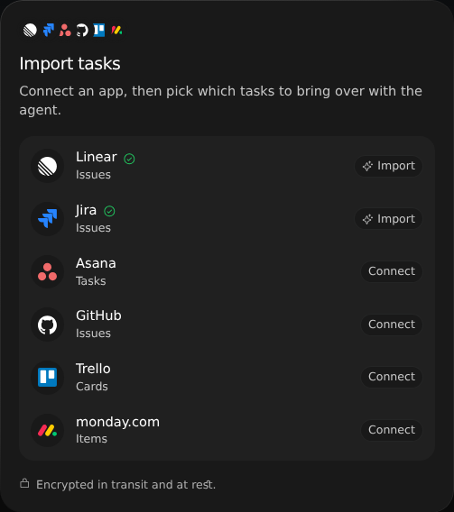
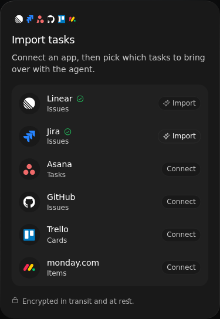

# Setup and import cards

## Import from connected apps

With `enable-sidebar-promotions` on (on in dev) and the Pipedream connector stack
enabled, the Drive, Tasks, and Customers sidebars end with an import card (the
Chat sidebar's Slack card is the same component under the Slack import gates;
see [channels](channels.md#imported-slack-history)):
overlapping provider logos, a two-line pitch, and **Import files**, **Import
tasks**, or **Import customers**. Customers shows it only to team members.
**Dismiss import files** (or tasks, customers) hides that card for good. See
[Dismissing cards](#dismissing-cards).

The button opens a dialog listing that category's apps (Files: Notion, Google
Drive, Dropbox, OneDrive, Box, Confluence; Tasks: Linear, Jira, Asana, GitHub,
Trello, monday.com; Customers: HubSpot, Salesforce, Close, Airtable). A
disconnected row offers **Connect** (`Connect <App>`). GitHub connects through
Macro's native GitHub MCP server (`api.githubcopilot.com/mcp`): authorization
opens in a new tab, and the row flips to connected when the app regains focus.
Every other app opens Pipedream's Connect UI inside the dialog. A connected row
(native MCP or Pipedream) shows a check and **Import** (`Import from <App>`).

- Every **Import** closes the dialog and opens an agent chat beside the current
  view with an unsent prompt. Notion, Linear and Jira open workspace importers
  (`ImportFromNotion`, `ImportFromLinear`, `ImportFromJira`) with “Import my
  <Provider> workspace into Macro.” They read only, ask who should see the import
  when needed, and present a review before creating anything. Other connectors
  list candidates and ask which ones to create. No importer writes to its source.
- The shared review identifies its source, shows task/project totals for issue
  trackers, and lets the owner exclude objects and change sharing. On phones,
  **Open full review** uses the existing full-height sheet. Approve on the card,
  or say yes and let the agent submit it with `DecideReview`; planning must be ready.
  Stop affects the selected source only, and completed copies stay in Macro.
- Files also offers **Upload files** and **Upload a folder** (Drive's own
  uploads), and Customers offers **Upload a CSV** (the existing CSV import).
  Each closes the dialog first.

`src/features/connector-import/browser-test/` exercises the connect and
handoff paths without a backend.

The connector browser fixture uses in-memory connection responses. Desktop
and 390-pixel viewport captures show the connected Linear/Jira actions:

## Sidebar setup cards

The same flag puts a dismissible card (`src/features/sidebar-promotion`) at
the bottom of three more sidebars. On desktop every card, import cards
included, uses the email message card's surface (`ComposerSurface`). Calendar's
card sits above **Settings**, outside the scrolling list.

- **Home** (desktop): "Make Macro your home base". **Connect tools** opens
  Settings → Connections; **Invite team** opens Settings → Team. **Invite
  team** is hidden for members of a team that limits invites to admins
  (Settings → Team would offer nothing to do).
- **Calendar**: "Connect more calendars", shown only with multi-inbox enabled.
  If a connected account lacks calendar access the button is **Turn on
  calendar**, and if its grant expired, **Reconnect calendar**; both rerun that
  account's consent like the calendar settings menu. Otherwise **Connect a
  calendar** adds another Google account (mail and calendar, like **Connect
  another account**; plans without multi-inbox see the paywall). The card
  hides once two accounts have working calendar access.
- **Pull requests**: "Bring in more repositories". Without a linked GitHub
  account the button is **Connect GitHub**; with an expired link it is
  **Reconnect GitHub** (the same reauthentication as Settings → GitHub). Once
  linked it is **Add repositories**, which opens the GitHub App install page
  (`/github/install-sync`) in a new tab, where GitHub asks which orgs and
  repositories to grant.

`src/features/sidebar-promotion/browser-test/` renders all three cards.

## Dismissing cards

Every card (import, Slack, and setup) has a close button. Dismissing is
permanent and per account: `POST /onboarding/prompts/<id>/dismiss` stores it
server-side, so the card stays gone on every device and browser. If
`GET /onboarding/prompts` fails, the browser's own record of dismissals is
used. Ids are `import:<files|tasks|crm|channels>`, `home-setup`,
`calendar-accounts`, and `pull-request-repositories`. Account deletion removes
them.

## Rendering on view switches

A card renders in the same frame as its sidebar. Each card remembers, per
account and in local storage (`sidebar-promotion:last-known:v1:*`), whether
it was last shown and the data behind its buttons (calendar account, GitHub
status, invite access). While feature flags, `GET /onboarding/prompts`, or the
host's queries load, the card shows that remembered state: a shown card
appears at once, and a hidden one never flashes. With nothing remembered
(first visit on a browser) it stays hidden until everything has loaded. The
one stale case is a card dismissed on another device since this browser last
loaded: it shows until the dismissal list arrives, then hides. The app loads
the dismissal list once at startup without retrying, and cards reuse that
answer (or its failure) instead of refetching when a view opens. Against a
backend without `/onboarding/prompts` (the shared dev backend before this
endpoint deploys), the list 404s and cards fall back to the browser's record.
The import dialog's code loads on first open (fetched ahead when the pointer
or focus reaches the card).
