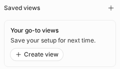
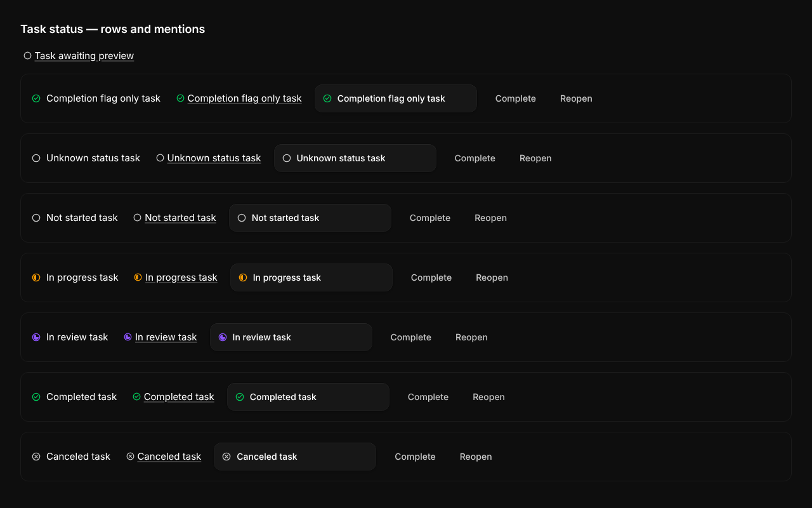
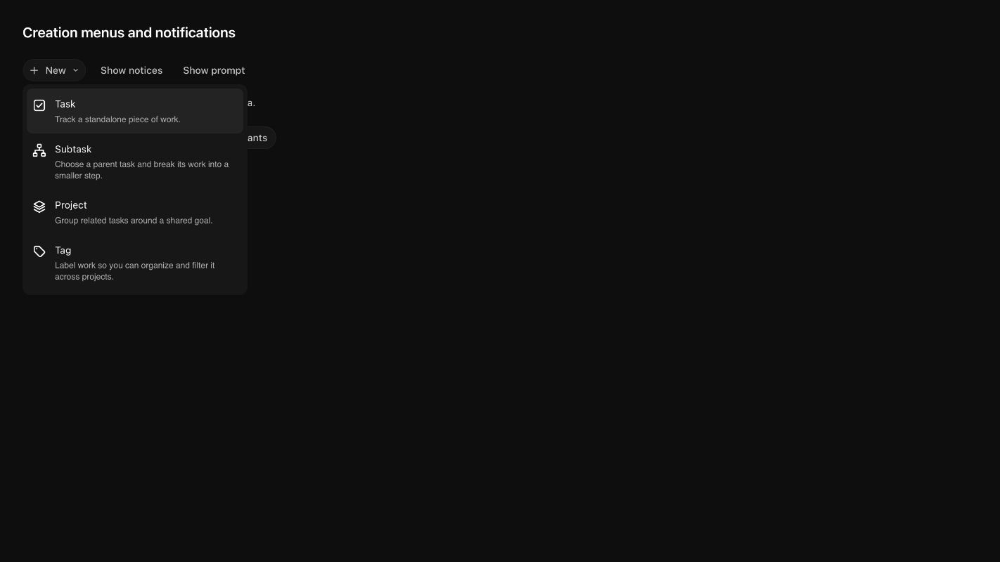

# Tasks

## Surface

`Go to Tasks` → `/app/component/tasks`. Task views: `My tasks`, `All tasks`, and `Created by me`.
The single-row desktop header contains the title, `Filter`, a separate
`Task layout` single-select icon group for `List`, `Board`, and enabled `Gantt`,
`Sort`, `Group`, `New`, and an expandable Search icon
(`Ctrl+F` opens it). The active-filter count sits beside the filter icon inside
its button, without overlapping the icon or the group border;
the filter uses the legacy compact option rows and searchable Assignee, Created by,
and Tags submenus. They use the [shared multiselect dropdown pattern](ui-conventions.md#multiselect-dropdowns):
checkboxes toggle and stay open, rows add and close, and Shift/Only selects just
one option and stays open. Escape dismisses the menu.
The top of the `Filter` menu is a `Filter with AI…` textbox, focused when the menu opens: type a plain-English
description such as `urgent and high priority tasks that are not completed` and press
Enter. It replaces the current selection with the matching Status, Priority, Assignee,
Created by, and Tags options (exclusions on Status/Priority become the complementary
options; subject matter such as `about billing` lands in the search box), then closes
the menu. Requests that only partly map keep the menu open and show a muted note
under the box; requests that map to nothing (excluding a tag, an unknown person,
off-topic text) keep the typed text and show a red error there instead. The box keeps
focus while you type even if the pointer drifts over the rows; ArrowDown moves into
the rows and hovering a submenu hands focus to it as usual. The mobile drawer has no
AI box.
The desktop sidebar's Search icon, immediately left of collapse, opens the
search field above New. It shares the current Tasks or Projects list query.
The desktop sidebar and toolbar `New` menus offer `Task`, `Subtask`, `Project` (when
Projects is enabled), and `Tag`. Task and Project open their existing composers;
Tag opens the tag editor, with personal scope selected and team sharing available
when the user has a team. The Projects list uses the same menu. Mobile creation
controls are unchanged. With Projects enabled, the collapsible `Projects` section
appears above `Saved views`. It contains `My projects` (assigned to the viewer),
`All projects` (all accessible projects), and `Created by me` (owned by the viewer).
These replace the old Projects tab and individual-project shortcut list. The plus
beside the section opens the project composer even while collapsed.
On mobile, one `Projects` pill opens a drawer with the same three views; the
active pill shows the selected view's name. Selecting a task or saved view clears
the project pill's active state. Project scoping applies before pagination and
cannot be removed by clearing editable filters. Opening a project and returning
through its breadcrumb retains the selected project view.
Cached project rows remain available through offline/background refresh failures.
Cache misses, server/permission errors, and failed continuation requests retain
failure and retry controls.
Opening a project shows a content-shaped skeleton while its data loads: title,
wrapping property pills, description, and discussion for Overview; toolbar and
rows for Tasks. The mobile skeleton uses the same compact insets as the content.
The description has its own subtle three-line skeleton while its collaborative
editor initializes; the project title, properties, and discussion stay visible.
Task lists, including project and CRM task lists, load a group's next page when
the end of that group scrolls into view, with a spinner row instead of a
`Load More` button. A failed
page shows `Retry` in that row and stops automatic requests for the group.
ArrowDown waits on a group's last loaded task until the next page arrives; after
a failure it continues into the next group. Collapsed groups load nothing. A page
that arrives after you scroll past its group must not move the rows on screen.
With GraphQL Soup enabled, verify a group with more than one page in both the
regular Tasks list and a project task list (scroll and ArrowDown). Both must use
the parent Soup query's continuation owner; reaching
the last page removes the group's paging row without hiding already loaded tasks.
Refresh a group containing at least 11 tasks while delaying its continuation
response: every already loaded continuation row should stay mounted, with no
brief collapse to the first 10 rows. Verify both background and explicit refresh,
including a changed cursor and a failed later page. Retrying should replace the
old pages; changing projects or filters must discard the old scope immediately.
The sidebar has no Tags section: filter by tag from the `Tags` group of the `Filter` menu,
and switching tabs clears it like any other filter. On mobile, the tabs
are pills and the leading sliders button opens one drawer containing Sort, Group, and
Filters (including Tags). The mobile bottom dock has **+ Task** and Search,
with no floating Ask AI input.
Mobile does not show the separate layout, sort, group, and filter toolbar.
Use the compact sliders drawer for task-list controls; project task lists use the
same drawer. Mobile supports List only. Opening a Board or Gantt link, or
restoring either layout, automatically selects List and replaces that host's
layout URL parameter without adding history or clearing search, sorting,
grouping, or filters. Desktop supports List and Board, plus Gantt when the
PostHog `enable-gantt` flag is enabled, or when running the local hot-reload
preview. This flag also gates project-task and Projects collection timelines. When the flag is disabled or still loading,
saved Gantt layouts and Gantt URLs render List without clearing the selected
layout, so enabling the flag restores Gantt. The local override is
`VITE_ENABLE_GANTT=true` (or `false` to force it off).

**Keyboard:** **H** and **←** collapse the focused item or its parent group.
On a focused group header, **H** collapses only that group; pressing it again
does nothing. Typing H in a text field remains ordinary input.

New accounts are seeded with three sample tasks (`Intro to tasks`, `Advanced task features`,
`How we use tasks at Macro`).

The Project column shows the linked project's name when one project is assigned,
and `Project` when empty. Multiple linked projects show an item count.
Long assignee and project names truncate within their columns; hover the cell
to read the full value.
The project pill beneath a task title shows the project icon and name without
a `Project:` prefix.

Click a task row or favorite to replace the list with the editable task document. Its top
bar shows the originating task tab as a text-only return breadcrumb,
followed by the task name and actions, Share, and the Details/Properties side-panel
toggle. The return label matches the task title's font weight in both wide and narrow
layouts. Narrow splits also show a close button when multiple splits are open. Choose
the originating tab breadcrumb, a task tab, or a tag to return to the list.
Shift-click a row or favorite to open it in a new split
instead. Keyboard list navigation only moves focus; press Enter to open the focused task.

In the task's Properties side panel, hover or focus a row for **Pin below title**
or **Unpin from title**. Pinning adds the property to the title row; unpinning keeps
its saved value and the side-panel row. The title pill's hover card also offers
**Unpin** as a filled icon-only button with a gap: beside the value in a row,
or beside the key above a full-width divider in a column.
Status, Priority, and Assignees are pinned by default, with Project when
enabled. Unpinning a default preserves the other pins, and clearing all pins stays
cleared after reopening. The empty Project placeholder can also be pinned or
unpinned without creating an assignment; its pin follows the real assignment when
one is saved. Builtin task properties cannot be deleted from the title or side panel.

Property edits should update the visible task before the save finishes. To verify,
delay the GraphQL mutation and change Status, an existing Priority, and an unset
Priority in the list and task detail. In a view grouped by that property, the task
should move groups and update both counts immediately. Reject a save to check that
the value, group membership, and counts all roll back without refreshing the page.

For tags, include a task with no prior tag assignment. Delay
`UpdateEntityPropertyOptions` and the following `EntityProperties` query: the tag
should appear immediately and stay visible through both responses in the list,
task header, side panel, and a reopened picker. A rejected save should remove only
the optimistic tag. Repeat with an existing assignment and with removal.

## Saved views

Saved views are available on main Tasks, not inside Project or CRM task lists.

- Desktop: use the **Saved views** sidebar section. Its icon-only **+** remains available when the section is empty, populated, collapsed, loading, or in an error state. Enter on the focused **+** starts a draft instead of opening the selected task.
- Mobile: the **Saved views** pill sits after **Filters** and before the built-in task tabs, using the same mobile pill component. It shows the selected view's name and active styling, and opens a drawer of saved-view rows with selection and management menus, without a duplicate section heading or a header create button. Create views from changed filters, layout, grouping, or sort in the filter drawer.
- The empty sidebar and mobile picker show **Your go-to views**, the muted description **Save your setup for next time.**, and a secondary **Create view** button with a leading plus icon in a rounded container with a subtle border, 12px padding, the surrounding background, and no shadow or illustration. It starts the same unsaved draft as desktop **+**; on mobile, the picker closes first. Configure the draft in Filters, then choose **Save view**.
- Desktop **+** starts an unsaved view without person restrictions and with explicit open-status filters. It expands the section and adds a selected, italic **New view** row labeled **Draft** in the sidebar and mobile picker. Configure filters, then choose **Save view**; the name defaults to **New view** and can be edited before saving. A confirmed save replaces the draft with the named view; **Cancel** in the desktop toolbar or mobile filter drawer, another selection, or leaving Tasks removes the unsaved row. Canceling only the name dialog keeps the draft for later.
- Desktop **Save view** and draft **Cancel** are separate standalone buttons with a gap, not segments of a button group.
- When filters, layout, grouping, or sort differ from the built-in tab defaults, the filled **Save view** button appears immediately left of Filters on desktop and in an edge-to-edge mobile banner above the filter drawer footer. The borderless banner overlays content on a drawer-colored backing and has a leading bookmark icon on its button. Base settings and search alone do not show the banner. It captures current filters, layout, grouping, and ordered sort directions, but excludes text search and scroll state. My Tasks adds **Me** to Assignee; Created by me adds it to Created by. Additional people in the same filter use OR matching.
- Saved views use the normal Assignee and Created by filters, not a separate Scope control. **Me** stays relative; its tooltip says “Matches whoever opens this saved view.” A named person stays fixed. Removing Me removes that restriction.
- Temporary filter, layout, grouping, or sort edits show a filled **Save changes** button and **Reset**. Opening or resetting a saved view restores all four. Mobile still displays a list without replacing the stored desktop layout. Right-click a sidebar view or use its **…** button for **Edit**, **Duplicate**, **Copy link**, and confirmed **Delete view**. On desktop, the selected view's topbar shows a bookmark icon before its name and an unframed ghost overflow button immediately after it. On mobile, the picker shows the name and contains row menus; creation and draft cancellation appear in the filter drawer's overlay banner above the footer; Save changes and Reset sit on the footer's right, opposite Clear all, not below the tabs. Non-owners cannot rename, share, overwrite, or delete a shared view.
- **Edit** opens the shared create/edit dialog with the saved name and team-sharing checkbox prefilled, without saving temporary filter, layout, grouping, or sort changes. Edit and delete dialog titles identify the saved view by name and wrap long names. Both create and edit modes use a 600px-wide dialog that stays within narrow viewports. **Duplicate** opens a private copy with a prefilled “(copy)” name; duplicating the selected view includes its temporary settings. If the original has unsupported or invalid settings, the dialog warns that the copy omits them and leaves the original unchanged. Sidebar actions on another view do not change the current selection unless a duplicate is saved.
- The optional **Share with team** checkbox shares only the view definition. Its adjacent info icon shows the explanation on hover; click, tap, or keyboard activation opens it without changing the checkbox. Each teammate still sees only permitted items. Both the owner and viewer must currently belong to that team; leaving disables access and rejoining restores it.
- Leaving the view or opening task detail discards temporary edits. The return breadcrumb retains the saved-view identity and reloads its saved filters, layout, grouping, and sort.
- An unavailable or deleted view shows an explicit unavailable state, not All Tasks under the old name. Unsupported or malformed filters are skipped while supported filters apply immediately. A danger-colored banner above the results names affected filters or view settings without an extra description. If no filters apply, the list shows all permitted tasks, including closed tasks. Loading never changes the saved definition. Unknown tag/person labels retain their filters until deliberately removed. Ordinary **Save changes** is disabled until the app understands every setting or the owner explicitly removes unsupported settings; Edit remains available.
- Owners can choose **Remove & save** at the right edge of that banner. It removes only skipped settings from the stored definition, preserves supported filters, layout, grouping, sort, and sharing, and leaves temporary edits unsaved. The banner disappears only after a confirmed save; failures retain it for retry, and revision conflicts offer **Reload saved view**.
- A conflicting save retains the draft and offers **Reload saved view** or **Duplicate**. A network failure also retains the name and sharing inputs.
- Copy links use the existing split search codec, for example `/app/component/tasks?s0.tasks.savedView=<uuid>`.

Verify creation without early persistence, explicit save/reset, copy versus owner-only editing, desktop/mobile metadata dialogs, and returning from task detail. Repeat with another teammate, a removed/rejoined owner, an unavailable tag, and a stale revision.

Exercise these flows at desktop, phone, and tablet widths. Verify the mobile pill strip reserves its full height without overlapping task content, including after scrolling and returning from a drawer. Check that the mobile creation banner stays above the footer while filters scroll behind it and that the final filter controls can scroll clear of the banner. Verify it appears for changes to filters, layout, grouping, or sort and disappears when all four match the built-in tab defaults. Check keyboard navigation inside the mobile picker and focus after opening and closing Edit, Duplicate, or Delete. These focused dialogs use the shared imperative dialog host and must close when their owning account or view changes; the picker closes before a management dialog opens. Saving from the filter drawer closes it before opening the name dialog; Cancel or Escape reopens the unchanged filter draft, while a confirmed creation selects the new view without reopening the drawer. Delay a save while navigating or editing filters, and delay a deletion while selecting its target: stale saves must not change the new selection, later filter edits must survive, and confirmed deletion must clear its selected target.
Also return a malformed definition from create or from another row's update: the selected view must remain accessible. Advance the selected view's revision while a duplicate saves; completion must not navigate away. Ordinary creation retains current facets even if its confirmed definition differs.
Verify mixed supported and invalid entries, unsupported fields, conflicting tag bindings, and an unknown version. Supported conditions must immediately filter results while the danger banner stays visible. If none apply, verify unfiltered tasks, including closed tasks. Confirm the saved definition is unchanged on load, reset, and navigation, and permission failures still show an unavailable state without querying tasks.
Verify banner cleanup on desktop and mobile, including an entirely unsupported definition. Confirm that only owners see the action, temporary filter edits stay unsaved, sharing stays unchanged, and failed or conflicting writes retain the original definition and warning.
Verify layout-only, grouping-only, and sort-only save/reset, duplicate and reload, sort direction, mobile list fallback without overwriting a saved board/Gantt layout, and delayed saves while presentation changes. Older views without grouping default to Priority. A future filter, layout, grouping, sort, or version must warn and block ordinary Save changes without altering the original; explicit cleanup remains available.

## Gantt layout

Choose **Gantt** in the **Task layout** group to see task timelines.
The same option is available in a project's Tasks section. The timeline uses
Created at as the start and Due date as the end; no separate Start date is
created or saved. Bars without a due date fade to transparent at the right edge.
The fade affects only the bar fill; labels remain visible.
Their displayed tail is a visual placeholder, not a saved deadline. Invalid or
missing start dates and due dates before creation are identified rather than
silently displayed as valid intervals.
The calendar fills the available pane width and height, including empty space
below loaded rows. Zooming, pane resizing, and loading earlier items preserve the
visible calendar position. On first load, the chart centers on today after its
viewport is measurable. Refetches and later resizes do not reset the scroll.
Bars use the app's neutral depth-two surface without an outline, with a small
status-colored indicator. In light mode, bars have a stronger solid neutral fill,
and item panels have a subtle neutral fill and clearer border.
Dark-mode base surfaces stay unchanged. Active items due within seven calendar
days use a danger-color background gradient at the due-date edge, blending into
the neutral fill toward the left and strengthening as the deadline approaches.
Due-today and overdue items use the strongest tint; completed, canceled, and
undated items stay neutral.
Deadline tints and the Today marker refresh at local midnight and when a tab
becomes visible or focused again.
The tint only appears when the actual end is inside the calendar range.
Bar text stays inside the visible portion of its bar as you scroll, zoom, or
open the item drawer, and truncates in narrow segments.
The full-width date header stays visible during vertical scrolling; the pointer's
date label stays in that header, and the vertical scrollbar begins below it.
Timeline-edge fades stay within the date header, beneath its floating buttons.
Fades start at the calendar edges, span up to 128px, and shrink in narrow calendars.
The floating item list uses separate rounded, bordered, low-contrast panels for
consecutive groups. Items clip inside their panels and use the same height and
padding as bars, with transparent backgrounds and hover-only highlighting.
Group headers match the normal list's rounded surfaces, status tints, disclosure
controls, and count pills.
The list starts expanded in wide panes and collapses automatically below 640px
until you explicitly choose open or closed. That choice stays in effect across
pane resizes while the chart is mounted. Use the top-left toggle to change it.
The drawer slides in and out, respecting reduced motion, and shares vertical
scrolling with the bars without shifting dates or reserving calendar width.
Clicking or focusing the calendar keeps the list open.
Escape or the toggle closes it; focus returns to the toggle when closing a focused
item. Closed drawer items are not focusable.
Task and project context menus remain available on drawer items. **Today** and
timeline settings are separate floating buttons at the top right.
Hold **Ctrl** or **Cmd** and scroll to zoom between 4 and 80 pixels per day, keeping the date
under the pointer in place. Hold the middle mouse button and drag to pan both axes,
including from bars or item panels, without changing dates or grouping properties.
Release the button, press Escape, or move focus away from the window to stop panning.
Ordinary scrolling is unchanged. Period presets in the settings menu also set zoom;
calendar labels adapt to the zoom level.
Floating controls at the chart's bottom right zoom out/in around the visible
calendar's center. The percentage/reset button stays visible; adjacent minus/plus
buttons sit to its left and appear on hover, keyboard focus, or during Ctrl/Cmd scroll zoom.
Minus/plus controls have no invisible hit area while auto-hidden; when revealed,
they remain visible but disabled at zoom limits or during edits.
The reset/value button matches the zoom buttons' height and has a fixed width
for the full percentage range. Click it to reset to 100%; the same zoom limits apply.
Controls stay fixed during scrolling and are disabled during date drags.

**Today** smoothly centers the current day, except when reduced motion is enabled;
initial centering is immediate. Its line extends into the calendar header, stays
behind bars, and clips outside the left item panels, including their gaps and
rounded corners, until the drawer finishes sliding closed. Only items and bars
have hover feedback, not full calendar rows.
The settings menu
changes the displayed period (Day, Week, Month), toggles calendar lines, and
changes their spacing (Daily, Weekly, Monthly) and
style (Solid, Dashed). Grid settings do not change item dates. Compact bold month
names share the main date band and switch from abbreviated names at Month zoom
to full names at Week/Day zoom. The pinned month always includes its year; other
months show the year after January only, when a new year starts. Unpinned month
text is centered on its date mark; a trailing year does not shift that center.
Short, higher-contrast date marks stay anchored to their calendar dates, even
when month text hides an overlapping day number. Marks do not move with the sticky month
labels, so daily gaps stay equal across month boundaries. Month/year labels fade
as the next month pushes them toward the left edge, before the expand/collapse
button.
Week-scale date marks divide each month into four near-even calendar-day sections,
not Monday-based weeks. Weekly grid lines use the same sections. Day spacing and
month widths still follow the real calendar, including leap-year February.
Labels remain visible during horizontal scrolling,
and the date header remains visible during vertical scrolling. The calendar
extends as you approach either horizontal edge, even during continuous scrolling.
Left-edge rebasing preserves the current visible date immediately; right-edge
extension does not write the scroll position. Click a task label or bar to open
the task; right-click either for the same actions as its list item.

Timeline dates are read-only: bars have no resize handles or end-date editing.
Created at stays fixed, and moving a bar between groups does not shift its dates.

When grouped by Status, Priority, Assignee, or Project, drag a task's list item or
bar into another visible group to change that property. Projects support Status,
Priority, and Assignee moves. Move at least 10px to start a drag; ordinary clicks
still open items. The drag overlay snapshots the visible item or bar; the original
placement dims, and a dashed ghost reserves the destination's sorted row. Drag
sources stay mounted during virtual scrolling and immutable row updates.
If the item already belongs to the destination assignee group, its existing row
becomes the ghost instead of creating a duplicate. Drop on a group's header
(including collapsed groups) or its rows. The active sort determines the resulting order; same-group reordering is
not supported. Assignee moves replace only the source assignee and preserve other
assignments. Unassigned accepts only a sole-assignee item; mixed-assignee drops
are rejected so they cannot clear other assignments. Creation-date grouping
and ungrouped views do not accept group moves. Membership and destination checks
run again on release. Escape cancels, failed saves show an error, and neither
Created at nor Due date changes during a group move. Active filters still apply.
Task group moves follow the task list's editing policy: no task or destination
permission prefetch is required before attempting a save. The backend authorizes
property writes; rejected saves roll back, show an error, and release the task lock.
Project Gantt also shows empty Status/Priority destinations from property options,
Unassigned when allowed, and assignees already seen in the current collection
scope. An emptied assignee group remains available for another drop. The ordinary
project list still shows only its loaded groups.

Drag horizontally across empty calendar space to open the task composer with
Due date prefilled and visible. Past dates and permission-disabled creation remain
unavailable, without a diagonal-line pattern.
This works with no loaded rows too. Release opens the composer rather than
immediately creating a task; Escape cancels the selection.
In a project's Tasks section, creation preserves that project and its edit gate.
The Projects collection offers the same interaction with the project composer.
There is no Start date property, so the selection sets only Due date; Created at
remains automatic. New selections begin today or later, so creation never produces
an end before Created at. Existing overdue items remain unchanged.

The timeline reuses the list's filtered, sorted, grouped rows and collapsed
state. Sidebar items fill the list's inset width and share vertical scrolling with
bars. Compact group headers show the grouping's icon and span both the list and
calendar; they remain visible when the list is collapsed.
A continuation row loads the next page when it scrolls near the visible rows,
showing a spinner in the item list and at the visible calendar's left edge
outside the open list, even after horizontal panning. A failed page shows
**Retry loading tasks** there instead. Group continuations stay after their
group; the global continuation appears once after the loaded rows. As in the
list, a page that lands above the visible rows keeps them in place. Continuation
rows and group headers do not start range creation.
The chart contains loaded results, not an implied complete schedule. Selecting
Gantt persists in `tasks.layout` or `projectTasks.layout`, just like List and Board.

## Board layout

Choose **Board** in the **Task layout** group in the toolbar
(or **List** to switch back). One icon is selected at a time; hover or focus shows
its label. **Group by**
offers Status, Priority, Assignee, and (when Projects is enabled) Project.
Both layouts share one grouping, which restores with the Tasks navigation entry.
List-only None and Date groupings display Status columns in Board; switching
back to List retains those selections and collapsed groups until grouping changes.

Each column header has an icon-only **Add task** plus button. It opens the task
composer with that column's Status, Priority, Assignee, or Project preselected,
while preserving the originating pane's other creation presets. **Unassigned**
and **No priority** start with that property empty. **No project** starts empty
outside project boards; project boards always retain the current project.
**No status** starts with **Not started**, because new tasks require a status.
Each pane or project scope and column keeps a separate composer draft. Project
boards hide creation actions when the project is read-only.

Click a card's body or title to open the task. Right-click a card, or press
Shift+F10 on its focused title, for the List row's task menu; it acts on that
card alone, since the board has no selection. Right presses never start or
redirect a drag. Move at least 10 pixels with the primary
mouse button held to start dragging to another column; holding still does not
start a drag. Property pills remain interactive and do not start a drag.
A new destination column highlights once movement slows
or pauses for about 100 ms. Fast travel suppresses activation of new columns.
A valid hover shows **Board sorted by Updated**, **Created**, or **Viewed**
using the active sort label. The drop does not choose a pointer insertion slot:
its card takes its place in the current sort (or search relevance order).
Same-column moves and column reordering remain disabled.
Layout, primary sort, sort direction, and grouping are reflected in `tasks.layout`,
`tasks.sort`, `tasks.sortReversed`, and `tasks.groupBy` search parameters.
Explicit URL values override saved preferences; back/forward navigation
restores the corresponding controls, including the layout.
Columns are 336px wide. Each column loads its next page when the end of its cards
scrolls into view; a failed page shows **Retry** at the bottom of that column.
Ungrouped results, such as a search, load their next page from the end of any
column.
Use the horizontal scrollbar to reach more columns. Vertical wheel input over
empty board background or gaps also scrolls horizontally. A wheel gesture stays
with its original scroll area until momentum stops, even if another column moves
under the pointer. A new gesture inside an overflowing column scrolls vertically.
Each column has its own vertical scrollbar when its cards overflow, while keeping
its heading visible. Lane scrollbars appear while hovering the lane or scroll track
and hide 200 ms after leaving. Off-hover momentum does not reveal them; focus and
active scrollbar dragging retain visibility.
Normal columns fit their content up to the viewport height; only the hidden-column
summary fills the height. Both columns and cards are virtualized, so offscreen
content is not all present in the DOM. A column's vertical position restores when
scrolling away and back. The active drag source
stays mounted while scrolling to a destination.
While dragging, hold the card near a column's top or bottom edge to scroll its
cards vertically. Hold near the board's left or right edge to scroll horizontally;
moving beyond that edge keeps scrolling until release or cancellation. Valid drops
still require the pointer to be inside a visible destination column.

Column titles use status/priority icons, assignee avatars, or the project icon.
Active filters also restrict columns: excluded values do not remain as empty
boards. Allowed Status and Priority values retain empty destinations. Assignee
and Project columns come from matching task groups; there is no extra-column
selector. When filters hide known columns, a full-height dashed summary appears
at the end. A filter illustration, count, and outline **Reveal hidden columns**
button stay near the top of that column.
Status and Priority show **N hidden**. Assignee and Project show **N+ hidden**:
these lower bounds count known groups, not every group excluded by server filters.
**Reveal hidden columns** clears only the current grouping's filter;
other filters, the current tab, and search stay active. The dashed column is not
a drop target.

An icon-only status pill appears before the task title, and an icon-only assignee
pill appears to its right in every grouping. The lower row omits status, assignee,
and the grouping property. The remaining properties use standard pill controls
and icons. Priority uses a compact icon-only pill; due date and project appear
when set. Metadata properties stay read-only, and pending writes disable editing.
A task assigned to multiple people appears in each person's column. Moving it
from Alice to Bob replaces Alice while keeping the other assignees. Moving to
**Unassigned** clears all assignees. Project moves change the task's Project
property (an initiative), never its legacy folder.

Task moves and property pills follow the list's editing policy without permission
prefetches. Property definitions and valid destinations must still be available.
A pending move disables further moves of the same task in every column;
failed writes use the shared property mutation's rollback and show an error.
A valid destination highlights and shows the sort overlay only while dragging
inside that column, not in gaps or outside the board. Drops move the card
immediately while the save is pending; failures restore its prior membership.
After a successful save, the board scrolls only as needed to reveal the destination
card, including virtualized columns and rows; already visible cards stay in place.
It does not scroll after a cancelled or failed drop, or when the current board
scope changes during the save. Successful moves show no notification.
A cross-column drop settles one opaque visual copy from the card's release position
into its sorted destination; the real card appears when the copy lands. The release
snapshot survives source unmounting after edge scrolling. Sorting updates retarget
an in-flight copy without restarting from the source column.
Visible placements animate during moves and rollback without animating ordinary
scrolling or paging. In Assignee grouping, moving to an already assigned person
reveals the existing card rather than creating a duplicate.
Reduced-motion preferences disable these transitions.
Filters remain active: completing a task or removing yourself as assignee can
hide the card from the current view. Click its title to open the task; modified
clicks can open a separate split.

Due-date columns and priority/due-date sorting are not in this version.
The shared board primitives remain independent of Tasks queries and mutations.

## Cached grouped lists

Project grouping in the task list matches the Project column: tasks group by
their initiative Project property, with unassigned tasks under **No Project**.
Legacy folder membership does not affect these groups. Projects sort by name with
**No Project** last. Headers show the name the server labels the group with; a
group still labeled by its key resolves the name through the same authorized
identity query as the Project column. Verify two
projects and an unassigned task on desktop and mobile; changing or clearing a
task’s Project must move it to the matching group without reloading.

The synthetic project-grouping browser regression uses the production grouping
logic and group headers, with HTTP replaced. Run from `apps/web`:
`bunx playwright test --config src/features/tasks-view/browser-test/playwright.config.ts project-grouping.browser.e2e.ts`.

With GraphQL caching enabled, previously loaded grouped task lists remain usable
when their background refresh fails without an HTTP response. Load a Priority-grouped
view online, navigate away, then reopen it offline. Repeat by holding its GroupSoup
request: cached rows should appear before the response, and rejecting that request
must not replace them with **Tasks couldn’t be loaded**. A cached empty result is
also usable. An initial cache miss still shows failure; HTTP and GraphQL errors
remain visible even with cached rows. Change filters while retaining prior rows:
those older results must not hide a failure for the new, uncached query.

## Reviews view

With `enable-tasks-reviews` enabled (on by default in development),
`Reviews` is available in desktop navigation and the mobile bottom dock's
`More views` drawer (or directly in the dock after Customize dock), not the mobile Tasks tabs.
It opens a separate `/app/reviews` shell whose sidebar lists `Pull requests`,
`Authored by me`, `Assigned to me`, `Involves me`, and `Review requests`;
`Involves me` is selected by default. The selected tab is stored in the URL and
survives opening a PR and returning through the breadcrumb.
The list contains accessible GitHub pull requests of any status. `Involves me`
uses the server's participant filter for your linked GitHub account: author,
requested reviewer, assignee, commenter, or reviewer. Participant IDs are retained
across partial GitHub refreshes, so this is not strictly a list of current
review requests.
`Authored by me`, `Assigned to me`, and `Review requests` match the linked
GitHub user ID. If the link-status endpoint has no identity, the list explains
why the tab is unavailable.
The sidebar offers **Search reviews** above its navigation. On desktop the
**List**/**Board** icon group lives in the header; List is the default and the
choice is remembered. The desktop header always offers an expandable Search icon; Command-F expands and
focuses it. The single row contains the selected scope, status tabs, grouped
filter and sort controls, New, and Search. Active-filter counts sit beside the
filter icon inside its button. A separate
**Open** / **Closed** / **All** toggle with icons (`aria-label="Pull request
status"`) picks the status in the desktop header and above the list on touch
devices, and the board hides it. The desktop sidebar has no layout or status
switches. Status tabs size to their labels with even horizontal padding and use
the shared fully rounded segmented style. Open is the default; Closed includes
both closed and merged PRs, and All shows every status. The filter dropdown and mobile drawer also
offer independent Open, Closed, and Merged selections. Custom multi-status
selections hide the toggle, except the combined Closed preset keeps it visible.
A partial Closed-only or Merged-only selection leaves every option unhighlighted.
Status combines with other filters, counts toward filter badges, and applies
before pagination. Clearing filters resets to Open. Other filters cover
priority, linked work, started from, repository, author, assignee, label, and,
when a GitHub identity is linked, reviews (Reviewed by you, Not reviewed by you,
and Awaiting review from you). The selected scope remains in the desktop header
when the sidebar is collapsed; there is no separate title or search row.
Saved review selections stay inactive, including their filter badge and empty-state
copy, while the GitHub identity is unavailable; they resume when it returns.
Sort offers Priority, Recently updated, Least recently updated, Newest, and Oldest;
Priority orders the loaded rows most urgent first and keeps recency within a
priority. Date sorts group rows under the same headings as email (Today,
Yesterday, Last 7 days, Earlier this month, Last month, Older) by the sorted
date; Priority sorts and searches list rows flat. When visible PRs
have GitHub labels, a Labels section below Favorites lists them like email's
Tags section (a colored dot and the name); choosing a label shows only PRs with
it, and choosing it again clears it. Above it, an **Agents** section lists the
tools the loaded PRs were started from (Claude, Codex, Cursor, and so on, with
their marks); choosing one shows only PRs started from it, using the same
**Started from** filter as the filter menu. PR rows use the shared entity layout with selection checkboxes,
author avatars and names, and a context menu. The current user's Macro display
name appears when their linked GitHub identity matches the PR author; other
authors fall back to GitHub names. The virtualized list fetches more pages as
you scroll, including when local filtering removes most fetched rows.
Linked agent sessions appear alongside the row's other metadata pills and beneath
the PR detail title. Narrow PR rows put wrapping metadata below the title, keeping
session chips visible without squeezing the title. One session shows its name with the agent sparkle icon;
multiple sessions show a count chip that opens a list of names. Selecting a name
opens that session; Shift-click on the single-session chip opens another split.
Chip clicks do not open or select the containing PR row. Empty results have no
chip, and loading, private, deleted, or unavailable sessions never offer navigation.
The PR's status pill stays passive; status filtering lives in the Reviews list tabs.

Each PR row shows what it links to. A priority icon before the title comes from
the most urgent open linked task (a closed task counts only when none is open),
otherwise from a GitHub priority label (`P0`–`P3`, `priority: high`, `urgent`,
`critical`); the tooltip names its source. Row pills use the email tag style
(neutral outline; GitHub labels show a colored dot and name). After the title
they show where the PR was started, the **channel messages** its agents were
started from (for example an @mention), **Customer**s (CRM companies in linked
tasks' Companies property, or a company whose thread started a session),
**Ticket**s (tasks the PR text, branch, or comments mention as `MACRO-<id>`, and
tasks whose thread started a session), the GitHub labels, the author, the diff
size, comments, and the linked agent sessions chip. A channel pill names the
channel; hovering it previews the starting message in the same card as message
mentions, and clicking opens the channel at that message (Shift-click for
another split). Several channel messages stack as overlapping pills that spread
out on hover. Customer and ticket pills with one item open it; with more they
show `+N` and open a list. Items the viewer cannot access are omitted. When the
pills would squeeze the title, they drop their text (keeping icons, dots, and
tooltips) and overlap; they expand again once the row is wide enough. Rows show
a pulsing placeholder while links load. The first pill names where the PR was started
(Claude, Codex, Cursor, Devin, Copilot, Jules, or Macro), including PRs opened
outside Macro: a Macro agent session that opened the PR wins and shows the tool
its harness ran; otherwise a session link in the description (`claude.ai/code/…`,
`chatgpt.com/codex/tasks/…`, `cursor.com/agents…`, `app.devin.ai/sessions/…`,
`jules.google.com/…`, `macro.com/app/agent/…`), then footers such as
"Generated with Claude Code" or a `Co-Authored-By: Claude` trailer, then the
bot author (for example `Copilot` or `devin-ai-integration[bot]`), then the
branch prefix (`claude/`, `codex/`, `cursor/`, `devin/`, `copilot/`, `jules-`).
Its tooltip names the signal; clicking it opens the Macro session in a split or
the external session in a new tab. Filters add **Priority** (including No
priority), **Linked to** (an agent session, a ticket, a customer, a channel),
and **Started from** (each tool, or Unknown); these run on the loaded rows,
which wait for their links before matching. The PR side panel's **Linked work**
section shows the same origin under **Started from**, plus the priority,
tickets, customers, and channels.

**Board** lays the scope's open and merged PRs (status filter and tabs give
way to the board) out in columns: **Draft**, **In review** (checks running or
none), **Checks failing**, **Conflicts** (GitHub reports the branch conflicting
with its base; read live for the open PRs on the board), **Ready to merge**
(every check passed), and **Merged**. Cards show the status icon, priority,
title, checks, `owner/repo#N`, author, link pills, labels, and agent sessions;
clicking a card opens the PR. Right-clicking a card, or Shift+F10 on its focused
title, opens the list row's context menu. Dragging asks GitHub for the change as you: drop
on **Merged** (from In review or Ready to merge) to merge after the same
confirmation as the PR's Merge button; drop on **Draft** to convert any open PR
to a draft; drop a draft on **In review** to mark it ready for review. Checks
failing, Conflicts, and Ready to merge take no drops, and merged cards cannot be
dragged. A refusal shows GitHub's message and the card returns. **Load more pull
requests** fetches the next page.

Pull requests can no longer be favorited. PRs favorited earlier still appear in
a collapsible Favorites section below the views (hidden when there are none).
Favorite rows open the PR in Reviews (Shift-click opens another split), and their
context menu can remove the favorite. PR favorites also open in Reviews from the
global Favorites sidebar or command menu. A PR row's context menu offers **Open
in new split**, **Copy Link**, and **Open on GitHub**.

Select a PR to open `/app/reviews/pr/<foreignEntityId>` in the Reviews shell.
Opening a PR refreshes it from GitHub in the background for viewers with a
linked GitHub account, so labels, reviewers, and review state catch up without
waiting for GitHub's next webhook. A successful refresh also reloads the Changes
summary, so new commits replace the previous diff range.
Its breadcrumb returns to the Reviews list. Old `/app/pr/<id>` links redirect
to the Reviews detail. When the flag is off, the Reviews shortcut is hidden and
opening `/app/reviews` redirects to `/app/tasks` after flags load. Copied PR
detail links still work; check both URLs with the flag off.

The PR header has a **Changes** toggle (`aria-pressed`) with the diff's `+N −M`
at the PR's current base and head. It opens the same resizable Changes pane as
an agent session (see "Reviewing a linked GitHub pull request" in
[AI chat](ai-chat.md)) beside the PR, read-only: there is no review-note gutter,
notes chip, or hand-off card. The PR's split stores the pane in
`s<N>.changes.pane` and `s<N>.changes.style`, the same as a session, until you
leave the PR or close its split. The first view of a base and head reads GitHub; later
views, and agent sessions linked to the same PR, reuse the stored diff. An
unavailable or oversized PR is explained in the pane.

The Agent sessions side-panel section distinguishes loading PR details, loading
sessions, failed requests, and an empty result. Failed session requests offer Retry.
Hover a truncated session name to see its full name.

Check all five tab URLs, the Labels section, author avatars and display names, row selection and
context menu, favorites add/remove and collapse/empty visibility, filters, sort,
illustrated empty states, loading, errors, and pagination after filtering. Use
Open in new split from a PR row's context menu; verify the Reviews list stays in
the original split and the PR appears beside it. Open a favorite from the global
sidebar, return through the breadcrumb, and open a copied link in a second split.
Open a PR's Changes pane; check the file tree, a file's diff, **Unified / Split**,
refresh after new commits, and that reloading with `s<N>.changes.pane` in the URL
restores the pane. Check session loading/error/empty copy and full-name tooltips.
Check both status tabs and the menu's individual statuses. Confirm Closed includes
merged PRs, custom multi-status choices hide the tabs, and Clear filters returns
to Open. Combine status with a repository filter while loading another page.
Repeat on touch. Check the tabs follow search and filters, and that the topbar
shows Reviews after narrowing or collapsing navigation.
Check zero, one, and multiple linked sessions in PR rows and beneath the detail
title, including keyboard activation and a long name. Open the count menu, choose
a session, and confirm the PR row was not activated. Check permission-denied and
loading session previews remain disabled.
Use existing PRs and do not modify hosted data.

## Create a task

On touch devices, task creation opens in a bottom sheet with a drag handle and
scrollable, keyboard-aware content. It opens at 70% of the screen, with the
description filling the room above the properties; the keyboard shortens it.
Opening it from `+ Task` or Home's `+ New` raises the keyboard with the title
focused and the caret after any text. Its glass pane has broad screen-scaled
corners, an 8px outer inset, and a blurred backdrop, matching the create and
filter sheets. Its header has `Continue editing in split` on the left and
`Create Task` on the right, with a text-only `Clear` 32px to its left once the
draft has changes, and no close button. When the
keyboard leaves too little room for the whole composer, the header pins to the
top of the sheet (with a solid background only while pinned over content), so
`Create Task` stays in reach. The properties sit on a single line that scrolls
horizontally, with the `Share with <team name>` switch below them. The sheet
has no `Create More` switch and no similar-tasks list. `Create Task` shows no
keyboard shortcut on touch. Assignees, Project, Tags, and Due Date open their
pickers in a full-height sheet stacked over the composer (`PickerSheet`), with
Cancel, the property's name, and Done: picks apply on Done, Cancel or the
backdrop drop them, picking keeps the keyboard up, and a single-choice Project
or a date applies its pick at once. Status and Priority keep their dropdowns,
which leave focus in the title. Tapping a pill doesn't take focus, and closing
a picker sheet returns it to the title or description with its caret, so the
keyboard stays up throughout. Desktop uses
the centered composer dialog. Both layouts are views in
`apps/web/src/features/task-composer/views` composing the shared
`TaskComposer` parts.

After creation, the `Task created` toast shows `Link copied` when copying
succeeds and an `Open` action. Touch devices omit `Open (New Split)`; desktop
keeps both actions. Either action immediately dismisses the toast before opening
the task. Verify the toast at phone and tablet widths with touch
emulation: the message and action fit without clipping, and `Open` visits the
created task in place.

1. Click the `Task` button (or `Create` → `Task T`, or keyboard `c` then `t`).
2. A dialog opens with the title contenteditable focused (placeholder `New task`), plus
   `Add description...`, and property buttons: `Not Started` (status), `Priority`, assignee
   chip (defaults to you), `Due Date`, `Project` (when Projects is enabled; the standard
   property dropdown, listing projects), `Change or select tags`, a desktop-only `Create More` switch,
   and `Create Task Ctrl ↵` (`Create Task` alone on touch). `Attach image or video`
   (paperclip) sits just under the
   description, above the property buttons. If the chosen project can't be
   set, the task is still created and a toast says it wasn't added to the project.
   The `Share with <team name>` switch in the footer's left corner (hidden when you
   aren't on a team) defaults to on and remembers your
   choice in local storage across composer openings and page reloads. Recovered
   submissions use their saved sharing choice without changing this default. Hovering it
   explains whether the task will be visible to your whole team or only to you and
   the people you share it with. The choice also applies to Create More, continuing
   in a split, and tasks created from a project.
3. `type_text` the title, then press **Ctrl+Enter** to create, or tap `Create Task` on
   touch (the button enables once there is a title). Dialog also offers `Continue editing in split` to open the
   task as a full document.

The property row adapts when the launching pane supplies a task-composer preset.
The app shell's creation-context provider snapshots the focused pane's preset
before the composer opens. It reads the layout's existing focus accessor, not a
global context registry; no detail fetch or navigation-state capture is needed.
Without a preset, the standard property row and draft are used. The shared
composer is not feature-flagged. Create-menu actions, shortcuts, and pane buttons
capture the provider during setup and read the preset when invoked.

Customers supplies its preset when PostHog `enable-crm-activity` is enabled:
**Companies** and **Contacts** replace Status in the initial row; Status still
starts as Not Started on the saved task. Record-level task creation prefills the
company or contact, including the contact's company when already loaded. With the
CRM flag off or loading, record-level creation uses the standard property row
while retaining its record-scoped draft and associations. **Add property** opens the same property
editor as the document/task side panel: search by name or type, select a property
and enter its value, or create a property from an unmatched search. Assignments
and values stay in the task draft until creation; opening or closing the editor
preserves other draft values. Tag selection continues through its separate Tags
picker. CRM drafts are isolated from the ordinary task draft and from other CRM
records; reopening restores added properties as well as their values. **Clear Draft**
restores that view's preset.
Later flag, focus or record changes leave the open draft and associations intact,
even between launch and mount. The next opening uses the current context.

Task creation requires a connection. Before any create request, the composer
saves a separate copy of the title, description/editor state, properties, and
sharing choice on this device. Pending submissions do not expire and survive an
app restart. Reopen the same task composer context and choose **Recover: <title>**
to continue an unconfirmed draft; **Clear Draft** (**Clear** on touch) discards that recovered copy.
Explicit logout removes these account-scoped copies. Recovery does not submit
anything automatically: check Tasks before retrying because a lost response may
mean the task already exists. A submission still in flight cannot be recovered
or submitted again. Recovered drafts create one task at a time.

**Create More** keeps newer input separate from its pending submission. A late
success removes only the confirmed submission; failure leaves it recoverable
without replacing newer text. Continuing in a split has the same durable save.
A confirmed create retires its saved copy before history/project follow-up work,
so a failure in that follow-up does not present an already-created task for retry.

Tasks are documents under the hood (creation hits `POST /dss/documents/create_task`), so they
also show up in Files/`All` and in AI-chat document listings.

To bring tasks over from Linear, Jira, Asana, and other apps, use the **Import
tasks** card at the bottom of the Tasks sidebar; see
[Import from connected apps](setup-cards.md#import-from-connected-apps).

## Projects

Projects are enabled by default in development. Production rollout is gated by
PostHog `enable-projects`; `VITE_ENABLE_PROJECTS` overrides either environment.
When off, Tasks hides the Projects section and mobile picker, project column,
and assignment actions. A saved project view temporarily shows My tasks without
overwriting the saved selection.

Choose a view in the `Projects` section in Tasks, or open
`/app/component/tasks-projects` for All projects. Project view links use the Tasks
search namespace: `tasks.tab=my-projects`, `projects`, or `created-projects`.
Desktop project-view titles open the same view switcher as Tasks; individual
project names remain content titles. Mobile keeps the Projects picker.
Projects use the same list rows, property cells, selection, group headers, and
keyboard navigation as Tasks. Search (`Cmd/Ctrl+F`), `Sort projects`,
`Group projects`, and `Filter projects` sit above the list. Groups default to
Status; choose None, Priority, or Assignee to change them. Click a group header
or use the list's disclosure keys to collapse or expand it. Sort by Updated
or Created. Filters include Status, Priority, and Assigned to me;
`Filter due date` provides From and Through bounds and `Clear dates`.
Search and filters apply before pagination. Scrolling or navigating near the
end loads more projects; `Load more projects` also continues the list.
Keyboard movement changes focus; Enter opens the focused project and
Shift-selection opens it in a new split. Folders remain separate in Files.

On desktop, **Project layout** offers **List** and **Gantt**. Gantt shows one
bar per visible project from Created at to Due date, using the same search,
filters, sort, grouping, and pagination as the project list. Click a project
label or bar to open its overview. Right-click either for its project list menu.
The same timeline settings and read-only dates apply as in task Gantt.
**Load more projects** continues the chart.
The selection persists in `projects.layout` and restores with the navigation
entry. Projects without a due date have explicitly open-ended bars. Mobile
continues to render the project list.

Right-click a project row for its context menu; the row takes focus, as in
Tasks. Every project offers `Open in new split` (disabled when no split fits),
`Copy Link` (the Overview link), `Copy ID`, and `Share`, which opens the same
Share menu as the project's top bar. Edit access adds `Rename`, which opens a
name dialog, and the `Set status` and `Set priority` submenus; owners also get
`Delete`, which confirms first and leaves the project's tasks in place.
Right-clicking one of several checked rows acts on the whole selection and
offers only `Set status`, `Set priority`, and, when you own every project,
`Delete`. A partially failed delete keeps only the failed projects in the
dialog for retry. On phones, long-press a row for the same actions in the
bottom action drawer, without `Open in new split` and with each Status and
Priority choice as its own row. Use disposable projects: these actions change
hosted data.

`New project` and the global Create menu's `Project` action (C, then P) open
the same native composer host and layout as task creation,
with a project name, a Markdown description (`Add description...`), and the
shared property pills for Status, Priority, Assignees, and Due date. Team
sharing is enabled by default. As in the task composer, Enter or ArrowDown in
the name moves to the description instead of creating the project; Escape, or
ArrowUp/Shift+Tab at the start of the description, returns to the name. The
description seeds the project's Overview description.
Project Status offers `Not Started`, `In Progress`, and `Completed` in the
composer, list, and detail/side-panel pickers. The Status filter uses the same
three choices. Task statuses are unchanged. Existing project values from the
previous status catalog remain visible until an editor changes them.

Submit with
`Create Project` or Cmd/Ctrl+Enter from the name or description. `Continue
editing in split` preserves the name, description, properties, and sharing choice; `Clear Draft` resets an uncreated draft.
Leaving a property unset keeps its normal server default.
Submitting closes the composer at once; a full composer returns its split to
Projects, and Back skips the submitted composer. One request creates the project
together with its selected properties: a value the server rejects fails the whole
create, so no half-configured project is left behind. When the server answers, a
`Project created` toast offers `Open` and `Open (New Split)` (on touch devices
both open in place); nothing navigates on its own. The Projects list then
refreshes in the background to include the new row. If creation fails, the
composer reopens as a popover with the draft and the error.
Closing the popover without submitting keeps the underlying view open.

Opening a project keeps the Tasks workspace and its navigation. The top bar
shows the Projects return breadcrumb and the project name, with the same Share
and side-panel controls as task detail. `Project actions` (the dots button
after the name) opens the row context menu's entries for this project,
including `Delete` for its owner. Choose Overview or Tasks using the inset
tabs in that top bar; below 600px they collapse to icons, with tooltips on
desktop, and the project name truncates instead. In Tasks, an outlined
circular search button expands into a focused `Search in <project name>` field.
Close or Escape clears the query and restores focus to the button. The task
toolbar stays the same height and scrolls
horizontally in narrow splits, keeping list controls, Add existing tasks, and New
task accessible. Opening an associated task extends the breadcrumb trail; choose
the project breadcrumb to return, or Projects to restore the collection and its
filters, groups, and scroll position. Project URLs retain identity and section:
`/app/tasks/projects/<project-id>/overview` (or `tasks`). Share, and Copy Link
in the project title and Projects row menus, copy `/app/initiative/<project-id>`,
which opens the project in Tasks; pasting it, or an older
`/app/component/initiative-view~<project-id>~overview` link, into a markdown
editor inserts a project mention. A link to a project discussion stays a link.
Project properties live in the shared floating information panel and honor
project access. Editors can rename the project; its owner can delete it.
Deleting a project leaves its tasks in the workspace.
Opening a project without access shows `You don't have access to this project`
with the same Request access row and access level as documents. The owner
reviews it under Share's `Permission requests`, and once granted the open
project loads in place. Losing access while the project is open switches to
that view. A deleted project shows `Project unavailable` with Try again.

Project information panels start closed and float over the content at every
width, both in the Tasks project view and standalone initiative blocks. Opening
the panel does not resize the content; use its toggle or click outside to close.

Share (or Cmd+S) opens the same Share menu as tasks and documents: the
`To: Email or group` field, optional message, access choice, and `Share`
action. Only the owner can share; other members get Copy Link. Owners can open
`Manage collaborators` from People. The usual team and link-access controls and
Copy link action use the same menu as other entities; copied links open the
project's Overview. Access changes also apply to the description. Sharing to a
channel posts a native project chip, which opens the project in Tasks; channel
attachments list it in their Projects section.

Assigning a person to a project also adds them as a collaborator with edit access.
Clearing the assignee leaves that access in place; the owner can remove it through
Manage collaborators in Share. Removing a collaborator does not clear assignees.

Project Assignees also offers the same agents as task Assignees. Choose an agent
in the project composer, Overview property pills, project list, or Properties
side panel; dismiss the picker to save. The picker explains that assigned agents
automatically take on tasks created in or moved into the project. People and
agents can remain assigned together. Existing agent permissions still apply:
private agents run for their owner, and shared team agents run for team members.
Assigning an agent to the project does not start work on tasks already in it.
Removing the project agent stops assignment to future tasks; it does not cancel
sessions already started for its tasks.
For verification, create a task from the project's Tasks tab, then move another
task into the project through `Add to project…`; both should start the assigned
agent's normal task session and show its message in the task's Discussion.

Overview's Description uses the shared collaborative Markdown editor on the
project's collab surface and saves automatically; its access follows project
access. Edit/owner access allows typing; view/comment access is read-only. Two
tabs on the same project see each other's edits live. The description is part
of the native project view and does not open a separate document block.
It edits like a markdown document body: `/` opens the commands menu (headings,
lists, checklists, quotes, code blocks, tables, equations, links, images,
video, dividers, and creating a task), `@` mentions, `:` emoji, `;` snippets,
and markdown shortcuts work. Tables have the document's insert, resize, move,
and delete controls; blocks have drag handles; files and images can be pasted
or dropped in, and items dragged from lists insert mentions. Mentions in a
description are not tracked as document references, so mentioned users are not
notified. Document-only tools (comments, tags, AI writing, find and replace) are
not available in descriptions.
Discussion appears below the description, using the same discussion component
as tasks. The surface has the project's id and is created on first open, or at
creation when one is given (agents can pass a description). Projects no longer
have description documents; older ones are ignored and stay hidden from document
search, history, and Soup lists.
An unavailable connection shows `Retry description` without clearing saved content.

A task's project is its `Project` system property: one reference to the project,
set only on tasks. Setting it needs edit access to the task and the project;
removing it needs edit access to the task. The project's Tasks tab lists the
tasks whose Project property names the project.

The project's Tasks tab starts with task search, controls, and the selected List or
Board layout; the project title and property pills appear only on Overview.
Use the same **Task layout** group to choose a layout. Both layouts
show only tasks linked to the current project and use the same filters and editors.
Layout, sort direction, and grouping use `projectTasks.layout`, `projectTasks.sort`,
`projectTasks.sortReversed`, and `projectTasks.groupBy` URL parameters, independent
of the main Tasks view's controls. Saved project entry state remains the fallback
when URL parameters are absent. Use
`New task` to create a task in the project: the composer opens with its Project
set to this project (change or clear it like any property), and the create
request carries it, so there is no separate assignment step. The new row appears
once the task is created. Verify this with GraphQL Soup both enabled and
disabled. The section tabs
use the same control as Channels. Editors can choose `Add existing tasks` beside
`New task`; both actions use bordered buttons with a background. `Add existing
tasks` opens an anchored task-selector dropdown: search, select several, and
confirm `Add N tasks`. Escape or Cancel dismisses without assigning tasks. Tasks
already in this project are excluded. Adding a task moves it from its previous
project. A partial failure keeps only
failed tasks selected for retry, and a request failure preserves the selection.

The regular Tasks list includes a Project column. Its cell is a regular property
cell: clicking it opens the same entity dropdown as the other property columns,
listing projects. Narrow lists show Project as a compact pill after the row's
Status, Priority and Assignees pills. A project's Tasks tab hides the Project
column, pill and board-card property, since every task there shares that project. Right-click a task and choose `Add to project…` to choose or clear
its project. On mobile the same action is in the long-press menu. For a selection,
choose `Actions → Add to project…`; there is no separate assignment button in the
selection toolbar. A context action on a selected row applies to the selection.
Inside an open task, Project is a regular property: a pill beside Status,
Priority and Assignees below the title, and a row in the Properties side panel.
Both open the standard property dropdown, which searches projects; clear the
value there to remove the task from its project. `Add to project…` in the
title's actions menu does the same. Tasks show Project even before it's set,
and the `Add property` picker doesn't list it.

Discussion at the bottom of Overview uses the new discussions system. Comments
appear from oldest to newest, with the comment input below them. The Discussion
heading collapses the section, and `Load earlier comments` loads older comments
at the top. Comments, replies, and reactions stay attached to the project identity.
Notification links open Overview at the relevant discussion. Existing `activity`
URLs also open Overview and preserve the target discussion. Project history is
not included in this discussion section.
Click or tap the linked comment to clear its highlight; the loaded discussion
and expanded replies stay in place. Following another comment link highlights
its target again.

## Bulk delete

Select task rows with their leading checkboxes, choose **Actions → Delete items**,
then confirm **Delete**. With GraphQL Soup enabled, selected rows disappear while
requests are pending, including rows loaded through grouped pagination. The
confirmation closes when the whole batch succeeds. After a partial failure it
reports how many items were deleted and keeps only failed items in the dialog for
retry; successful items must not be submitted again. Confirmed deletions are
removed from split histories immediately, even if the dialog is then canceled.
Cancel clears stale selection and focuses a surviving failed item or a live
neighbor; it does not undo successful deletions or run deferred email deletions.
After a partial deletion is retried successfully, focus uses a surviving neighbor
captured before deletion (next, then previous), rather than restarting at the top
of the list. If both neighbors disappeared, it falls back near the original list
position, skipping group headers and load-more rows.
Failed items return to Soup and search immediately, while successful removals
remain absent from both.
Successfully deleted items stay hidden until all enabled GraphQL Soup lists
revalidate successfully, even if the first refresh fails. Refresh is attempted
at most three times (one- and two-second retry delays); suppression expires one
minute after deletion finishes if revalidation remains unavailable. The
GraphQL-disabled path retains its existing behavior.

For verification, use disposable tasks and delay only their DELETE requests:
rows should disappear before those requests complete. Then fail a Soup refresh:
successful deletes should remain hidden after the confirmation closes and clear
their suppression after a successful retry. Partial deletion failures restore
only the failed items.

## Other list actions

With GraphQL Soup enabled, **Rename** updates the row title before the request
finishes, as well as updating previews. **Move to folder**, **Remove from folder**,
and **Duplicate** refresh mounted GraphQL lists after the server responds; a
manual page reload is not required. Duplication does not show a placeholder before
the server returns the new item ID. Use disposable tasks/folders for these checks.

## View and edit task properties

An open task shows Status, Priority, and Assignees as property pills below its title. Task
mentions and document references also show the same three pills in their hover-card preview,
including properties that do not have a value yet. Click a preview pill to edit it without
opening the task; the property picker keeps the preview open while you make a selection.
Users with view or comment access see the same pills read-only.

Each GitHub pull request linked to an open task shows a pill beside its property pills
with the PR's status, title, `owner/repo#N`, and line changes. Clicking it opens the PR in
Macro in a new split (in place on touch devices); a PR Macro has not synced yet opens on
GitHub instead.

The Assignees picker offers people and available agents together. Agent rows show
their name and an `Agent` label; saved agents also show their `@handle`. Search by
name or handle to find one. Built-in session agents follow the same availability
as message mentions, alongside your own and team agents.
Select an agent in the task composer, then create the task to start its session.
For an existing task, add an agent to Assignees and dismiss the picker to save and
start the session. Discussion gains one message linking to the assigned agent's
session; progress and final answers stay in that session. The agent retains the
original task reference in its session instructions and updates the task's
description or status as appropriate. It must not post or edit discussion messages
unless explicitly asked. This also applies to task assignments inherited from a
project. When the task belongs to a project the assigning user can view, the
startup prompt links that project and tells the agent to read its current
description before starting work. The assignment instructions and task details
are private startup context; no message is posted as you. People and agents
can remain assigned together. Removing an agent and saving, then assigning it
again starts a new session; saving an unchanged assignment does not restart it.

Selecting Status or Priority dismisses the picker immediately, without waiting
for the save request. With the GraphQL cache active, the pill updates
optimistically while the request is pending. To verify, delay `SetEntityProperty`
on a disposable task: the picker should close before the response, and reopening
it during that delay should not let the earlier save close the new picker.
A failed save uses the mutation's rollback/error handling; it must not reopen
the picker or trigger a success refresh.

In the task list, setting an **unset Priority to Urgent** also updates before the
response, including when no priority assignment exists yet. Verify another task's
unset priority stays unchanged. First assignments target the normalized entity
through a fragment-rooted relation recipe: no flat/grouped Soup page discovery
or pre-save network fetch is needed, even with more than 128 cached pages.
Check a grouped-only row and an offline/reloaded queued edit as well.
Property-group moves read only mounted, enabled grouped queries and their loaded
continuations, never all historical cache variants. Verify that a move still works
with more than 128 cached grouped pages, that duplicate split views do not multiply
membership reads, and that closing/disabling a view stops its revalidation. Bulk
moves share membership reads for distinct entities; repeat edits to one entity
reread its installed optimism. Each durable mutation retains its own recovery
queries so partial failures and offline replay still reconcile correctly.
On success the temporary assignment is replaced
by the server assignment without a blank cell or duplicate property; failure
restores the unset cell. Bulk property edits install every optimistic layer before
the first HTTP response, while network requests retain durable queue ordering.
The bulk save remains pending until every queued item settles, including while
offline; queue acceptance alone is not success. Delay the second response after
the first succeeds: no success callback or refresh should run yet. Then reject
the second request: the bulk save reports failure, the first task keeps its
committed value, and only the second task rolls back. Repeat with both requests
succeeding and with the first failing before the second succeeds.

A self-contained browser regression uses the production list cell, mutation hooks,
and worker/WASM cache with delayed fixture HTTP (no hosted task edits). From
`apps/web`, run `just build-cache-wasm`, then
`bunx playwright test -c src/features/tasks-view/browser-test/playwright.config.ts`.
The harness defaults to port 3004; `TASK_PROPERTY_TEST_PORT` can select a verified
same-worktree dev server.

For multi-tab status checks, open the same task in several browser tabs
and change status repeatedly in the visible tab. Hidden tabs defer cache-change
refreshes for Quick Access searches, its channel list, and history, plus
cache-triggered GraphQL query rereads. Switching back catches up each affected
reader once against the latest cache state; closed readers must not restart.
Existing rows remain available while hidden. Initial loads, explicit requests,
saves, realtime cache writes, worker recovery, and the shared cache worker still
run. A query already fetching from the server must finish normally rather than
be canceled/reissued on return. Verify task status, mention search, and history
catch up after switching tabs, including when the cache-owning tab is hidden.

## Messages as tasks

In any channel composer, toggle the `Task` switch before sending to create a task from the
message.

### Nested sidebar tags

In the Email and Calls sidebar Tags sections, tag names containing `/` render with
one child level (for example, `Work/Urgent`).
Deeper paths remain in the child label: `Work/Customers/Acme` appears as
`Customers/Acme` under `Work`, alongside any actual `Customers` tag.
Use the caret to expand or collapse a branch. A folder-only parent expands without
filtering; clicking an actual tag selects only that tag, including when it has
children. Personal and team paths stay separate. Ancestors of restored selected
tags start expanded. Filter-menu options continue to show full tag names.

## Tasks — `/app/component/tasks`

Task navigation uses `My Tasks`, `All Tasks`, and `Created by me`. The desktop
sidebar has the full-width `New` menu and a collapsible list of task favorites;
tag filtering lives in the `Filter` menu. Favorite rows open their tasks.
Normal row and favorite activation replaces the list with the editable task
document; its originating-tab or saved-view breadcrumb returns to the list and its
header exposes Share and the task Details/Properties panel. Shift-click opens
the task in a new split instead. While the list is visible, `J` and `K` move
focus without opening a task until activation. In an open task detail, they
replace it with the next or previous task in the same filtered order.

When `enable-tasks-reviews` is enabled, `Reviews` appears above `My Tasks` as a
shortcut to the separate Reviews view. It lists accessible GitHub pull requests;
Open/Closed tabs below search and filters default to Open; Closed includes merged
PRs. Status also remains in the filter menu. Custom multi-status selections hide
the tabs except for the combined Closed preset.
The list topbar says Reviews at narrow widths or with its sidebar collapsed;
selecting one opens `/app/reviews/pr/<foreignEntityId>` with a Reviews breadcrumb.
See [Tasks](tasks.md#reviews-view) for verification.

The desktop `Create` → `Task` modal uses the standard dialog panel, circular
icon controls, and a pill-shaped `Create Task` button with 16px outer padding.
The mobile task drawer keeps its layout apart from the wrapping footer described
above.

## Task status icons

Task rows show a circular status icon: empty for Not started, partially filled
for In progress or In review, checked for Completed, and crossed for Canceled.
Task @mention pills and @mention menu rows use the same live status and update
when a task changes. Pills show status only in their leading icon; the trailing
badges carry priority and the first assignee.
Lightweight previews fall back to the task completion flag until status
properties arrive; missing or unknown status without completion stays empty.
The navigation and creation icons remain generic task icons.

The backend-free browser fixture exercises the real row icon, document
mention, and mention menu row, including completing and reopening without a reload:
`bunx playwright test --config src/lib/core/component/LexicalMarkdown/component/decorator/browser-test/playwright.config.ts task-status.browser.e2e.ts`.

The Task, Subtask, Project, and Tag entries use a wide menu with original icons and muted descriptions. Subtask opens a parent-task picker, then the normal task composer. Saving includes the selected Parent task property; if that link cannot be confirmed, keep the created task and show a warning instead of asking the user to create it again. Canceling either step creates nothing.

