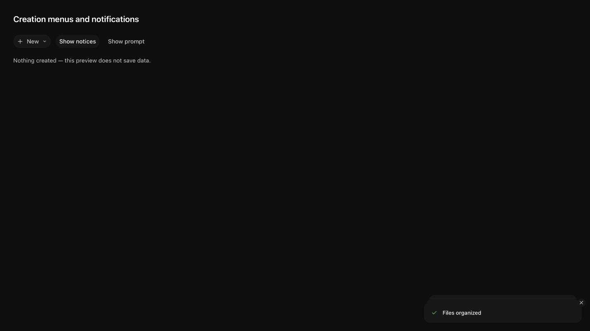

# Toast notifications

Desktop notifications appear at the bottom right. Up to three ordinary notices
are mounted at once; additional notices queue until a slot opens. Older notices
peek behind the front card. Hover the stack or focus one of its controls to
expand it and pause dismissal. Moving away resumes the remaining time.

Ordinary notices dismiss after 4.5 seconds unless the caller specifies a duration.
Persistent prompts and reminders keep their separate, single-card queues and
remain until answered or dismissed. A new success notice does not replace a
persistent reconnect prompt. Mobile keeps one transient notice at a time above
the dock and preserves full descriptions and accessible close buttons. On phones,
open sheets and the pickers and menus on them cover prompts and reminders, which
sit above the transient notice; the notice itself stays on top of sheets.
While the desktop stack shows anything, its height above the window's bottom
edge is `--desktop-toast-inset-bottom` (0 otherwise). A view's bottom-right
control takes `ref={followDesktopToastInset}`
(`@core/component/Toast/desktop-toast-inset`) and adds the property to its
offset to stay above the stack, as the calendar view's setup pill does. The
stack writes it only on those elements, never on `<html>`: its height changes
in every frame of a toast's animation, and a property on the root restyles
every element of the page each time.

Backend-free regression that a toast animating over a heavy page restyles only
the toasts and the controls that follow them (it counts style passes in a
trace, not milliseconds): `bunx playwright test --config
src/components/view-shell/browser-test/playwright.config.ts
toast-frame-cost.browser.e2e.ts` from `apps/web`.

All toasts place actions to the right of the message, centered vertically. The
close button floats halfway over the top-right corner; stacked cards leave room
for it when expanded. Close, Escape while focused,
and swipe dismiss a notice. Closing a persistent prompt can record a real
user dismissal; do not dismiss a real reconnect prompt merely to clear a test
screenshot. Motion follows the system's reduced-motion preference.

Use `/app/debug/ui?ui=toast` to preview success, an expandable stack, and a
persistent prompt. Demo actions do not change account state. Demo notices are
removed when their preview unmounts.

Backend-free desktop/phone coverage: `bunx playwright test --config src/components/view-shell/browser-test/playwright.config.ts` from `apps/web`. The fixture uses only local callbacks and demo notices.

