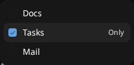
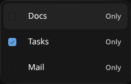

# UI conventions

## Home list loading

Home shows compact row skeletons during initial loading, with taller notification
placeholders on touch devices. Date grouping includes a placeholder heading.
Pagination appends three placeholders without replacing existing items; refresh
keeps loaded items visible. Wait for real rows before navigating or selecting.

## Top bars

On touch devices, check top bars with a nonzero safe area as well as at phone
and tablet widths. Collection headers clear the pane's full top content inset:
safe area only in composable CRM/Tasks/Drive, plus the floating split header in
Reviews. Native project detail navigation also clears the safe area, with its
content directly below it. Content nested below an in-flow header must not add
the same inset again. See the [mobile layout rule](../../.agents/rules/web/mobile.md#layout-and-chrome).

Use one desktop header row: title or breadcrumbs, then view tabs, on the left;
semantic control islands on the right. Collection headers use `ListHeader`:
filters, view options, New, then expandable Search. Related detail actions share
a `HeaderActionGroup`; keep sharing, item navigation, and detail/view toggles in
separate groups. View tabs (channel, CRM record, and project sections, Signal and
Noise) are `Tabs`: separate 32px pills, never inside a group. Groups use the
canonical elevated surface, fully rounded ends, 32px controls, and 8px gaps.
A group owns its frame; its child buttons stay flat and do not get extra borders
or shadows. Nested shared actions reuse the containing group rather than adding
another frame, and a group with no visible actions renders nothing. Keep
tooltips on icon-only controls and collapse labels as a pane narrows (`Tabs
iconOnly`, then a menu). Preserve specialized editor toolbars and touch
layouts. Recent, Folders, and Agents lists use the same islands (filters,
view options, New, expandable Search) with active filter chips below; Search
keeps its full-width field with facet chips under it. Inputs, search fields,
and filter chips are pills on the control frame. The [design system rule](../../.agents/rules/web/design-system.md)
lists which control to use for each role.

On touch devices, low-emphasis header actions remain borderless with their
existing hover and pressed states. Emphasized variants retain their treatment,
including an active call's green ink. Button size does not change variant colors
or framing. Use `glass={false}` for an explicitly flat frame. Inline
calendar-invitation text actions remove the transparent border to keep alignment.

## Canonical desktop surfaces

Use `not-touch:elevated` for desktop control surfaces. Buttons, button groups,
inputs, and unselected tab pills share the same `shadow-elevated` treatment as
composers, menus, settings cards, and dialogs: a fine outer outline, faint inner
edge, brighter top edge, and compact shadow. Keep semantic fills and component
geometry; a button group owns the frame so its child buttons remain flat.
In dark mode, compact controls use thinner, lower-opacity edges than composers
and floating panels. Keep desktop shadows close and faint, with only a slight top
highlight, and define the border with subtle edge contrast.
Inside composers, dialogs, and menus, controls use `control-raised`: a lighter
fill in dark mode and a faint neutral tint in light mode. Keep the container's
base fill and border treatment; nested controls separate by fill rather than
stronger outlines or shadows.
In light mode a fine outline vanishes against near-white content, so controls
draw a full 1px frame edge, menus keep the glass cast shadow, and
`ComposerSurface` (composers and settings cards) keeps the wide `composer-shadow`
halo. Touch surfaces retain their existing shadows.

Tabs are separate pills, like Linear's view tabs: unselected pills use the
outline Button frame, and the selected pill takes the pressed fill, flat, the
same state as a pressed (`aria-pressed`) Button. There is no track and no
separate active tint, except the agent composer's Chat/Code switch
(`variant="track"`). Touch keeps each surface's existing tab treatment.

Reuse `Button`, `Input`, `InputGroup`, `Tabs`, `ComposerSurface`, `menu-surface`, and
`elevated-surface` instead of introducing one-off surface styling. Every menu,
popover, floating toolbar, and editor panel (including the Figma, PowerPoint,
and Photoshop editors) floats on `menu-surface`; dialogs open through `Dialog`.
Loading states use the shared shimmer, and each view's skeleton shows the same
one-row header as the loaded view, with its tabs and controls as placeholders.
Settings
cards inherit `ComposerSurface` through `SettingsSurface`. Use the shared surface; do not
add diagonal reflections, dark inset shading, or custom shadows.
Touch retains its existing glass treatment.
The agent composer's tray sits below that surface with its own fill, and holds
the Chat/Code switch; the open tray gives the input its multiline layout.

## Scrolling content

Desktop Email, Drive, and Tasks lists, email threads, and the Channels thread feed
and navigation lists use a linear 32px top fade as content scrolls
beneath the header. The fade grows with the scroll
offset and clears at the top; it does not blur content or change mobile fades.

On touch, glass rims stay highlighted around most of the perimeter, with short soft gaps
at the top-right and bottom-left corners. Light themes keep a soft highlight
through those corners so they are only slightly dimmer. The iOS app also uses shared
[glass press feedback](navigation.md#mobile-glass-feedback).

## Multiselect dropdowns

Use `Dropdown.MultiSelectItem` for filter options, not independent settings.
Clicking the left checkbox toggles only that option and keeps the menu open.
Clicking the rest of the row adds the option and closes the whole dropdown;
clicking an already-selected row leaves it selected. Shift-click or **Only**
replaces that group's selection with the option and keeps the menu open, even
when it is already the sole selection. Other filter groups stay unchanged.
Only also clears persisted selections missing from the current options. Dynamic
`ListFilterDropdown` callers supply `selectedIds` so hidden values remain known;
ordinary checkbox and row actions preserve those values.

Arrow keys navigate. Space toggles a focused menu row; Enter adds and closes;
Shift+Enter selects only that option without closing. Searchable filters retain
input focus and use Enter/Shift+Enter on the highlighted search result.
**Only** sits at the right on hover or keyboard highlight and remains visible on
touch devices. Touch rows and checkbox hit areas use the shared touch sizing.
Existing mobile filter drawers retain their toggle-and-stay-open behavior.
Inbox selectors retain their explicit **Only**/**All** reset action.

| Pointer dropdown | Touch dropdown |
| --- | --- |
|  |  |

## Mobile filters

Adjacent checked options in a filter section share one continuous selection
surface, rounded only at the top and bottom of each run. Unchecking a middle
option splits the surface into separate rounded groups; isolated selections and
single-select rows keep their rounded shape.

## Dialog actions

Cancel uses a ghost button. Confirm, save, and create actions use strong: the
outline surface and border with semibold text, without inverted colors. Disabled
and pending primary actions retain the strong variant. Mobile confirmation drawers
use the same action hierarchy.

## List-item sharing

Right-click a shareable list row and choose **Share**. The sharing dialog must
remain open after the context menu closes, with recipient selection and the
optional message available. Dismiss it with Cancel, then reopen Share on the
same row and confirm focus enters the recipient selector again. Opening or
cancelling the dialog does not change access; do not submit shares on real dev
data unless authorized.

## User cards

Avatar and user-mention cards open on hover on pointer devices and as a bottom
sheet on touch devices. With a keyboard on a touch device, Tab to the trigger and
press Enter or Space; verify focus enters the sheet and returns to the opener
after dismissal or copying, including after reopening. DM, Open contact, and
Assign task should leave focus in their destination when the sheet closes.
On pointer devices, avatars should stay out of the Tab order while still opening
their cards on hover. Copy email/name confirms only after the clipboard
write succeeds: the hover card shows a checkmark, while the sheet closes. A failed
write shows failure feedback and leaves the card open for retry.

## Floating block information panels

Actions live in the top bar immediately before Share, with consistent compact
buttons (labels collapse on narrow headers). There are no Actions sections in
information panels. Markdown/tasks include Ask Macro and document/task dispatch; email
includes Ask Macro and Create task; PDF and calls include Ask Macro. Native
projects put Delete in the `Project actions` menu after the project title.

Standard metadata is quiet, non-collapsible text at the bottom of each panel,
separated by a muted divider. Owner and available timestamps share one format;
Markdown adds word/character counts. There is no standard Details or Stats
disclosure. Agent runtime information remains in its dedicated Session section.

Block information panels float over the right side of the block without changing
the content width or its centered position. A single rounded bubble fits its
contents, with `edge-muted` dividers between sections. Its height is capped at
the block height with internal scrolling. At every width it starts closed and
acts as a split-local overlay menu on desktop. The top-right sidebar icon, rotated
180 degrees, opens it, and clicking outside dismisses it. On touch devices the
control uses the Phosphor info-circle icon and opens the standard bottom drawer
with a drag handle, scrollable sections, and safe-area/keyboard-aware spacing.
Dismiss the drawer by swiping down or tapping its backdrop. Opening is never
restored from saved preferences or triggered by the global chrome shortcut. The 320px bubble enters
with a slight slide from the right and a 120ms fade;
closing fades it out in 70ms.
This applies across Markdown/tasks,
snippets, email, calls, agents, pull requests, projects, and all file blocks
including PDFs, images, code, video, canvas, unknown file types, and CRM company
and contact views (both inside the CRM workspace and in standalone blocks).
