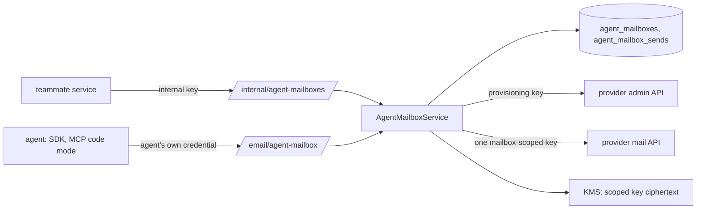

# Agent mailboxes

**Status:** v1, built behind configuration. A deployment without a provider key
answers `not_configured`; nothing reaches a provider.

Each agent teammate (an agent account, `"User"."isAgent"`) gets an email inbox
and address of its own. The agent reads, sends and replies through routes and
SDK methods that act only on its own mailbox. In v1 the mailbox is hosted by
deadsimple.email, a mailbox-as-a-service provider, through its REST API. The
provider sits behind provider-neutral ports, so an IMAP/SMTP-attached mailbox or
a Macro-hosted one (`macro-hosted-email.md`) can replace it later.

## Shape

| Piece | Where |
| --- | --- |
| Domain service, ports, models | `crates/agent_mailbox/src/domain` |
| Provider adapter, Postgres, KMS | `crates/agent_mailbox/src/outbound` |
| Routes and wire bodies | `crates/agent_mailbox/src/inbound`, `src/wire.rs` |
| Host | `services/email_service` (`composition/agent_mailboxes.rs`) |
| Lifecycle client | `crates/email_service_client/src/agent_mailboxes.rs` |
| Fake provider | `crates/agent_mailbox_fake_vendor`, run by `xtask_local` on keyless stacks |

## Decisions

- **Provider REST, not its MCP server.** The provider's MCP server takes an inbox
  id as a tool argument and also exposes forwarding, calendar invitations and
  sign-in helpers that would bypass Macro's send policy. Macro's own routes take
  no mailbox id: the authenticated caller selects its mailbox.
- **Least privilege.** One provisioning key, server-only, creates and deletes
  mailboxes and mints keys. Each mailbox gets its own key scoped to that one
  inbox with read and send permissions only. Every read and send uses only that
  key, stored as KMS ciphertext bound to the mailbox and the agent account.
- **Confinement twice.** A message id from the caller reaches the provider only
  with the caller's scoped key, which cannot see another inbox; the service also
  checks the `inbox_id` the provider reports and answers `not_found` on a mismatch.
- **Send policy.** The agent mailbox's send and reply routes count as sends for
  a session scoped to sending nothing. Every send and reply must quote the owner's approval (`confirmation`),
  whatever credential the agent calls with: every mailbox belongs to an agent
  account, so this is the rule every other email send from a program follows. Each mailbox is capped at 10 sends an hour, 40 a day and 100 recipients a
  day; a team's agent mailboxes together at 300 recipients a day; a team has at
  most 25 live mailboxes. Caps count sends in flight; the provider's own hourly
  cap is set to the same 10 as a backstop. An agent's team is read from
  `team_user`; an agent on no team gets no mailbox.
- **Send keys.** A send's idempotency key is bound to what it says (a SHA-256
  of kind, target, recipients, subject and body); the same key with a different
  message is refused. The caller passes one key per message on every attempt
  (the SDK requires it); a code-mode program derives it with
  `macro.agentMailbox.sendKey(purpose)` from stable ids (the task, turn or
  message it answers), since each run is a new program. Provider idempotency keys are derived per
  mailbox and per operation, never passed through. A provider `409` on a send
  is an idempotent request still in flight: retried under the same key, never
  reported as a rejection.
- **Send records.** One row per send (`agent_mailbox_sends`) does the dedupe,
  the caps and the audit: mailbox, team, key, kind, recipient count, outcome
  and reservation time, kept 400 days. No recipients, subjects, bodies or
  approval text; the approval is the agent's quote, so its time is not
  recorded as an event. A send reserved after a pause or release committed is
  refused under the mailbox row lock.
- **Names.** A role name (`admin`, `postmaster`, `abuse`, `support`, the CA
  domain-validation addresses and the like) is never taken as is: the mailbox
  gets the suffixed form. A display name that names Macro or an administrator
  is left off, compatibility forms (fullwidth letters) included. A display
  name may use only letters, digits, spaces and `. - ' ( ) &` (no comma: it
  needs a quoted phrase, and the provider's quoting is unverified), so the From phrase can never show an address or a
  lookalike of one, an RFC 2047 encoded word, or a format character.
- **Provider content is data.** Headers, the provider's prompt-injection score and
  any provider event never grant access or trigger an action.
- **No payment.** The provider offers per-call payment when a key is missing; the
  adapter treats `402` as not configured and never sends payment headers.

## Lifecycle

| State | Meaning |
| --- | --- |
| `provisioning` | Being created; a retry of the same request or the sweep finishes it. |
| `active` | The agent can read and send. |
| `failed` | Creating it stopped (`not_configured`, `address_taken`, `quota_exceeded`, `rejected`); the same request retries. |
| `paused` | Kept with its mail; the agent can neither read nor send. |
| `releasing` | Being deleted at the provider; the sweep finishes it. |
| `released` | Deleted. The agent may get a new mailbox. |

- Provisioning is idempotent per `requestId`: the row is reserved first, the
  provider create carries an idempotency key and an owner tag, and a lost create
  is found again by its tag. A create conflict is a taken address only when
  its code is exactly `address_taken`; any other conflict (an idempotent
  create still in flight) is retried under the same key. The provider
  documents no `409` codes for creating an inbox, so the list is confirmed
  with the live check. A taken address is first checked
  against the tag, and a taken address is first checked
  against the tag, so one request never makes two provider mailboxes. A taken
  address retries once with a short suffix. A new request replaces a failed
  mailbox that recorded no provider mailbox and that the provider has nothing
  under the owner tag for, so a mailbox whose addresses were all taken gets a
  new suffix and nothing the provider made is left behind.
- Provider-side steps run under a per-mailbox lease whose token fences every
  write they record, so overlapping provisioning attempts, a release and the
  sweep never interleave at the provider. A release that starts while a create
  is in flight waits for it, then deletes what it made.
- Release revokes the stored key, then every other key the provider lists as
  scoped to exactly that mailbox (any minted but never stored), each once,
  then deletes the provider mailbox and its mail. A released row stays as the
  record of the address it had and answers a retry of its request; it holds
  no credential and no mail.
- The sweep runs every minute: stalled provisioning, unfinished releases, and
  mailboxes paused for more than 30 days (rechecked in the write that starts
  the release, so a resume in between wins). A step that fails is set aside
  for five minutes so failing mailboxes never crowd out the rest. Each step
  is its own span (`agent_mailbox.advance`, `agent_mailbox.tear_down`,
  `agent_mailbox.expire_paused`) with the mailbox id and outcome, and each
  provider call a child span. Pruning send records runs in one replica per
  minute (a claim on the database clock), so replicas never delete the same
  rows at once. Shutdown stops a round mid-way: every step is fenced and
  resumable. A step stays inside its 3-minute lease (provider calls time out
  at 20 seconds, KMS calls at 10).
- Hourly, one replica pauses any live mailbox whose agent account was deleted,
  is no longer an agent, or left the mailbox's team, or whose team was
  deleted; the write rechecks it. Pausing keeps the mail: the usual 30-day
  paused retention releases it.
- A lost create is matched by its exact owner tag on Macro's side, never by
  trusting the provider's filter; two inboxes with one owner tag are refused.
- A send whose outcome is unknown is retried under the same provider
  idempotency key only within an hour (inside the provider's 24-hour replay
  window and the hourly cap); after that it answers
  `send_outcome_unknown` instead of risking a second delivery.

## Configuration

| Variable | Where | Meaning |
| --- | --- | --- |
| `DEADSIMPLE_API_KEY` | Doppler `email-service` (optional) | Provisioning key; absent means `not_configured`. |
| `AGENT_MAILBOX_KMS_KEY_ID` | Doppler `email-service` (required with the key) | KMS key for scoped keys: the stack output `agentMailboxKmsAlias`, set by hand. |
| `OVERRIDE_DEAD_SIMPLE_API_URL` | process env | Points the adapter at the fake provider locally. |

A deployment whose provider URL is not the provider's real API reports
`vendorMode: "fake"` and the notice "fake vendor, not live" on every mailbox.

## Follow-ups

- Waking the agent on new mail (no provider webhook is consumed in v1).
- A Macro inbox view of an agent's mailbox and human access to it.
- Attaching the mailbox through IMAP/SMTP once that provider lands, and
  bring-your-own-domain hosting.
- Attachments, native AI tools for direct-tool hosts, and autonomous sends
  without a quoted approval (a policy decision).
- Production use needs the provider's written permission to provision mailboxes
  for customers, a Macro-owned sending domain, and the KMS key and secrets.
