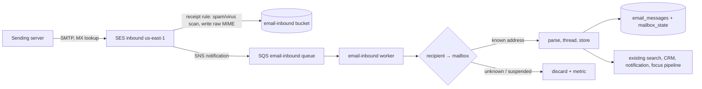

# Macro-hosted email: architecture and implementation plan

**Status:** Proposal, November 7, 2026. Nothing here is built. Decisions marked
**Decision** are the recommended calls; the open questions at the end need an
owner before phase 1 starts.

Today Macro is an email *client*: Gmail and Outlook own the mailbox and Macro
syncs from them. This document designs Macro *hosting* the mailbox itself, so a
team can receive and send mail at addresses on its own domain with no Google or
Microsoft account behind it. It also lists what is still Gmail- or
Outlook-shaped in the provider layer and has to become generic before a third
provider fits.

## Goal and scope

| In scope | Out of scope (v1) |
| --- | --- |
| Mailboxes on a team's own domain (bring your own domain), received and sent by Macro. | IMAP, POP or JMAP access from other mail clients. Mail is read in Macro apps only. |
| Inbound spam, virus and authentication verdicts. | Running our own outbound IPs or an MTA. |
| Sending with per-domain DKIM, SPF and DMARC alignment, bounce and complaint handling. | Free `@macro.com`-style consumer addresses (abuse magnet; see [Abuse](#abuse-and-trust)). |
| Import of existing mail from Gmail/Outlook when a team moves its MX to Macro. | Selling domains (feasible later through a registrar API; see [Domains](#domains-and-dns)). |
| Everything users already get on Gmail: threads, read/star/archive/trash/labels, drafts, scheduled and undo send, search, attachments, Signal/Noise. | Calendar and contacts hosting (CalDAV/CardDAV). |

## Decision: build on Amazon SES, Macro is the mailbox of record

| Option | What it is | Why not (or why) |
| --- | --- | --- |
| **SES receiving + SES sending** (chosen) | MX points at SES inbound; a receipt rule writes raw MIME to S3 and notifies us; we send through SES v2. | Macro already sends through SES in `us-east-1` (a receiving region) and already handles SES bounces (`services/email_suppression_handler`). SES owns IP reputation and warm-up; [tenants](https://docs.aws.amazon.com/ses/latest/dg/tenants.html) isolate each customer's reputation. We own storage, spam policy and abuse. |
| Self-host [Stalwart](https://stalw.art/) | One Rust binary: SMTP, IMAP, JMAP. Multi-tenancy needs the Enterprise licence (about €2/mailbox/year). | Gives IMAP for free, but we would run stateful mail servers and still relay outbound through SES. Revisit only if IMAP access becomes a requirement; Stalwart can then sit beside the SES ingest and read from the same store. |
| Mailbox-as-a-service APIs (AgentMail, Shipmail, MailSlurp) | REST API for inboxes on custom domains. | Small vendors aimed at AI agents; per-inbox pricing; their store duplicates ours. |
| Google Workspace reseller | Real Gmail seats. | 100-seat minimum and a partner agreement; Google still owns the mailbox. |
| Own MTA and IPs | Postfix/Stalwart sending directly. | New IPs have no reputation; one compromised account blocklists every user. Months of warm-up and a permanent ops load. |

Precedent: Amazon WorkMail ran millions of mailboxes on SES for transport and
spam scanning. AWS [ends WorkMail on March 31, 2027](https://docs.aws.amazon.com/workmail/latest/adminguide/workmail-end-of-support.html),
so its customers need a new home in the same window this work targets.

**Consequence:** Macro becomes the system of record. Raw messages and
attachments are stored permanently in S3, and backups, retention, export and
deletion become our job instead of Google's.

## Where a hosted mailbox fits the current code

The email stack currently runs two provider architectures side by side:

- **Gmail** uses the older path: numeric history cursors (`SyncCursor::Gmail`,
  `crates/email_api_client/src/domain/models/changes.rs`), labels as the source
  of mailbox state, and `ScheduledDeliveryAdapter` for sending
  (`services/email_service/src/outbound/scheduled_delivery.rs`).
- **Outlook** uses the provider-neutral path that #7461 introduced:
  `MailboxGateway`, `MailboxCommandGateway` and `DraftGateway`
  (`crates/email/src/domain/mailbox.rs`, `mailbox/commands.rs`,
  `mailbox/drafts/ports.rs`), normalized `MailboxState`
  (`crates/email_api_client/src/domain/models/provider.rs`) stored in
  `email_messages.mailbox_state`, `email_mailbox_folders` with a `FolderRole`,
  and the durable command and send ledgers.

**Decision: the Macro provider is built on the Outlook-shaped path.** It writes
`mailbox_state` directly, uses `email_mailbox_folders` for its folders, and
implements the same domain gateways. Most of the remote-provider machinery
(delta streams, reconciliation, pending overlays, provider subscriptions,
draft transfers) collapses to nothing, because there is no remote copy to
reconcile:

| Domain port | Macro implementation |
| --- | --- |
| `MailboxGateway` (content, folder changes) | Reads our own S3 object store; there is no change feed to poll. |
| `MailboxCommandGateway` (read, star, archive, trash, junk, label) | Confirms immediately: the command's local write *is* the mailbox. No `email_pending_mailbox_state` overlay. |
| `DraftGateway::submit_draft` | Builds MIME with the existing builder (`crates/email/src/domain/mailbox/drafts/content.rs`), sends through SES `SendEmail` (raw), stores the sent copy. Records the attempt in `email_send_attempts`. |
| `MailboxIngest` | Called by the inbound pipeline below with a fully parsed message instead of a provider fetch. |
| Watches, subscriptions, token sources | Not implemented; the gateway reports that it needs none. |

### Making the provider layer generic

These are the Gmail/Outlook assumptions a third provider trips over. Each is a
prerequisite PR in phase 0, behaviour-neutral for existing providers:

1. **Provider discriminator.** Add `Macro` to `UserProvider`
   (`crates/email/src/domain/models/link.rs`), its legacy copies in
   `models_email`, `DbUserProvider` (two crates plus a private copy in
   `services/email_refresh_handler`), the Postgres `email_user_provider_enum`,
   `GraphqlEmailProvider`, and the generated SDK types. Replace the web app's
   hand-written `'GMAIL' | 'OUTLOOK'` unions (`features/email-compose/core/*`,
   `context/compose-capabilities.ts`, `settings/connections/integration-items.tsx`)
   with the generated enum, matched exhaustively, and delete the string parsers
   that match `"OUTLOOK"` (`services/email_service/src/api/middleware/link.rs`,
   `crates/email/src/outbound/mailbox_pg/lifecycle.rs`) in favour of the typed
   enum.
2. **One dispatch point.** Provider selection is an ad hoc `match link.provider`
   in about 30 outbound adapters. Replace those with one
   `MailboxProviderRegistry` in the `email_service` composition root that maps a
   resolved mailbox context to its gateways, so adding a provider adds one arm
   instead of thirty.
3. **Capabilities.** Provider differences (attachment size limits, signature
   import, read-only features) are hard-coded branches. Introduce a
   `MailboxCapabilities` value returned by the gateway and exposed on the GraphQL
   mailbox object, and have the compose and settings UI read it instead of
   checking the provider name.
4. **Sending.** `ScheduledDeliveryAdapter::try_claim` returns early for non-Gmail
   links; Outlook sends through the draft coordinator instead. Route Gmail's
   scheduled and immediate sends through `DraftGateway::submit_draft` too, so
   scheduled send and undo send stay in `email_scheduled_messages` and only the
   final submit is per provider.
5. **Sync stream kinds.** `email_sync_streams.kind` is a CHECK list; add
   `macro_import` for the one-off migration import (phase 3). The Macro mailbox
   itself needs no stream.

## Inbound



- **One catch-all receipt rule** with no recipient list matches every verified
  identity in the account. It enables SES spam and virus scanning, writes the
  raw message to a dedicated `email-inbound` bucket, and publishes to SNS → SQS.
  No per-domain receipt rules.
- **Recipient routing** uses the SMTP envelope recipients from the SES
  notification, never the `To` header (Bcc and mailing lists put the real
  recipient only in the envelope). One delivered message with three Macro
  recipients becomes three mailbox copies sharing one S3 object.
- **Verdicts.** SES returns spam, virus, SPF, DKIM and DMARC verdicts with each
  notification. Virus → discard. DMARC `FAIL` with `p=reject` → discard.
  Spam `FAIL` or DMARC quarantine → deliver with `in_junk`. Store the verdicts on
  the message so the UI can show why something was junked and so a later
  rspamd pass can be added without reprocessing.
- **Parsing** uses `mailparse`, already in tree (`crates/email_api_client`), and
  feeds the same normalized message the Gmail and Outlook converters produce.
  Attachments are written to the existing `email-attachments-bucket` layout so
  `attachment_access.rs` serves them unchanged.
- **Idempotency.** SES may deliver a notification twice. Key ingestion on
  `(mailbox_id, ses_message_id)`; RFC `Message-ID` is not unique (the same message
  legitimately arrives via To and a list) and is stored only as threading metadata.
- **Size.** SES inbound accepts messages up to 40 MB. Larger messages bounce at
  SMTP time, which is the standard behaviour senders expect.
- **Bounces addressed to users** (DSNs for mail they sent) are ordinary inbound
  messages and land in the inbox, as in Gmail.

### Threading

Gmail and Outlook hand us `provider_thread_id`; nothing groups threads from
headers today. The Macro provider computes it:

1. If `In-Reply-To` or any `References` id matches a message already in the same
   mailbox, join that message's thread.
2. Otherwise, start a new thread. Do not merge on subject alone: Gmail's subject
   fallback groups unrelated "Invoice" mails, and users notice wrong merges more
   than missed ones.

This lives in a pure function in `crates/email/src/domain` with golden tests
over the `.eml` corpus, and writes `provider_thread_id` as a Macro-minted id so
the existing thread queries work unchanged. Sent messages join their thread
through the same headers, which the draft builder already sets.

### Mailbox state

Every message is written with a full `MailboxState`; there is no label
fallback. Folders are rows in `email_mailbox_folders` with `provider_folder_id`
null and the standard roles (inbox, sent, drafts, archive, trash, junk) created
when the mailbox is provisioned. User labels map to the existing label tables.
Gmail's categories and Outlook's Focused inbox set `attention` for those
providers; a hosted mailbox has no such signal, and `unknown` counts as Signal,
so without a classifier every newsletter would land in Signal. **Decision:** the
ingest sets `attention` from headers, deterministically: `List-Unsubscribe`,
`List-Id`, `Precedence: bulk|list` or `Auto-Submitted` other than `no` → `other`;
anything else → `primary`. A user moving a thread between Signal and Noise records a per-sender
override that later mail follows. Signal/Noise then works through
`email_message_mailbox_facts` unchanged, and the existing
`services/email_focus_worker` keeps classifying Focus on top of it.

## Outbound

- **Path.** `DraftGateway::submit_draft` → build MIME → SES v2 `SendEmail` with
  `Content.Raw`, the tenant name and the user-mail configuration set → store the
  sent copy with `is_sent` and the SES message id. Bcc recipients go in the
  envelope only and stay on our stored copy.
- **Separation from Macro's own mail.** User mail uses its own configuration set
  and SES tenants; Macro's invites and notifications keep `macro.com` and
  `notification.macro.com`. A spam incident on user mail must never pause
  transactional mail.
- **Events.** The user-mail configuration set publishes delivery, bounce,
  complaint and reject events to SNS. A handler updates the send attempt and the
  message's delivery status, and adds hard-bounced and complaining addresses to a
  per-tenant suppression list. Extend `services/email_suppression_handler` rather
  than adding a second bounce path.
- **Limits.** 40 MB per message after base64, so about 28 MB of raw
  attachments. Compose enforces it through `attachmentLimitBytes`
  (`apps/web/src/features/email-compose/core/constants.ts`), which becomes a
  capability value instead of a provider check (see item 3 above).
- **Rate limits per mailbox and per tenant**, enforced before SES, protect the
  account's bounce and complaint thresholds (SES reviews an account above 5%
  bounces or 0.1% complaints).

## Domains and DNS

A team adds a domain in Macro settings; Macro shows the records to paste, or
configures them in one click through [Domain Connect](https://www.domainconnect.org/)
/ [Entri](https://www.entri.com/) for supported DNS hosts.

| Record | Value | Purpose |
| --- | --- | --- |
| `MX` | `10 inbound-smtp.us-east-1.amazonaws.com` | Deliver mail for the domain to SES. |
| 3 × `CNAME` | SES Easy DKIM tokens | Sign outbound mail for the domain. |
| `MX` + `TXT` on `mail.<domain>` | SES custom MAIL FROM | SPF alignment for bounces. |
| `TXT` on `<domain>` | `v=spf1 include:amazonses.com ~all` | Authorize SES to send. |
| `TXT` on `_dmarc.<domain>` | `v=DMARC1; p=none; rua=…` to start | Required by Gmail and Yahoo for bulk senders; tightened after a clean report period. |

Backend flow, behind an `EmailDomainProvider` port with an SES adapter and an
in-memory fake for tests:

```text
add domain    → CreateTenant (one per Macro team, idempotent)
              → CreateEmailIdentity(domain) + CreateTenantResourceAssociation
              → PutEmailIdentityMailFromAttributes(mail.<domain>)
              → persist email_hosted_domains row: status pending_dns
verify worker → GetEmailIdentity until DKIM SUCCESS (SES re-checks for 72 h)
              → resolve MX; status active_send (DKIM ok) / active (DKIM + MX ok)
remove domain → suspend mailboxes, DeleteEmailIdentity, keep mail for export
```

- **Ownership proof.** A domain is never usable for sending or receiving until
  SES verifies its DKIM records, so no team can claim another's domain.
  Routing ignores mail for domains that are not active.
- **Partial adoption.** `active_send` lets a team verify for sending while its MX
  still points at the old host, so it can import mail and switch MX when ready.
- **Drift.** The verify worker keeps rechecking active domains daily; DKIM or MX
  records removed later move the domain to `degraded` and notify team admins.
- **Mailboxes** are rows keyed by `(domain_id, local_part)` and linked to a Macro
  user, so they appear as an `email_links` row with provider `MACRO` alongside any
  Gmail or Outlook links the user has. Aliases and group addresses route to one
  or more mailboxes.
- **Selling domains** later goes through a registrar reseller API (OpenSRS,
  Name.com), registered in the customer's name, never through Route 53 Domains
  (which registers to our AWS account). It is the shortest onboarding (records
  created automatically) but adds renewal and billing risk; it is not v1.

## Migration from Gmail or Outlook

A team moving its MX to Macro keeps its history:

1. Verify the domain for sending (`active_send`).
2. Each user's existing Gmail or Outlook link, already synced, is copied into
   their Macro mailbox by an import job (`email_sync_streams` kind
   `macro_import`), fetching raw MIME through the existing
   `MailboxRawMessageClient` / `MailboxContentReader::mime` ports so the Macro
   store holds real originals.
3. The admin switches MX. Mail arriving at the old provider during DNS
   propagation keeps syncing through the old link until the import's final pass
   finishes, then the old link is disconnected.

## Abuse and trust

Hosted mailboxes are paid, team-scoped and tied to a verified domain, which keeps
out most bulk abuse. On top of that:

- New tenants start with low daily send limits that rise with clean history.
- SES tenant [reputation policies](https://aws.amazon.com/about-aws/whats-new/2025/08/amazon-ses-tenant-isolation-automated-reputation-policies)
  pause only the offending tenant automatically; Macro mirrors that pause into
  the UI and alerts on it.
- Outbound content is not scanned for v1; complaint rate and bounce rate per
  tenant are the signals, with Datadog monitors next to the existing
  `infra/stacks/monitoring/monitors/ses.ts`.
- An `abuse@` and `postmaster@` route per hosted domain goes to the tenant's
  admins; Macro's own `abuse@macro.com` handles reports about the platform.

## Storage, retention and compliance

- Raw MIME in `email-inbound` (S3, versioned, SSE-KMS), attachments in the
  existing attachments bucket. Lifecycle to Infrequent Access after 90 days.
- Deleting a mailbox or domain follows the existing mailbox purge path
  (`email-sfs-delete-handler`), extended to delete S3 originals.
- Export: per-mailbox MBOX export from the S3 originals, which B2B customers
  will ask for and which doubles as the backup restore format.
- Legal hold and retention policies are a team setting on top of the same store;
  not v1, but the store must not prevent them (no destructive dedup of originals).

## Observability

Per the [observability rule](../../.agents/rules/observability.md), each new hop
carries trace context:

- `email.inbound` span from SQS receive through routing, parse, thread and
  ingest, with `ses_message_id`, `mailbox_id`, `domain_id`, verdicts and
  attachment count; the SES notification can't carry `traceparent`, so the span
  records the SES message id for correlation.
- `email.send` on the Macro gateway with tenant, configuration set and SES
  message id; delivery events link back to it by SES message id.
- `email.domain_verify` per domain check with the resulting status.
- A synthetic canary: a scheduled job sends Gmail → Macro and Macro → Gmail
  every few minutes; a monitor alerts on round-trip time. It is the only way to
  notice that inbound has stopped.

## Testing along the way

| Layer | How |
| --- | --- |
| Domain logic | Unit tests against fakes for `EmailDomainProvider`, the object store and the sender: domain state transitions, recipient routing, verdict policy, threading. |
| Parsing | Golden tests over an `.eml` corpus (Gmail, Outlook, Apple Mail, lists, forwards, DSN bounces, non-UTF-8, malformed MIME, 30 MB attachments) asserting the normalized message and thread. |
| Ingest and storage | DB tests (`#[sqlx::test]`) for ingest idempotency and `mailbox_state` writes; the existing facts-view tests cover Signal/Noise for `MACRO` messages. |
| Local stack | Drop a raw message into the local S3 bucket and an SQS notification; assert rows. Outbound points at a local SMTP sink (Mailpit) so nothing leaves the machine. |
| Real SES | The [mailbox simulator](https://docs.aws.amazon.com/ses/latest/dg/send-an-email-from-console.html#send-email-simulator) (its success, bounce and complaint addresses) exercises real bounce and complaint events without touching reputation. |
| Dev end to end | A dev subdomain (`mail.dev.macro.com`) with MX to the dev account, plus one throwaway domain to test bring-your-own-domain; mail exchanged with real Gmail and Outlook accounts; check "Show original" for SPF, DKIM and DMARC `PASS` and a mail-tester score. The dev SES account needs production access first (sandbox accounts only send to verified addresses). |

## Cost

SES list prices ([pricing](https://aws.amazon.com/ses/pricing/)): outbound
$0.10 per 1,000 messages plus $0.12/GB of attachments; inbound $0.15 per 1,000
messages plus $0.09 per 1,000 incoming 256 KB chunks; tenants $0.005 per tenant
per month plus $0.005 per 1,000 messages. Classic receipt rules have no endpoint
fee (Mail Manager would add $50/month per ingress endpoint and isn't needed).

For a user receiving 1,000 and sending 50 messages a month at about 100 KB each,
that is roughly $0.25–0.30 a month, almost all inbound, plus about $0.002 of S3
per month of mail retained. Engineering and operations time dominate the cost.

## Implementation sequence

Each phase is its own stack of PRs; each lands behind an `enable-hosted-email`
flag (new connections and settings UI), off by default.

0. **Generic provider layer** (the five items in
   [Making the provider layer generic](#making-the-provider-layer-generic)).
   No behaviour change for Gmail or Outlook; the same contract tests run for both.
1. **Domains.** `EmailDomainProvider` port + SES adapter, `email_hosted_domains`
   and hosted mailbox tables, verify worker, settings UI for adding a domain and
   mailboxes, Pulumi for the tenant-scoped IAM, configuration set and SNS topics.
2. **Inbound.** Receipt rule, bucket, SNS → SQS, `email-inbound` worker, parser,
   threading, verdict policy, `MailboxIngest` for the Macro provider.
3. **Outbound.** Macro `DraftGateway` and `MailboxCommandGateway`, SES events
   into the suppression handler, per-tenant limits and suppression.
4. **Migration import** from existing Gmail/Outlook links, MBOX export.
5. **Rollout.** Dev end to end, canary and monitors, internal dogfood on a Macro
   test domain, then flagged customers.

## Open questions

| Question | Recommendation |
| --- | --- |
| Does anyone need IMAP access from other clients (phones' native mail apps, Apple Mail)? | Not for v1; Macro has web, desktop and mobile apps. If it becomes a requirement, add Stalwart reading the same store rather than replacing SES. |
| Pricing to customers: per mailbox, or included in a plan tier? | Product call; cost is under $1 per mailbox per month even for heavy users. |
| Should Macro offer addresses on a Macro-owned domain for teams without one? | No for v1: it invites free-account abuse that every user's deliverability pays for. Domain purchase through a reseller is the better onboarding shortcut. |
| Spam filtering beyond SES verdicts (rspamd)? | Start with SES verdicts and user "Report spam" feedback; measure false negatives on dogfood before adding a scorer. |
