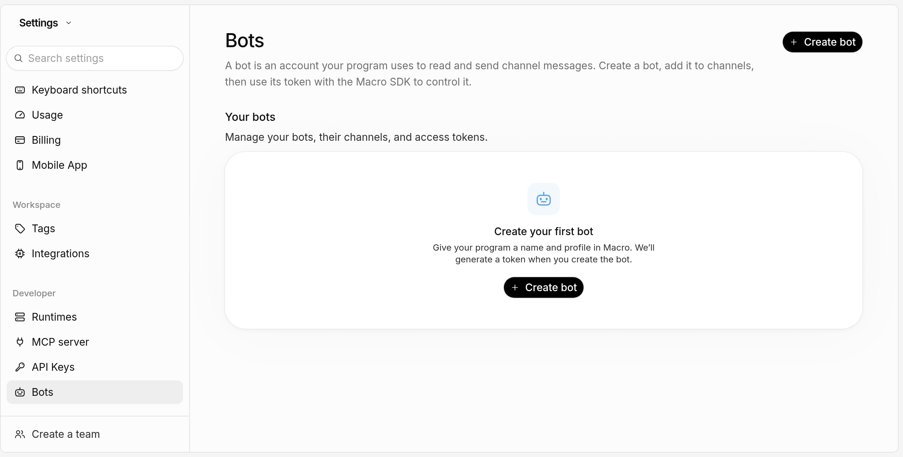
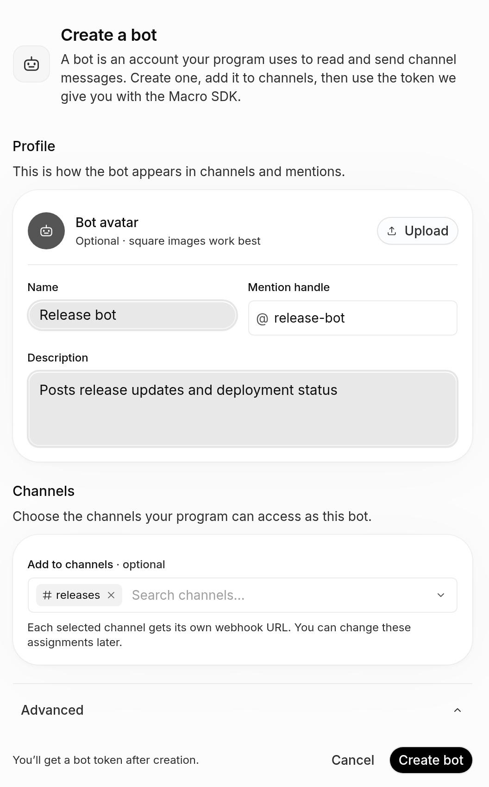
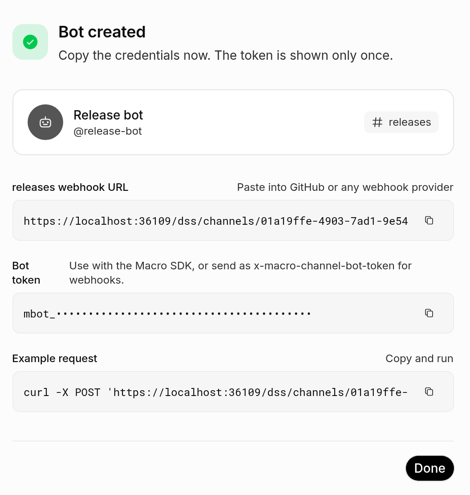
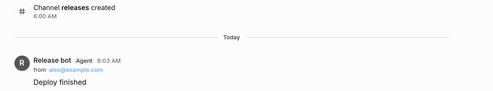

# Building a bot

A bot is a Macro account for a program, such as a release job or a webhook
relay. It posts to channels under its own name. This guide creates one in the
app, then uses it from TypeScript with
[`@macro-inc/sdk`](https://sdk.macro.com).

## 1. Create the bot

Open **Settings → Developer → Bots** and click **Create bot**.



Give the bot a name, and under **Channels** pick the channels it may post to.
Only private and team channels are listed. You can change them later from the
same page.



## 2. Copy the token

Click **Create bot**, then copy the **Bot token**. It starts with `mbot_` and
is shown only once, so put it in a secret store, not in code.



## 3. Send a message

A bot you create is personal, so it posts as itself on your behalf:
`requestedAs` names you, the owner, and the bot uses your access.

```ts
import { Macro } from '@macro-inc/sdk';

const bot = new Macro({
  auth: { type: 'bot', token: process.env.MACRO_BOT_TOKEN! },
});
const macro = bot.requestedAs(bot.users.byId('macro|you@example.com'));

await macro.channels.byId('<channel-id>').send('Deploy finished');
```

The channel id is the last part of the channel's URL. The message is posted by
the bot and shows who it was sent for:



## 4. Search

Bots can't search: search rejects bot tokens. Search with an API key from
**Settings → Developer → API Keys** instead. It acts as you.

```ts
import { Macro } from '@macro-inc/sdk';

const macro = new Macro({ token: process.env.MACRO_API_KEY! });

for await (const doc of macro.documents.search('roadmap', { pageSize: 5 })) {
  console.log(doc.id, await doc.name());
}
```

## Manage bots from code

An API key can do everything the settings page does: create and configure bots,
grant channels, read webhook URLs and mint or revoke tokens.

```ts
const macro = new Macro({ token: process.env.MACRO_API_KEY! });

const bot = await macro.bots.create({ name: 'Release bot', handle: 'release-bot' });
await bot.grantChannel(macro.channels.byId('<channel-id>'));
const { secret } = await bot.createToken({ label: 'ci' });
const [webhook] = await bot.webhooks();
```

`secret` is shown only once. POST `{ "content": "..." }` to `webhook.url` with
the token in `x-macro-bot-token` and `x-macro-bot-scope: user`.

Writes to the same conversation share a per-process limit of four active
writes. If a request waits for capacity for two seconds, the webhook and
message API return HTTP `503`, header `Retry-After: 1`, and this JSON body:

```json
{ "message": "conversation is busy; retry the request" }
```

That attempt did not commit a message change. The server, web sender, and SDK do
not automatically retry this response or act on `Retry-After`. The web sender
shows a failure and restores the draft; the SDK throws `MacroApiError` with
status `503` and the response body, without preserving the header on that error.
Retry manually, or implement a retry policy in the calling program that waits
at least one second for this response.

Retrying this admission rejection creates one message: the rejected attempt
never acquired a write connection. The webhook generates a new message ID on
each accepted request, so a retry after an unknown outcome (for example, a
lost response after commit) can still create a duplicate, as before.

## What a bot can do

- **Personal bot** (the default): owned by you. It acts only as you, through
  `requestedAs`, and can read and post wherever you can.
- **Team bot**: turn on **Advanced → Mentionable** when creating it. Only team
  admins and owners can. Teammates can @mention it, and it can act as any
  team member.
- Messages are always credited to the bot, never to the user it acts for.
- No bot can search, whoever owns it.

## More

- [SDK documentation](https://sdk.macro.com): authentication, threads,
  mentions, edits and every other entity.
- [Bots settings walkthrough](../agent-guide/settings.md#bots) for driving the
  page in a browser.
- Example bots:
  [`anthropic-status-bot`](../../services/bots/anthropic-status-bot/README.md)
  (posts through the channel webhook without acting as anyone) and
  [`goalert-bot`](../../services/bots/goalert-bot/README.md) (threads, edits,
  acting as a user).
- Server code: [`crates/bots`](../../crates/bots/AGENTS.md). Who a bot may act
  as is decided in `crates/macro_authorization/src/domain/bot_authorizer.rs`.
