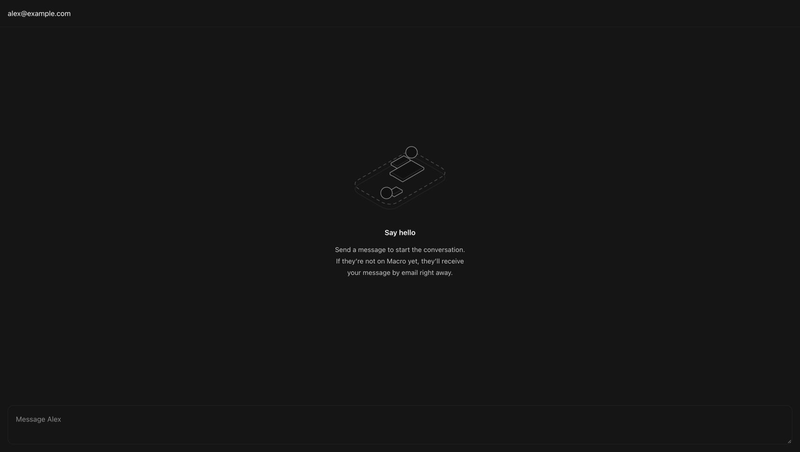
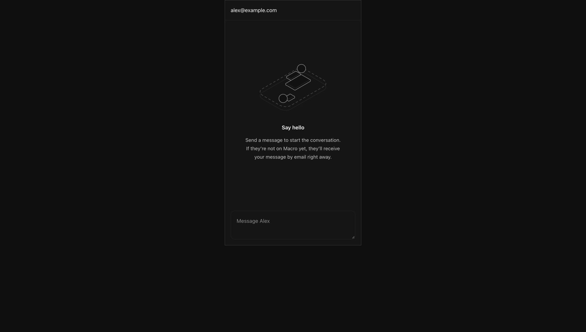

# Direct-message empty state

Browser captures of `DirectMessageEmptyState` rendered with the app's real
styles and shared illustration in an isolated component preview. The header and
composer are preview scaffolding. Wide and 390px-wide panes were inspected;
these captures do not demonstrate live message or email delivery.

